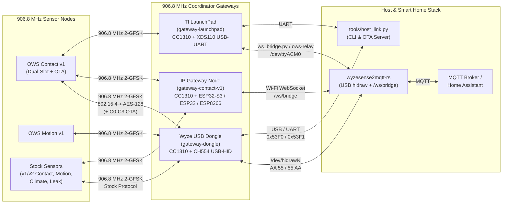
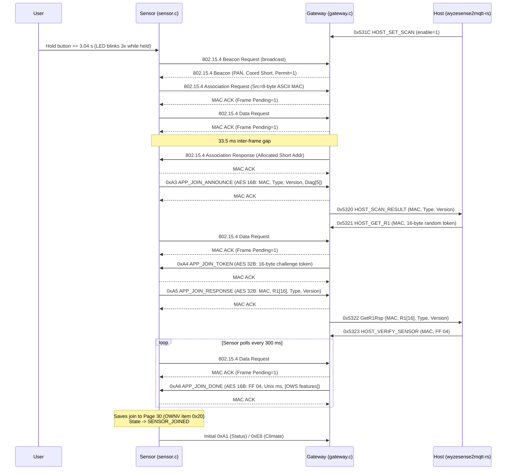
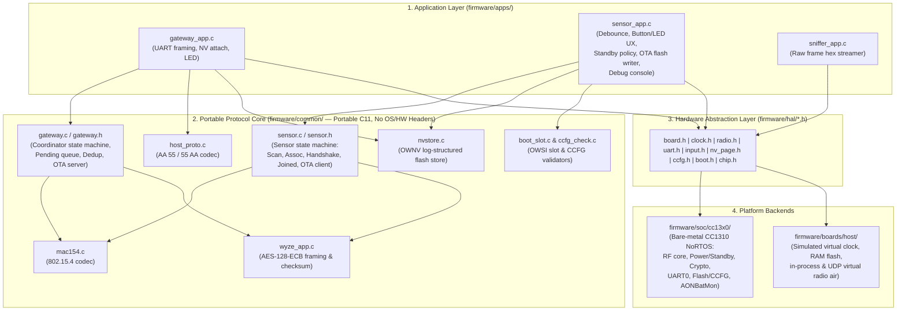
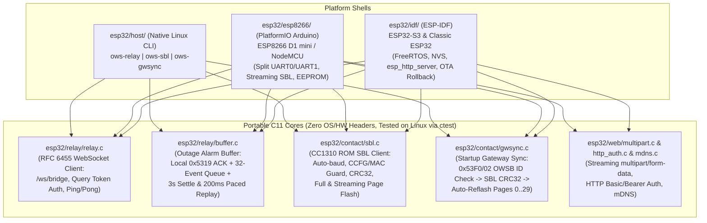

# OpenWyzeSense — System Architecture & Design Document

**Status:** Authoritative Design Specification  
**Scope:** Sensor Firmware, Gateway Firmware, RF & Host Protocols, Flash/NV/OTA Architecture, ESP32 IP Relay, and Tooling  
**Related Documents:**
- [`docs/TODO.md`](../TODO.md) — The one task list: what is open, including the bench checklist
- [`docs/FACTS.md`](../FACTS.md) — Protocol reference tables and hardware facts with primary evidence
- [`docs/known-issues.md`](../known-issues.md) — Root-cause analysis of stock firmware bugs
- [`docs/stock-re/`](../stock-re/README.md) — Reconstructed C source code of stock sensor (`contact_v1`, `motion_v1`) and gateway (`gateway_v1.8`) firmware with flash/SRAM addresses
- In this folder: [`requirements.md`](requirements.md) (requirements and the user's decisions), [`nv-format.md`](nv-format.md) (flash page 30), [`ota.md`](ota.md) (sensor updates), [`roaming.md`](roaming.md) (several gateways, one network), [`low-battery.md`](low-battery.md) (battery reports), [`v1-contact.md`](v1-contact.md) (the v1 contact board on the bench)
- [`docs/guide/`](../guide/README.md) — End-user guide by level, from release files only
- [`docs/development.md`](../development.md) — Development environment: toolchain, builds, tests, HIL matrix, bench hardware, repository tools

---

## 1. Executive Summary & Project Vision

### 1.1 Problem Statement
Wyze discontinued the Wyze Sense v1 and v2 product lines, leaving existing hardware unsupported and vulnerable to critical stock firmware bugs:
1. **The Stock v1 "Zero-MAC" Brick Bug ([`docs/known-issues.md` §1](../known-issues.md), [`docs/FACTS.md` §5](../FACTS.md))**: Stock v1 sensors store their runtime identity—the 16-byte XXTEA key and 8-byte ASCII MAC—in TI `NVOCTP` item `(sys=6, item=8, sub=0)` on **Flash Page 30 (`0x1E000–0x1EFFF`)**; the duplicate 8-byte ASCII MAC in CCFG (`0x1FFCC`, Page 31) is written once on the factory line and **never read back** during normal boot (`Ssf_readMacAndKey()` reads only NV item `8`). Worse, `Sensor_init()` unconditionally increments and writes NV item `(6, 6, 0)` (boot counter) and `(6, 4, 0)` (`seq + 25`) to Page 30 *before* `Ssf_checkBootBattery()` checks the unloaded coin-cell voltage (`bat_v32 <= 0x53`, i.e., `2.59 V`). As a CR2032 ages, ~250 brownout boot loops fill the 4 KB Page 30 log until `NVOCTP_compactPage()` erases `0x1E000` (`FlashSectorErase`) and browns out mid-erase—permanently wiping NV item `8` (and network item `1`) so the sensor forgets its pairing and transmits an all-zero MAC (`00:00:00:00:00:00:00:00`) forever, even with a fresh battery.
2. **Stock USB Dongle Limitations ([`docs/known-issues.md` §2–§4](../known-issues.md))**:
   - **Single-point USB placement**: The stock dongle must plug directly into a host USB port (originally the back of a Wyze Cam), limiting RF coverage across larger homes.
   - **NV Sensor Table Defects**: Deleting sensors via `0x5325` (`DeleteSensor`) scans only the first `num_devices` contiguous NV `subID`s (`0 .. count-1`), orphaning higher slots when earlier slots are deleted (`known-issues.md` §2).
   - **Fixed 8-Second Downlink Window & Broken >32 B AES**: Stock gateways expire buffered indirect downlink frames (`ApiMac_sec_t` / MAC indirect queue) after ~`8 s` and contain a broken `> 32 B` branch in `AES_decryptBuffer` (`known-issues.md` §3).
   - **No Over-The-Air (OTA) Firmware Updates**: Stock sensors disable the CC1310 ROM bootloader in CCFG (`BL_CONFIG = 0x00FE0AC5` / `0x00FE02C5`, `BOOTLOADER_ENABLE = 0x00`) and have no OTA mechanism.

### 1.2 What We Are Building
**OpenWyzeSense (OWS)** is an open-source, clean-room replacement ecosystem for Wyze Sense hardware built around six pillars:

1. **Open-Source Sensor Firmware (`sensor-*`)**:
   - Runs on TI CC1310F128-based Wyze sensors (`wyze_contact_v1`, `wyze_motion_v1`, and future `v2` / `climate` / `leak` boards) as well as `LAUNCHXL-CC1310`.
   - Recovers "dead" Zero-MAC v1 sensors by reading their intact 8-byte ASCII MAC directly from CCFG (`0x1FFCC`) on every boot, eliminating runtime NV flash writes during normal operation, and adding fail-safe dual-slot Over-The-Air (OTA) firmware updates.
2. **Open-Source Gateway Firmware (`gateway-*`)**:
   - Runs on the stock Wyze Sense USB Dongle (`gateway-dongle`), repurposed v1 contact sensor PCBs (`gateway-contact-v1`), and TI LaunchPads (`gateway-launchpad`).
   - Speaks the stock `AA 55` / `55 AA` UART host protocol so [`wyzesense2mqtt-rs`](https://github.com/HclX/wyzesense2mqtt-rs) works out of the box, while adding backward-compatible OWS host extensions for deduplication, CCFG restoration, build identification, direct software SBL entry, and streaming sensor OTA updates.
3. **Network / IP Gateway Relay (`esp32/`, `tools/ws_bridge.py`)**:
   - Pairs an **ESP32-S3**, **classic ESP32 (LOLIN32)**, **ESP8266 (Wemos D1 mini / NodeMCU)**, or Linux host with a `gateway-contact-v1` board over UART (`RX`/`TX`) to bridge the gateway protocol over Wi-Fi WebSockets (`/ws/bridge`) to `wyzesense2mqtt-rs`, with local RAM buffering and replay of up to 32 sensor alarms across network outages.
   - Embeds the canonical `gateway-contact-v1` firmware image and automatically updates the CC1310 over its ROM Serial Bootloader whenever the `OWSB` build image ID changes.
4. **Reference Model, Host Simulation & Provisioning Tooling (`reference/`, `firmware/boards/host/`, `tools/`)**:
   - Python SDR/IQ decoder and protocol reference (`wyzesense_ref`), deterministic C multi-node radio simulator (`ows-host-{gateway,sensor,sniffer}`), and safe backup/flash/NV-migration tools (`ows-flash`, `uniflash.py`, `uart_sbl.py`, `ows-sbl`, `ows-gwsync`, `nv_json.py`, `host_link.py`).
5. **Custom & Repurposed CC1310 Sensor Hardware**:
   - Enables building future new sensor types—either by reusing/repurposing `wyze_contact_v1` boards (via their exposed `DIO7`, `DIO11`, `DIO10` `W`, and `DIO0`/`DIO1` `TX`/`RX` pads) or by designing completely new CC1310-based hardware—that join and report through the same gateway protocol.
6. **Companion Host Service (`wyzesense2mqtt-rs`, Separate Repository)**:
   - Maintained in [`HclX/wyzesense2mqtt-rs`](https://github.com/HclX/wyzesense2mqtt-rs), this Rust daemon is the host-side counterpart that bridges both local USB HID dongles (`/dev/hidrawN`) and remote Wi-Fi IP relays (`/ws/bridge` WebSocket endpoint) to MQTT and Home Assistant.
   - While OWS firmware remains 100% compatible with stock hosts and unmodified `wyzesense2mqtt-rs`, pairing OWS with `wyzesense2mqtt-rs` is how OWS's extra capabilities are fully utilized in production—unlocking multi-room Wi-Fi IP gateway relays with outage alarm replay, runtime gateway feature flag configuration (on-gateway deduplication, `A6` OWS capability announcement), build-info introspection, sensor OTA firmware delivery, and future coordinated multi-gateway roaming.

### 1.3 Core Design Requirements & Invariants

| ID | Principle | Design Rule |
|---|---|---|
| **R1** | **Bidirectional Stock Compatibility** | OWS gateways must pair and communicate with unmodified stock sensors (**v1 contact, v1 motion, v2 contact, v2 motion, climate, leak**, and potentially other Wyze sensors such as chime, keypad, etc.), and OWS sensors must pair and communicate with unmodified stock USB dongles. |
| **R2** | **Zero-MAC & Brownout Immunity** | Sensor MAC is read directly from read-only CCFG (`0x1FFCC`). Message counters live in RAM only (`#38`). Normal sensor events perform **zero flash writes**. Power loss at any byte of an NV write must never prevent booting (`#38`, `#61`). |
| **R3** | **Opt-In Protocol Extensions** | Any behaviour that changes on-air frames or host packets seen by a stock peer is locked behind runtime feature flags and defaults to **OFF**. Internal bug fixes invisible to peers are always **ON**. |
| **R4** | **Hardware & CCFG Safety** | Normal firmware and flashing tools never overwrite Flash Page 31 (CCFG, where the factory MAC and keys live) without the user's explicit instruction. Every stock device must have a verified dual-read backup before flashing. |
| **R5** | **Portable, RTOS-Free Core** | All MAC, crypto, NV, sensor, gateway, and relay protocol logic is written in portable C11 (`CMAKE_C_STANDARD 11` in `firmware/common/`, `esp32/relay/`) with **zero** hardware or OS dependencies, driven purely by timestamps (`now_ms`) and I/O callbacks. |

---

## 2. System Architecture & Product Matrix

### 2.1 End-to-End Topology



### 2.2 Firmware Product Matrix (`firmware/products.cmake`)

Every firmware target is a composition of an **Application** (`firmware/apps/<app>/`) and a **Board** (`firmware/boards/<board>/`):

| Product Target | App | Board | MCU Package | Flash Layout | Power Profile | Primary Interface | Status |
|---|---|---|---|---|---|---|---|
| `gateway-dongle` | `gateway` | `wyze_dongle` | CC1310F128 5×5 RHB (32-pin) | Single image (Pages 0–29) + `OWNV` (Page 30) | Mains / USB (`always on`) | UART0 (`DIO0` TX / `DIO1` RX) + LEDs (`DIO10`, `DIO13`) ↔ CH554 USB-HID | Production |
| `gateway-contact-v1` | `gateway` | `wyze_contact_v1` | CC1310F128 5×5 RHB (32-pin) | Single image (Pages 0–29) + `OWNV` (Page 30) | Mains 3.3 V (`always on`) | UART0 (`DIO0` TX / `DIO1` RX), `W` (`DIO10`), LED (`DIO9`) ↔ ESP32-S3 / ESP32 / ESP8266 | Production |
| `gateway-launchpad` | `gateway` | `launchxl_cc1310` | CC1310F128 7×7 RGZ (48-pin) | Single image (Pages 0–29) + `OWNV` (Page 30) | Mains / USB (`always on`) | UART0 (`DIO3` TX / `DIO2` RX) ↔ XDS110 `/dev/ttyACM0` | Production |
| `sensor-contact-v1` | `sensor` | `wyze_contact_v1` | CC1310F128 5×5 RHB (32-pin) | Boot Selector (Page 0) + Dual Slots A/B (Pages 1–28) + `OWNV` (Page 30) | CR2032 Standby (`BOARD_LOW_POWER=1`) | Reed (`DIO7`), Button (`DIO11`), LED (`DIO9`), `W` (`DIO10`), UART (`DIO0`/`DIO1`) | Production |
| `sensor-motion-v1` | `sensor` | `wyze_motion_v1` | CC1310F128 5×5 RHB (32-pin) | Boot Selector (Page 0) + Dual Slots A/B (Pages 1–28) + `OWNV` (Page 30) | CR2032 Standby (`BOARD_LOW_POWER=1`) | PIR (`DIO9`/`DIO10`), Button (`DIO13`), LED (`DIO12`), `W` (`DIO2`), UART (`DIO0`/`DIO1`) | Production |
| `sensor-launchpad` | `sensor` | `launchxl_cc1310` | CC1310F128 7×7 RGZ (48-pin) | Boot Selector (Page 0) + Dual Slots A/B (Pages 1–28) + `OWNV` (Page 30) | USB (`always on`) | Buttons (`DIO13`/`DIO14`), LEDs (`DIO6`/`DIO7`), Console (`DIO3`/`DIO2`) | Production / Test |
| `sniffer-launchpad` | `sniffer` | `launchxl_cc1310` | CC1310F128 7×7 RGZ (48-pin) | Single image (Pages 0–29) | USB (`always on`, RX only) | Streams raw hex frames (`RX <rssi> <ts> <hex>`) over UART | Production / Tool |
| `ows-host-{gateway,sensor,sniffer}` | all 3 | `host` (Linux PC) | Native x86_64 / ARM64 process | File-backed simulated flash (`--nv`, `--slot-a`, `--slot-b`) | Host process | PTY / stdio console + localhost UDP virtual radio air | CI & Simulation |
| `ows-relay` (ESP-IDF / PlatformIO) | `esp32` | `esp32s3` / `esp32` / `d1_mini` | ESP32-S3, ESP32 (LOLIN32), ESP8266 (D1 mini / NodeMCU) | Dual OTA slots (`esp32/idf/` `partitions.csv` or ESP8266 4 MB flash) + Embedded `gateway-contact-v1-app.bin` | Mains / USB (`always on`) | UART + `W`/`S` Open-Drain GPIOs ↔ `gateway-contact-v1`; Wi-Fi `/ws/bridge` + Web UI (`:80`) | Production |

### 2.3 CMake Build Presets (`CMakePresets.json`)

The C/C++ build system is organized around **three** clean CMake presets—one for CC1310 hardware, one for native host simulation and testing, and one for host code coverage—complemented by `tools/idf.sh` (ESP-IDF for ESP32-S3 / ESP32) and `tools/pio.sh` (PlatformIO for ESP8266):

| Preset / Tool | Target | Purpose |
|---|---|---|
| `fw` | CC1310 (`arm-none-eabi`) | Builds all CC1310 firmware products (`build/fw/firmware/<product>.{elf,hex,bin,img}`). |
| `host` | Native Linux (`gcc`/`clang`) | Builds all C unit tests (`ctest --preset host`), simulated host apps (`ows-host-{gateway,sensor,sniffer}`), and portable host relay/SBL binaries (`ows-relay`, `ows-sbl`, `ows-gwsync`). |
| `coverage` (`tools/coverage.sh`) | Native Linux (`clang` + `llvm-cov`) | Builds instrumented host tests (`-fprofile-instr-generate -fcoverage-mapping`) and generates HTML/summary coverage reports (`build/coverage/`). |
| `tools/idf.sh` | ESP32-S3 / ESP32 (`xtensa-esp-elf`) | Builds `esp32/idf/` (`build/ows_relay.bin`) with embedded `gateway-contact-v1-app.bin`. |
| `tools/pio.sh` | ESP8266 (`xtensa-lx106-elf`) | Builds `esp32/esp8266/` (`env:d1_mini`) with embedded `gateway-contact-v1-app.bin`. |

> [!NOTE]
> **Removal of Legacy Presets (`fw-no-tx`, `fw-mirror`, `fw-test`, `fw-test2`, `fw-bench`) in `TASK-09`**:
> Earlier iterations maintained five extra cross-compile presets to toggle `OWS_ENABLE_TX`, hardcode compile-time PAN IDs (`0x845B`, `0x65FE`, `0x65FD`), or disable standby (`OWS_LOW_POWER=0`). Those legacy presets and `OWS_ENABLE_TX` were removed in `TASK-09`: network PAN IDs now live in runtime/NV configuration (`OWS_SUB_NETWORK`, `#76`, `#77`), passive HIL house-mirror tests use `-DOWS_PASSIVE=ON` (`TASK-24`), and battery boards keep their UART console awake dynamically whenever serial input arrives during the initial `10 s` boot window (`5-minute` sliding timeout + `sleep` command).

---

## 3. Hardware Platform & Lessons from Stock Firmware Reverse Engineering

### 3.1 Board Pinout & Signal Map
Reverse-engineering of the stock firmware dumps (`contact_v1`, `motion_v1`, `gateway_v1.8` in [`docs/stock-re/`](../stock-re/README.md) and [`docs/FACTS.md` §5](../FACTS.md))—including `BoardGpioInitTable` in `.rodata` and the LZSS-compressed `.data` initializer tables unpacked by `__TI_decompress_lzss` at startup—established the complete hardware pin mapping across all devices:

| Function | `wyze_contact_v1` (5×5 RHB) | `wyze_motion_v1` (5×5 RHB) | `wyze_dongle` (5×5 RHB) | `launchxl_cc1310` (7×7 RGZ) | Notes |
|---|---|---|---|---|---|
| **UART0 TX** | `DIO0` (`T` pad) | `DIO0` (Factory UART TX) | `DIO0` (to CH554 RX) | `DIO3` (XDS110 `RXD`) | 115200 8N1. Stock `UARTCC26XX_hwAttrs` at `0x155d8` / `0x1595c` / `0x17328`. |
| **UART0 RX** | `DIO1` (`R` pad) | `DIO1` (Factory UART RX) | `DIO1` (from CH554 TX + SBL backdoor) | `DIO2` (XDS110 `TXD`) | Pull-up enabled so floating RX pads do not inject break/noise bytes. |
| **Sensor Input (Reed / PIR)** | `DIO7` (Reed switch to GND) | `DIO9` (PIR primary) / `DIO10` (PIR alt) | — | `DIO13` (BTN-1) | Configured in stock `.data` `sensorPinTable` (`0x20002258` in `contact_v1`). |
| **Pairing Button** | `DIO11` (active-low, ext pull-up) | `DIO13` (active-low) | — | `DIO14` (BTN-2) | Short press (`< 1 s`): check-in + OTA window; Long press (`>= 3.04 s`): pair (stock UX). |
| **Primary LED** | `DIO9` (active-high, Red) | `DIO12` (active-high, Red) | `DIO10` (active-high) | `DIO6` (Red LED) | Blinks only on events on battery boards (`BOARD_LOW_POWER=1`). |
| **Secondary LED** | — | — | `DIO13` (active-high) | `DIO7` (Green LED) | Dongle configures both `DIO10` and `DIO13` as LED outputs (`0x174c0`). |
| **Factory `W` Pad / Bootloader Backdoor** | `DIO10` (`W` pad, ext pull-up); `DIO1` (`UART_RX` SBL backdoor) | `DIO2` (`W` pad, pull-up); `DIO1` (`UART_RX` SBL backdoor) | `DIO1` (CH554 controls SBL entry, `BL_CONFIG = 0xC5FE01C5`) | `DIO13` (BTN-1, `0xC5FE0DC5`) | Stock `contact_v1` disables ROM SBL (`BL_CONFIG = 0x00FE0100`); OWS `wyze_contact_v1` enables SBL on `R` (`DIO1`, `0xC5FE01C5`), matching stock `motion_v1` and `wyze_dongle`. |
| **JTAG / Reset** | `M` = `TMSC`, `C` = `TCKC`, `S` = `RESET_N` | `M` = `TMSC`, `C` = `TCKC`, `S` = `RESET_N` | Internal pads + CH554 reset line (`DIO1` + `RESET_N`) | On-board XDS110 (4-pin / 2-pin cJTAG + `RST`) | Wyze boards expose 2-pin cJTAG (`TMSC`/`TCKC`) only; requires TI UniFlash (`DSLite`) with `xds110_2pin.ccxml`. |

### 3.2 Discovery of the `W` Test Pad (`DIO10` / `DIO2`) and ROM Bootloader Provisioning
In stock sensor firmware (`contact_v1` `BoardGpioInitTable` at `0x1532C`, `motion_v1` at `0x156B0`), the `W` test pad (`DIO10` on `contact_v1`, `DIO2` on `motion_v1`) is initialized as an input with pull-up (`0xC000200A` / `0x80002002`). At boot:
- If `W` (`DIO10` / `DIO2`) is held low (`0`) at startup, stock firmware sets `factoryTestActive = 1` (`0x20000A74`), opens `UART0` (`DIO0`/`DIO1` at 115200 8N1), shortens unjoined polling to `400 ms`, and activates the `AA 55` Factory Test UART handler (`0x43`/`0x53` commands `0x04–0x0B`, `0x17`, `0x22`, `0x2A`, `0xD2`, `0xFF`). On the assembly line, command `0x08` writes the 8-byte ASCII MAC into CCFG `0x1FFCC` (`FlashProgram` on Page 31), and command `0x0A` writes the 25-byte `{xxtea_key[16], mac[8], valid=1}` record into NVOCTP item `(6, 8, 0)` on Page 30 (`0x1E000`).
- Notably, stock `contact_v1` CCFG disables the ROM bootloader (`BL_CONFIG = 0x00FE0100`, backdoor pin 1 = `DIO1`, active low, with the two `0xC5` enable bytes cleared), whereas stock `motion_v1` CCFG (`motion_v1_777A9A46/dump.bin`) already enables the ROM bootloader with `DIO1` (`UART_RX`, active-low) as the backdoor pin (`0xC5FE01C5`).
- In **OpenWyzeSense**, we preserve the factory MAC in CCFG (`0x1FFCC`), keep `wyze_motion_v1`'s stock `0xC5FE01C5` CCFG untouched, and set `BOOTLOADER_ENABLE = 0xC5` on `R` (`DIO1`) in `wyze_contact_v1` (`0x1FFD8` -> `0xC5FE01C5`). This allows:
  1. **Hands-free bench flashing** via any 3.3 V USB-UART adapter (`tools/uart_sbl.py`, `ows-sbl`) by holding `R` to `GND` across a reset (`S`).
  2. **In-field CC1310 firmware updates by an attached ESP32/ESP8266** (`gateway-contact-v1` + relay) by holding `R` low across `S` (or a power cycle), without needing a wire to `W`.

### 3.3 Stock Firmware vs. OpenWyzeSense Architectural Comparison

| Aspect | Stock Firmware (`docs/stock-re/`) | OpenWyzeSense (`firmware/`) |
|---|---|---|
| **OS & Stack** | TI-RTOS kernel in ROM + TI 15.4-Stack (`ApiMac`, `Cllc`, `Ssf`, `NVOCTP`), ~90 KB flash | Bare-metal NoRTOS event loop (`clock_wait(app_step())`), portable C11 state machines, ~32 KB flash |
| **MAC Address Source** | Read **only** from Page 30 `NVOCTP` item `(6, 8, 0)` (`Ssf_readMacAndKey`); CCFG `0x1FFCC` is write-only in factory test (`0x08`) and **never** consulted at normal boot! | Read directly from read-only CCFG `0x1FFCC` (`board_mac()`), validated as 8 uppercase hex chars, never modified |
| **NV Flash Storage** | 1-page TI `NVOCTP` on **Page 30 (`0x1E000–0x1EFFF`)** on both sensors and USB dongle (`FACTS.md` §5) | 1-page append-only `OWNV` store on **Page 30 (`0x1E000–0x1EFFF`)** with per-record IEEE CRC-32 |
| **Flash Writes on Boot & Events** | Writes NV item `(6, 6, 0)` (boot count `+1`) and `(6, 4, 0)` (`seq + 25`) on **every boot before checking battery**, plus every 25 events and offline `0xAD` logs (item `3`); triggers Page 30 erase/compaction | **Zero flash writes** on boot or normal operation; message counter is RAM-only (`#38`); NV is written **only** when pairing (or saving an optional `0x21` DIY profile) |
| **AES-128 Implementation** | Hardware `CryptoCC26XX` AES-128-ECB wrapper (`0x0C5F0` / `0x0924C`) with missing `else` on `len <= 16` (3 ops + 16 B OOB read) and broken `> 32 B` decrypt (`known-issues.md` §3) | Direct CC1310 hardware crypto engine (`CRYPTOAesEcb` in `soc/cc13x0/radio.c`) + verified portable C reference (`aes_ref.c`), clean 16-byte loop up to `112 B` |
| **Button Hold UX** | Polled every `10 ms` while held (`Ssf_buttonClockCb`); blinks LED 3× at **`3.04 s`** (`300` ticks after `40 ms` debounce) while still held to start pairing; `< 3 s` checks in if joined | Mimics stock `3.04 s` while-held 3× blink to start pairing (`TASK-12`), **plus** a short press (`< 1 s`) blinks once, sends a `0xA1` check-in, and opens the 5-minute OTA window |
| **Firmware Upgradability** | Sensor: None (`BL_CONFIG` disabled, no OTA). Gateway: USB HID `0x4312` enters CH554/ROM SBL | Sensor: Dual-slot A/B OTA (`0xC0–0xC3`) with CRC-32 + 3-boot probation rollback, plus ROM SBL on `R` pad (`DIO1`). Gateway: SBL + `OWSB` auto-update |

### 3.4 Definitive Root Cause of the Stock v1 "Zero-MAC" Bug
Disassembly of `contact_v1` and `motion_v1` ([`docs/stock-re/stock_sensor.c`](../stock-re/stock_sensor.c), [`docs/known-issues.md` §1](../known-issues.md)) proved how the infamous v1 bricking bug actually works:
1. **CCFG (`0x1FFCC`, Page 31) is write-only in stock firmware and never erased**: During factory provisioning (`W` held low), command `0x08` writes the 8-byte ASCII MAC to CCFG `0x1FFCC` (note: `0x1FFD8` in CCFG is `CCFG_O_BL_CONFIG`, *not* an XXTEA key), while command `0x0A` writes `{xxtea_key[16], mac[8], valid=1}` into **Page 30 (`0x1E000`) `NVOCTP` item `(6, 8, 0)`**. During normal operation, `Ssf_readMacAndKey()` (`0x11C50` / `0x11EC8`) reads the MAC and XXTEA key **exclusively from Page 30 NV item `8`** and has no fallback to CCFG `0x1FFCC`. Every "dead" Zero-MAC unit inspected (`777B42DF`, etc.) still has its original ASCII MAC intact at `0x1FFCC` while its Page 30 (`0x1E000`) is blank or freshly re-initialized without item `8`.
2. **Unconditional NV Flash Writes Before the Boot Battery Check**:
   - In `Sensor_init()`, the firmware calls `Ssf_incrementBootCounter()` (writing NV item `(6, 6, 0)`) and updates NV item `(6, 4, 0)` (`seq + 25`) **before** `Ssf_checkBootBattery()` checks whether `bat_v32 <= 0x53` (`2.59 V`).
   - When a CR2032 nears end-of-life, internal resistance rises: the unloaded coin cell rebounds just enough to start booting, appends ~24 bytes to Page 30 (`0x1E000`), and then browns out as the radio or flash charge pump (~8–20 mA) loads the cell.
   - Across ~250 brownout boot loops, those unconditional boot records pack all 4096 bytes of Page 30 until `NVOCTP_compactPage()` (`0x11258`) is forced to erase Page 30 (`FlashSectorErase(0x1E000)`—the highest-energy flash operation on the chip) before copying live items (`1`, `8`, `9`) back from scratch RAM. Voltage collapse mid-erase leaves Page 30 blank (`0xFF`), permanently destroying NV item `8` (MAC + XXTEA key) and item `1` (PAN + short address). On the next battery change, `NVOCTP` formats an empty Page 30 and the sensor transmits `00:00:00:00:00:00:00:00` forever.
3. **How OpenWyzeSense Permanently Fixes It**:
   - **On OWS Sensors**: `board_mac()` reads CCFG `0x1FFCC` directly into `sensor_config_t.mac` on every boot; boot counters and message counters live in RAM only; normal reed/PIR/heartbeat operation performs **zero** flash writes; and `nvstore.c` formats and boots cleanly even if power is cut at any byte during pairing.
   - **On OWS Gateways (for un-reflashed stock sensors)**: nothing is recovered. As the stock dongle does (`stock-unknowns.md` D8), a report goes to the host only when its short address and MAC both match a sensor in the table, so a zero-MAC report is dropped, and a sensor associating with an all-zero address is never paired (#31). The cure is reflashing the sensor with our firmware.

---

## 4. RF Protocol & Cryptography Design (906.8 MHz)

### 4.1 Physical Layer (PHY) & Framing
All devices communicate on a single sub-GHz channel using **TI SimpleLink Long Range Mode 2 (`SWRA642`)** on the CC1310's proprietary + 802.15.4g radio core (`CMD_PROP_RADIO_DIV_SETUP` + `rf_patch_mce_sl_longrange` + `rf_patch_rfe_sl_longrange`, [`docs/FACTS.md` §1–§2](../FACTS.md), [`firmware/soc/cc13x0/radio.c`](../../firmware/soc/cc13x0/radio.c)):

| Parameter | Value | Evidence / Detail |
|---|---|---|
| **Center Frequency** | **906.800 MHz** | `frequency = 0x038A` (`906`), `fractFreq = 0xCCCC` (`52428 / 65536`), `loDivider = 5` |
| **Modulation & Coding** | **2-GFSK, 20 ksym/s, DSSS = 2 + Rate-1/2 FEC → 5.0 kbps** | `modulationType = 1` ($BT = 0.5$), `deviation = 20` ($\pm 5\text{ kHz}$), `preScale = 15`, `rateWord = 0x3333` (`20 ksym/s`), DSSS $M = 2$ (`10 kchip/s`) + $K = 7$ convolutional FEC (`5.0 kbps` effective data rate), `rxBw = 0x21` (matching stock dongle RAM & `phy_settings.c:33`) |
| **Preamble & Sync Word** | **64-symbol `0xCCC3C3CCC33C3333` × 3** | Configured via `syncWord = 0x5555904E` parameter interpreted by `rf_patch_mce_sl_longrange` / `rf_patch_rfe_sl_longrange` |
| **PHY Header (PHR)** | **2 bytes (`0x08LL` IEEE 802.15.4g)** | 16-bit LE in TX buffer / MSB-first on air; `LL` = total PSDU length (`MAC_header + MAC_payload + 4-byte FCS`, max `127` bytes) |
| **Whitening & Bit Order** | **PN9 (`x^9 + x^5 + 1`, seed `0x1FF`) on PSDU** | Applied to PSDU only (not PHR); PSDU bytes transmitted LSB-first (`rbit` per byte in `radio.c`) |
| **FCS (CRC-32)** | **IEEE 802.3 Reflected CRC-32** | Standard reflected CRC-32 (`0xEDB88320`) over PSDU; 3-byte MAC ACKs (`5 + 4 = 9` bytes PSDU) pad a zero byte before CRC (`crc32(ack[0..2] || 0x00)`) |
| **TX Power** | **+14 dBm (`0xA73F`)** | Requires `CCFG_FORCE_VDDR_HH = 1` (`0xA73F`) |

### 4.2 IEEE 802.15.4 MAC Layer (`firmware/common/mac154.c`)
Inside the PHR and FCS sits a standard IEEE 802.15.4-2006 MAC frame:

```text
+---------+---------+----------+----------+----------+----------+-----------------+
| FCF (2) | Seq (1) | DstPAN(2)| DstAddr  | SrcPAN(2)| SrcAddr  | MAC Payload ... |
+---------+---------+----------+----------+----------+----------+-----------------+
```

- **Addressing Modes**:
  - `0` (`MAC_ADDR_NONE`): No PAN ID or address (used in ACKs and Beacon SrcPAN-less frames).
  - `2` (`MAC_ADDR_SHORT`): 2-byte PAN ID + 2-byte short address (little-endian).
  - `3` (`MAC_ADDR_EXT`): 2-byte PAN ID + 8-byte extended address. During association, a sensor sends its **8-byte ASCII MAC in forward order** (e.g., `"77BD514D"` = `37 37 42 44 35 31 34 44`, [`docs/FACTS.md` §3](../FACTS.md)).
  - Mode `1` (`0b01`) is reserved in IEEE 802.15.4 and must be rejected on parse (`TASK-03`).
- **ACK & Indirect Data Polling (`Frame Pending`)**:
  - Sensors are sleepy end-devices whose receivers are off by default.
  - Every unicast frame (`Data` or `Command`) sets `FCF.ACK_REQ = 1`. The recipient sends a 3-byte MAC `ACK` (`02 00 <seq>` or `12 00 <seq>` with `Frame Pending = 1`, `FCF bit 4`) within ~2 ms.
  - When a sensor sends an `0xA1` status report (or handshake frame) and polls the coordinator with a MAC `DATA_REQ` (`cmd 0x04`), the gateway immediately ACKs with `Frame Pending = 1` if a downlink frame (`0xA4`, `0xA6`, `0xB0`, `0xC0`, `0xC2`) is queued for that sensor, then transmits the downlink data frame **`33.5 ms`** (`GAP_AFTER_ACK_US = 33500`) after the start of the ACK so the sensor has turned its receiver back on.
  - **Sensor-Type Filter for `0xB0` Time Sync**: The gateway queues a `0xB0` (`APP_TIME_SYNC`) downlink after reports for v1 contact (`0x01`), v1 motion (`0x02`), v2 leak (`0x03`), and v2 climate (`0x07`), and **never** for v2 contact (`0x0E`) or v2 motion (`0x0F`), matching stock gateway behavior (`gateway.c:481`, `FACTS.md` §4).

### 4.3 Cryptography & Authentication (`firmware/common/wyze_app.c`)

#### 4.3.1 AES-128-ECB Transport Encryption
All application data frames (`0xA1–0xE8`, `0xC0–0xC3`, except unencrypted `0xA0` Wake) are encrypted in 16-byte blocks using **AES-128-ECB** with a single static 128-bit key—the NIST FIPS-197 Appendix B example key from TI's `CryptoCC26XX.h` (`contact_v1` SRAM `0x20001944`, `motion_v1` `0x20001988`, `gateway_v1.8` `0x200014E0`, [`docs/FACTS.md` §4](../FACTS.md)):

```text
AES-128 Key: 2B 7E 15 16 28 AE D2 A6 AB F7 15 88 09 CF 4F 3C
```

**Plaintext Block Construction (`app_encrypt` / `aes128_ecb_decrypt`)**:
1. Let raw application message have length $L$. The encrypted length $N$ is the smallest positive multiple of 16 such that $N \ge L$ ($N \in \{16, 32, \dots, 112\}$).
2. Bytes `0 .. L-1` hold the raw application message (starting with the command opcode `0xA1`, `0xA2`, `0xA3`, etc.).
3. Bytes `L .. N-1` (if any) are **zero-padded (`0x00`)** to the 16-byte block boundary (`wyze_app.c:9-16`). There is **no** application-layer checksum or MAC inside the AES plaintext; integrity relies on the outer 32-bit IEEE 802.15.4g FCS (and, for OTA images, the 32-bit `OWSI` slot `image_crc32`).
4. Each 16-byte chunk `pt[16k .. 16k+15]` is encrypted independently with `AES-128-ECB(app_key)`.
5. **Stock AES Wrapper Bug (`docs/known-issues.md` §3)**: Stock sensors and gateways wrap `CryptoCC26XX` in a helper (`0x0C5F0` / `0x0924C`) whose `if (len <= 16)` branch lacks an `else`, causing 16-byte frames to execute 3 hardware AES operations and read 16 bytes out-of-bounds (`inBuf + 16`), and whose `if (len > 32)` decrypt branch corrupts block 2 (`inBuf + 16` twice). Consequently, any OWS frame `> 32 B` (`0xC2` OTA blocks) must **only** be sent to confirmed OWS sensors.
6. **Inherent Protocol Security Limitation (R1 Constraint)**: Because the static key `2B 7E...` is public and ECB encrypts 16-byte blocks independently without a MIC (`state` at byte `14` is in block `0`, while `counter_be16` at bytes `15..16` straddles blocks `0` and `1`), a local 906.8 MHz SDR attacker within radio range can replay or splice stock frames. R1 preserves wire compatibility for stock sensors rather than adding an incompatible MAC-layer MIC.

#### 4.3.2 XXTEA-19 Pairing Challenge-Response (`0xA4` → `0xA5`)
During pairing, the gateway sends an encrypted `0xA4` (`APP_JOIN_TOKEN`) containing a 16-byte challenge `token[0..15]`, and the sensor replies with `0xA5` (`APP_JOIN_RESPONSE`) containing `xxtea_r1[0..15]`:
- **On Stock Sensors (`Stock_xxtea19_encrypt` at `0x07F98` / `0x0842C`)**:
  - Reads the 16-byte per-sensor factory key from **Page 30 `NVOCTP` item `(6, 8, 0)` bytes `0..15`** into SRAM (`0x20000ACC` / `0x20000F28`).
  - Interprets `token[0..15]` as four **32-bit big-endian** words `v[0..3]` and the key as four **32-bit big-endian** words `k[0..3]`.
  - Runs **19 rounds** ($q = 6 + 52/4 = 19$, $\Delta = \text{0x9E3779B9}$) of Corrected Block TEA (XXTEA) and places the 16-byte ciphertext in `0xA5` bytes `9..24`.
- **On Gateways & Hosts**:
  - Neither the stock gateway (`gateway_v1.8`) nor `wyzesense2mqtt-rs` contains an `XXTEA_decrypt` check for RF pairing (`gateway_v1.8` only uses XXTEA for host `0x4302` `GET_ENR`). Stock `gateway_v1.8` simply forwards the `0xA5` fields to the host via `0x5322` (in response to `0x5321` `HOST_GET_R1`) and waits for the host to approve pairing via `0x5323` (`HOST_VERIFY_SENSOR`).
  - Therefore, OWS sensors echo the 16-byte `token` in `0xA5` by default (or use a custom callback via `sensor_io_t.join_response`), which works seamlessly with both stock dongles + `wyzesense2mqtt-rs` and OWS gateways.

### 4.4 Application Message Catalog (`firmware/common/wyze_app.h`, `ota.h`)

To keep stock protocol compatibility distinct from OpenWyzeSense additions, the RF application opcodes are divided into **Stock Application Messages** and **OWS Add-On RF Messages**. All multi-byte integers in both tables are **big-endian**.

#### 4.4.1 Stock Application Messages (`0xA0–0xB1`, `0xE8`)

| Opcode | Name | Direction | Enc? | Raw / Encrypted Size | Payload Layout & Meaning |
|---|---|---|---|---|---|
| `0xA0` | `APP_WAKE` | Gateway → Broadcast | No | 7 B | `A0 FF FF FF FF FF FF`: Stock wake burst; unused in normal sensor polling. |
| `0xA1` | `APP_STATUS` | Sensor → Gateway | AES | 17 B → 32 B | `A1` + `mac[8]` + `type(1)` + `temp_c(1)` + `bat_v32(1)` + `data_len_be16(2: 0x0001)` + `state(1)` + `counter_be16(2)`. Periodic 4h heartbeat & button check-in. Followed by `DATA_REQ` poll(s). |
| `0xA2` | `APP_EVENT` | Sensor → Gateway | AES | 17 B → 32 B | `A2` + `mac[8]` + `type(1)` + `temp_c(1)` + `bat_v32(1)` + `data_len_be16(2: 0x0001)` + `state(1)` + `counter_be16(2)`. Immediate reed/PIR/leak state change (`0x00`/`0x01`). Stock retries at `80 ms` then `130 ms` on no MAC ACK. |
| `0xA3` | `APP_JOIN_ANNOUNCE` | Sensor → Gateway | AES | 16 B → 16 B | `A3` + `mac[8]` + `type(1)` + `fw_ver(1)` + `diag[5]` (`boot_bat`, `key_valid`, `factest`, `rst_cause`, `0x00`). Sent after 802.15.4 association; forwarded to host as `0x5320` (`HOST_SCAN_RESULT`). |
| `0xA4` | `APP_JOIN_TOKEN` | Gateway → Sensor | AES | 17 B → 32 B | `A4` + `token[16]`. Queued when host sends `0x5321` (`HOST_GET_R1`, `mac[8] + token[16]`) and delivered on `DATA_REQ`. |
| `0xA5` | `APP_JOIN_RESPONSE` | Sensor → Gateway | AES | 27 B → 32 B | `A5` + `mac[8]` + `xxtea_r1[16]` + `type(1)` + `fw_ver(1)`. Forwarded to host as `0x5322` (`GetR1Rsp`). |
| `0xA6` | `APP_JOIN_DONE` | Gateway → Sensor | AES | 11 B → 16 B | `A6` + `status[2]` (`FF 04`) + `00 00` + `clock_be48[6]` (`uint64_t` Unix ms with top 2 bytes zeroed at `[3..4]`; bytes `11..15` are `0x00` padding in stock gateway firmware). |
| `0xA9` / `0xAA` | `APP_RFTEST_*` | Sensor ↔ Gateway | AES | 32 B → 32 B | Stock 50-packet factory RF packet-error-rate (PER) and RSSI test frames (`stock_sensor.c`). |
| `0xAB` | `APP_MOTION_SUMMARY` | Sensor → Gateway | AES | 23 B → 32 B | `AB` + `mac[8]` + `type(0x02)` + `pir_buckets[12]` (12 × 10 s PIR pulse counts over 120 s) + `0x01`. Forwarded via `0x5319`. |
| `0xAD` | `APP_HISTORY_LOG` | Sensor → Gateway | AES | 22 B → 32 B | `AD` + `mac[8]` + `type(1)` + `timestamp_be64(8)` + `0xA2` + `state(1)` + `counter_be16(2)`. Stock v1 50-entry offline missed-event record (`TASK-15`). |
| `0xB0` | `APP_TIME_SYNC` | Gateway → Sensor | AES | 10 B → 16 B | `B0` + `00 00` + `clock_ms_be48(6)` + `0x28` (top 2 bytes zeroed, lower 48 bits carry Unix ms, matching `0xA6`). Sent in response to a joined sensor's post-report `DATA_REQ` poll (types `0x01, 0x02, 0x03, 0x07` only). |
| `0xB1` | `APP_DECOMM_ACK` | Sensor → Gateway | AES | 16 B → 16 B | Stock `motion_v1` decommission/command acknowledgement frame. |
| `0xE8` | `APP_CLIMATE` | Sensor → Gateway | AES | 19 B → 32 B | `E8` + `mac[8]` + `type(0x07)` + `temp_c(1)` + `bat_v32(1)` + `data_len_be16(2: 0x0003)` + `deg_int(1)` + `deg_hundredths(1)` + `rh(1)` + `counter_be16(2)`. |

#### 4.4.2 OpenWyzeSense Add-On RF Messages & Extensions (`0xC0–0xC3`, `0xA6` Padding)

These messages are transmitted **only** when explicitly enabled on an OWS gateway (`GW_FLAG_ANNOUNCE` / `GW_FLAG_OTA`) and never affect stock sensors. All multi-byte fields are **big-endian** (`ota_be32` in `firmware/common/ota.h`):

| Opcode / Field | Name | Direction | Enc? | Raw / Encrypted Size | Payload Layout & Meaning |
|---|---|---|---|---|---|
| `0xA6` bytes `11..15` | `A6_OURS` (Padding Extension) | Gateway → Sensor | AES | Inside 16 B `0xA6` | `"OW"(2)` + `ver(1)` + `gw_features_be16(2)` placed in the 5 trailing padding bytes (`11..15`) that stock gateways leave `0x00` (only when `GW_FLAG_ANNOUNCE` is enabled). Lets an OWS sensor record that its coordinator is an OWS gateway (`wyze_app.h:56-66`). |
| `0xC0` | `APP_OTA_OFFER` | Gateway → Sensor | AES | 25 B → 32 B | `C0` + `board_id_be32(4)` + `ver_be32(4)` + `size_a_be32(4)` + `crc_a_be32(4)` + `size_b_be32(4)` + `crc_b_be32(4)`. Offered on a sensor's `DATA_REQ` after a short button press. |
| `0xC1` | `APP_OTA_REQUEST` | Sensor → Gateway | AES | 14 B → 16 B | `C1` + `mac[8]` + `slot(1: 0=A, 1=B)` + `offset_be32(4)`. Requests the next 96-byte image chunk at `offset`. |
| `0xC2` | `APP_OTA_BLOCK` | Gateway → Sensor | AES | 6+n B → 16..112 B | `C2` + `offset_be32(4)` + `len(1, <=96)` + `data[len]`. Delivered on the sensor's `DATA_REQ`. |
| `0xC3` | `APP_OTA_DONE` | Sensor → Gateway | AES | 14 B → 16 B | `C3` + `mac[8]` + `status(1)` + `version_be32(4)`. Status (`ota.h`): `0=OK`, `1=BAD_CRC`, `2=REFUSED`, `3=GAVE_UP`, `4=FLASH`. |

### 4.5 Pairing & Reporting State Machines



---

## 5. Host Protocol & Gateway Design (`firmware/common/gateway.c`, `host_proto.c`)

### 5.1 UART Packet Format & CH554 USB-HID Ceiling
All traffic between the host (`wyzesense2mqtt-rs`, `host_link.py`, or an ESP32/ESP8266 relay) and the gateway uses big-endian framed packets over 115200 8N1 UART (`docs/FACTS.md` §9):
- **Host → Gateway**: `AA 55` + `type (0x43 sync | 0x53 async)` + `b2` (`payload_len + 3`) + `cmd_id` + `payload[0..N]` + `checksum_be16` (16-bit big-endian sum of all preceding bytes starting at `AA 55`).
- **Gateway → Host**: `55 AA` + `type (0x43 | 0x53)` + `b2` (`payload_len + 3`) + `cmd_id` + `payload[0..N]` + `checksum_be16`.
- **7-Byte `HOST_ACK` (`0x53FF`)**: `magic(2)` + `0x53` + `<cmd_lo>(1)` + `0xFF` + `checksum_be16(2)` (e.g., `AA 55 53 19 FF 02 6A` to ACK `0x5319`). Note that for `HOST_ACK`, `b2` encodes the acknowledged command byte rather than `payload_len + 3`.
- **Flow Control & Retries**: Every `0x53` async frame sent by the gateway to the host (`0x5319` Alarm, `0x5320` ScanResult, `0x5322` GetR1Rsp, `0x5331` SensorListItem, `0x5332` TimeSyncReq, and `0x53F1` OWS replies/events) is buffered in `gw->unacked[]` and retransmitted every **`160 ms`** up to **`4` times** (`HOST_RETRY_MS = 160`, `HOST_MAX_TRIES = 4`; stock `150 ms × 4`) until the host sends `HOST_ACK`. Periodic `0x5332` (`TimeSyncReq`) fires every **`~11.5 minutes`** (`692 s`, stock `11 min`).
- **CH554 63-Byte USB-HID Frame Ceiling (Design Invariant)**: On `gateway-dongle`, the CH554 USB-HID bridge chip transports UART frames inside 64-byte USB HID reports (`[len, frame_bytes...]`, max **63 bytes** per frame, i.e., **max `56 bytes` of payload** after the 7-byte header + checksum). Every stock and OWS `0x43`/`0x53` packet **must** stay `<= 63 bytes` total (`payload <= 56 B`) so identical framing works over both direct UART and `/dev/hidrawN`, and fits inside `gw->unacked[].pkt[64]` (`TASK-10`).

### 5.2 Stock vs. OpenWyzeSense Host Commands

#### 5.2.1 Stock Host Commands (`0x43xx` / `0x53xx`)
These commands match the stock `gateway_v1.8` UART protocol ([`docs/stock-re/stock_gateway.c`](../stock-re/stock_gateway.c), [`firmware/common/host_proto.h`](../../firmware/common/host_proto.h)):

| Cmd (Req → Rsp) | Type | Name | Purpose & OWS Behavior |
|---|---|---|---|
| `0x4302 → 0x4303` | Sync | `GetENR` | Takes 16-byte challenge; stock encrypts with XXTEA-19 ENR key (`0x20001374`) or CH554 answers on USB dongle. OWS returns 16 zero bytes (`0x00 * 16`). |
| `0x4304 → 0x4305` | Sync | `GetMAC` | Returns the gateway's 8-byte ASCII MAC (`gw->mac[8]`). |
| `0x4306` | Sync | `GetKey` | Defined in `host_proto.h`; unhandled / no-op in `gateway.c` (`wyzesense2mqtt-rs` does not call it). |
| `0x4312 → 0x4313` | Sync | `EnterUpdateMode` | On USB Dongle (`ows-flash`), intercepted by the CH554 bridge chip, which pulls `DIO1` low, resets the CC1310 into the ROM SBL, and switches USB HID from `AA 55` framing to raw SBL packet pass-through. On CH554-less direct-UART boards (`gateway-contact-v1`, `gateway-launchpad`), OWS replies `0x4313` (empty) and enters SBL in software via `chip_enter_sbl()` (§6.6, `TASK-11`). |
| `0x4327 → 0x4328` | Sync | `Inquiry` | Returns `0x01` (alive). Preserves all active `gw->flags`. |
| `0x5314 → 0x5315` | Async | `FinishAuth` | Host sends `0xFF`; gateway ACKs `0x5314`, starts coordinator (`OWNV` item `1`), sends empty 0-byte `0x5315`, and schedules `0x5332` (`TimeSyncReq`) `300 ms` later. |
| `0x5316 → 0x5317` | Async | `GetVersion` | Returns `"0.0.0.47 V1.8 Gateway GW3U"` (`26 B`, matching stock `gateway_v1.8` for host compatibility). |
| `← 0x5319` | Async | `Alarm` | Forwards decrypted sensor reports (`0xA1`, `0xA2`, `0xAB`, `0xAD` converted to synthetic `0xA2`, and `0xE8`) to the host: `clock_be64(8)` + `plaintext_up_to_counter` + `uint8_t(-rssi)`. |
| `← 0x5355` | Async | `Alarm2` | Forwards RF opcode `0xEA` reports (keypad button/PIN/motion, leak secondary report) to the host: the plaintext through its sequence byte (`pt[10] + 11` bytes) + `uint8_t(-rssi)`, matching the stock dongle's `0x5355` layout for `0xE8`. |
| `0x5353 → ACK` | Async | `SendKeypad` | `MAC(8) + 0xE9 + n + data[n]`: queues an RF `0xE9` reply for that keypad's next data request (encrypted with the sensor key). |
| `0x531C → 0x531D` | Async | `SetScan` | Enables (`0x01`) or disables (`0x00`) sensor inclusion (`gw->permit`) until toggled by the host. |
| `← 0x5320` | Async | `ScanResult` | Forwards a joining sensor's decrypted `0xA3` (`mac[8] + type(1) + fw_ver(1)`) to the host. |
| `0x5321 → 0x5322` | Async | `GetR1` | Host sends `mac[8] + token[16]`; gateway queues `0xA4` for the sensor and forwards the sensor's `0xA5` reply as `0x5322` (`mac[8] + r1[16] + type(1) + ver(1)`). |
| `0x5323 → 0x5324` | Async | `VerifySensor` | Host sends `mac[8] + FF 04`; sensor was saved during `associate()`; gateway queues `0xA6` (`APP_JOIN_DONE`) and immediately replies empty 0-byte `0x5324`. |
| `0x5325 → 0x5326` | Async | `DeleteSensor` | Deletes sensor by 8-byte ASCII MAC (scanning all `OWNV` sensor slots, fixing the stock `0..count-1` scan bug) and replies `mac[8] + 0xFF` (`9 B`). |
| `0x532E → 0x532F` | Async | `GetSensorCount` | Returns `uint8_t(gw->n_sensors)`. |
| `0x5330 → 0x5331*`| Async | `GetSensorList` | Streams `gw->n_sensors` `0x5331` packets (`mac[8]` per packet), paced one at a time via `HOST_ACK` so `gw->unacked[]` never overflows even with 64+ paired sensors (`TASK-05`). |
| `← 0x5332 / 0x5333`| Async | `TimeSync` | Gateway requests host clock (`0x5332`, empty); host replies `0x5333` with `clock_ms_be64(8)` and gateway ACKs `0x5333` with `HOST_ACK` (`0x53FF`; no `0x5334` frame). |
| `0x533F → 0x5340` | Async | `DeleteAll` | Clears `gw->sensors[]` and deletes all sensor records from `OWNV`. |
| `0x5370` | Async | `PlayChime` | Defined in `host_proto.h`; receives standard `HOST_ACK` (`0x53FF`), otherwise unhandled / no-op in `gateway.c`. |

#### 5.2.2 OpenWyzeSense Host Extension Multiplexing (`0x53F0` / `0x53F1` + Sub-ID)
Because the `AA 55` / `55 AA` host protocol uses a single 8-bit command byte (`0x00–0xFF`)—and the USB dongle's CH554 bridge chip intercepts selected command ranges—allocating two top-level command IDs per new OWS feature quickly exhausts the 256-entry opcode space.

All OWS-specific host extensions share **one** top-level async command pair, strictly respecting the **56-byte max payload ceiling** (§5.1):
- **Host → Gateway (`0x53F0`, `HOST_OWS_CMD`)**: `AA 55 53 <b2> F0 <sub_id> <sub_payload...> <chk_be16>`
- **Gateway → Host (`0x53F1`, `HOST_OWS_RSP` / Event)**: `55 AA 53 <b2> F1 <sub_id> <sub_payload...> <chk_be16>` (ACKed by the host with standard 7-byte `HOST_ACK` `AA 55 53 F1 FF 03 42`).
- **Backward Compatibility & Debug Injection**: `gateway.c` retains legacy 0/4-byte `0x53F0` flag queries/updates and read-only `0x53FA → 0x53FB` build-info queries as aliases for rolling upgrades, plus `#if OWS_DEBUG` sync `0x43F0 → 0x43F1` raw RF frame injection for bench HIL tests (`test_hw_tx.py`).

| `sub_id` | Function | Direction | Payload & Behavior (`<= 56 B` per packet) |
|---|---|---|---|
| `0x01` | `OWS_SUB_FLAGS` | Host ↔ GW | Query (`[0x01]`) or set (`[0x01, flags_be32(4)]`) runtime gateway feature flags (dedup, OTA, announce, roaming; bit 1 reserved). Reply (`9 B`): `[0x01, active_be32(4), supported_be32(4)]`. |
| `0x02` | `OWS_SUB_BUILD_INFO` | Host → GW | Paged query of the 116-byte `build_info_t` (`OWSB`) block (`req: [0x02, part=0|1|2]`): `part = 0` (`53 B`: `[0x02]` + 8 B header `magic/format/flags/reserved` + `id[8]` + `product[24]` + `app[12]`), `part = 1` (`55 B`: `[0x02]` + `id[8]` + `board[24]` + `version[0..21]`), `part = 2` (`27 B`: `[0x02]` + `id[8]` + `version[22..39]`). All pages are CH554-safe (`<= 55 B`), and `gwsync.c` needs only `part = 0` for its `OWSB` ID check. |
| `0x03` | `OWS_SUB_CCFG` | Host → GW | Two-step nonce-authenticated restoration of Flash Page 31 (`ows_ccfg_builtin`), bound to the chip's factory 8-byte IEEE address. Reply echoes `[0x03, step(1), status(1)]` (`3 B`, plus `nonce_be32(4)` = `7 B` on step 1). |
| `0x04` | `OWS_SUB_NETWORK` | Host ↔ GW | Query (`[0x04]`) or set (`[0x04, pan_le16(2), short_le16(2), ext_le64(8)]`) the gateway's PAN ID, coordinator short address, and extended address in `OWNV` item `1` at runtime. Reply (`14 B`): `[0x04, status(1), pan_le16(2), short_le16(2), ext_le64(8)]`. |
| `0x05` | `OWS_SUB_ENTER_SBL` | Host → GW | Requires 4-byte confirmation magic `"OSBL"` (`[0x05, "OSBL"]`). On direct-UART gateways (`gateway-contact-v1`, `gateway-launchpad`), replies `[0x05, 0x00]` and jumps to the ROM Serial Bootloader via `chip_enter_sbl()` (§6.6). **Refused (`0xE0`) on `gateway-dongle`** (whose CH554 requires `0x4312`) and **blocked over remote `/ws/bridge`** by `buffer.c`. |
| `0x06` | `OWS_SUB_NV_IMPORT` | Host ↔ GW | Zero-ladder sensor-table migration & export (`CLEAR = 1`, `SET_NET = 2`, `ADD_SENSOR = 3` replying `4 B` `[0x06, op, status, count]`, and `GET_SENSOR = 4` replying `18 B` `[0x06, 0x04, status, count, idx, sub_id_le16, short_le16, mac[8], type]` for `--nv-export` / `GET /contact/nv`). |
| `0x10` | `OWS_SUB_OTA_OFFER` | Host → GW | Stages or cancels dual-slot OTA update offers (`[0x10, mac[8], 24-byte C0 metadata]` = `33 B`, or `[0x10, mac[8]]` / `[0x10]` to cancel). Supports up to **8 concurrent staged sensor MACs** (`GW_MAX_OTA_TARGETS = 8`) and `"********"` wildcard fleet offers. |
| `0x11` | `OWS_SUB_OTA_NEED` | GW → Host | Gateway requests a 96-byte OTA block slice from the host (`[0x11, mac[8], slot(1), offset_be32(4), len(1)]` = `15 B`). |
| `0x12` | `OWS_SUB_OTA_DATA` | Host → GW | Host supplies a `<= 48 B` chunk (`[0x12, offset_be32(4), data[<=48]]` <= `53 B`) for the active 96-byte OTA block buffer. |
| `0x13` | `OWS_SUB_OTA_DONE` | GW → Host | Notifies the host when a sensor completes or aborts an OTA update (`[0x13, mac[8], status(1), version_be32(4)]` = `14 B`). |
| `0x20` | `OWS_SUB_OVERHEARD` | GW → Host | `GW_FLAG_ROAM` only: a report (A1/A2/E8/AB) from a sensor another gateway owns, heard and not ACKed (`[0x20, short_le16(2), <0x5319 payload>]`). Sent once, not resent ([`roaming.md`](roaming.md)). |
| `0x23` | `OWS_SUB_ADDR_RANGE` | Host ↔ GW | Query (`[0x23]`) or set (`[0x23, first_le16(2), last_le16(2)]`) the short addresses new sensors get, so gateways sharing a network never hand out the same one. Reply `[0x23, status(1), first_le16(2), last_le16(2)]`. Not kept across a reset. |

---

## 6. Flash Memory Architecture, `OWNV` Storage & Dual-Slot OTA

### 6.1 CC1310F128 Flash Layouts (32 Pages × 4 KB = 128 KB)

```text
+---------------------------------------------------------------------------------------------------+
|                             CC1310F128 128 KB Flash (32 × 4 KB Pages)                             |
+-------------------+------------------------+---------------------------+--------------------------+
| Pages / Address   | Stock Sensor & Dongle  | OWS Gateway / Single-App  | OWS Dual-Slot Sensor     |
|                   | (contact/motion/gw1.8) | (gateway-*, sniffer-*)    | (sensor-contact-v1, etc) |
+-------------------+------------------------+---------------------------+--------------------------+
| Page 0            | TI-RTOS Vectors + App  | Vectors + OWSB (0x0100)   | Read-Only Boot Selector  |
| 0x00000 - 0x00FFF |                        | + Gateway App             | (firmware/boot/selector) |
+-------------------+------------------------+                           +--------------------------+
| Pages 1 - 14      | Stock Application      |                           | Slot A (56 KB)           |
| 0x01000 - 0x0EFFF | + LZSS .data + Consts  |                           | 0x01000: OWSI Header(256)|
|                   |                        |                           | 0x01100: Vectors + OWSB  |
+-------------------+------------------------+                           +--------------------------+
| Pages 15 - 28     | Stock App Tail (0x16K) |                           | Slot B (56 KB)           |
| 0x0F000 - 0x1CFFF | + Unused (0xFF)        |                           | 0x0F000: OWSI Header(256)|
|                   |                        |                           | 0x0F100: Vectors + OWSB  |
+-------------------+------------------------+                           +--------------------------+
| Page 29           | Unused (0xFF)          |                           | Spare Page (0xFF)        |
| 0x1D000 - 0x1DFFF |                        |                           |                          |
+-------------------+------------------------+---------------------------+--------------------------+
| Page 30           | Stock TI NVOCTP Page   | OWS NV Store ("OWNV")     | OWS NV Store ("OWNV")    |
| 0x1E000 - 0x1EFFF | Sensor: Item 8 MAC+Key | (Item 1 Net, 4/5 Sensors) | (Item 0x20 Join Record,  |
|                   | Dongle: Items 1,4,5,6  |                           |  Item 0x21 NV_CFG DIY)   |
+-------------------+------------------------+---------------------------+--------------------------+
| Page 31           | 0x1FFCC: ASCII MAC (8) | CCFG (0x1FFA8-0x1FFFF)    | Original Factory Page 31 |
| 0x1F000 - 0x1FFFF | (Write-only on stock!) | + Factory MAC (0x1FFCC)   | 0x1FFCC: ASCII MAC (8)   |
| (NEVER ERASED BY  | 0x1FFD8: BL_CONFIG (4) | (Restorable via 0x53F0/03)| 0x1FFD8: BL_CONFIG on W  |
|  FLASH/OTA TOOLS) | 0x1FFA8: CCFG (88 B)   |                           | NEVER WRITTEN AT RUNTIME |
+-------------------+------------------------+---------------------------+--------------------------+
```

### 6.2 Reproducible Build Info Block (`OWSB`, `firmware/common/build_info.h`)
Every linked firmware binary places a 116-byte `build_info_t` structure in section `.ows_info` immediately after the Cortex-M3 vector table (`0x00000100` in single-image builds, `0x01100` / `0x0F100` in slot builds):
- Contains `magic = "OWSB"` (`0x4253574F`), `format = 1`, `flags` (`BUILD_INFO_TX = 0x01`, `BUILD_INFO_DEBUG = 0x02`), `id[8]`, `product[24]`, `board[24]`, `app[12]`, and `version[40]` (`git describe`).
- After linking, `tools/image_id.py` computes the SHA-256 over the flashed binary (Pages 0–29) with `id[8]` and `version[40]` zeroed, and stamps the first 8 bytes into `id[8]`. Thus, **identical source code and compiler flags always produce the exact same 8-byte `id`**, regardless of checkout path or git tag string, preventing unnecessary reflashes by automated relays (`#76`).

### 6.3 Dual-Slot Boot Selector & Probation/Rollback (`firmware/boot/selector.c`, `boot_slot.c`)
1. **Slot Header (`OWSI`, `slot_header_t` `80 B` at `+0x00` inside the 256-byte header region at `0x01000` / `0x0F000`, vectors at `+0x100`)**:
   - `0x00` `magic = 0x4953574F` (`"OWSI"`), `0x04` `board_id` (CRC-32 of `BOARD_NAME`), `0x08` `version` (monotonic build/commit number), `0x0C` `size` (`<= 56 KB - 256`), `0x10` `crc` (IEEE CRC-32 of the image bytes starting at `+0x100`), `0x14` `slot` (`0 = Slot A`, `1 = Slot B`, `0xFFFFFFFF = any`), `0x18..0x3F` `reserved[10]`.
   - `0x40` `confirmed` (`uint32_t`, initialized to `0xFFFFFFFF` at link time) and `0x44..0x4F` `attempts[3]` (`3 × uint32_t`, initialized to `0xFFFFFFFF`). Bytes `0x50..0xFF` remain `0xFF` up to the vector table at `+0x100`. Because NOR flash bits can be programmed from `1` to `0` without erasing the page, the running application updates `confirmed` and `attempts[]` in-place.
2. **Boot Selector Policy (`selector.c`, Page 0)**:
   - Runs at every hardware reset (`0x00000000`), performs **zero flash writes** (read-only), and inspects Slot A (`0x01000`) and Slot B (`0x0F000`).
   - A slot is **valid** only if its `OWSI` magic, `board_id`, `slot` index (`0`, `1`, or `0xFFFFFFFF`), bounds, stack pointer / reset vector range (`[slot_base + 0x100, slot_base + SLOT_SIZE)`), and `CRC-32` over the entire image match.
   - A valid slot is **usable** if `confirmed == 0` OR at least one `attempts[i] == 0xFFFFFFFF` remains.
   - Picks the usable valid slot with the higher `version` (or falls back to any valid slot if both exhausted their attempts), sets `SCB->VTOR = slot_base + 0x100`, loads `MSP`, and jumps to the slot's reset handler.
3. **Probation & Confirmation (`sensor_app.c`)**:
   - On startup, if the running slot has `confirmed != 0`, `boot_running_take_attempt()` programs one `attempts[i]` word from `0xFFFFFFFF` to `0x00000000`. If the new firmware crashes or resets 3 times before confirming, all 3 attempt words become `0`, and `selector.c` automatically rolls back to the previous slot on the 4th boot.
   - Once the sensor has run for **`60 seconds`** (`CONFIRM_MS`) and (if joined to a network) received at least **one MAC ACK** from its gateway (`a->sensor.acks > 0`), it programs `confirmed = 0x00000000`.

### 6.4 Power-Fail-Safe `OWNV` Flash Store (`firmware/common/nvstore.c`)
Flash Page 30 (`0x1E000–0x1EFFF`, 4096 bytes) uses the custom `OWNV` log-structured format (`docs/design/nv-format.md`):
- **Page Header (8 bytes)**: `"OWNV"` (`4F 57 4E 56`) + `version (0x01)` + `FF FF FF`.
- **Record Format (12 + $n$ bytes, 4-byte aligned)**:
  - `marker (0xA5)` + `state (0xFF = live, 0x00 = deleted)` + `item_le16` + `sub_id_le16` + `len_le16` ($0 \le n \le 64$, multiple of 4) + `crc32_le32` (covering `item`, `sub_id`, `len`, and `data[0..n-1]`, excluding `state`) + `data[n]`.
- **Crash, Brownout & Memory Safety Rules**:
  - Appends write the 12-byte header and payload into erased (`0xFF`) space *before* clearing `state = 0x00` on older records for the same `(item, sub_id)`, and always advance `nv->end` past any partially written bytes even if `nv_page_write()` returns false (`TASK-07`).
  - If power fails mid-write, either the record's CRC-32 fails (so `nv_get()` skips it and retains the previous live record) or non-`0xFF` bytes trail the last valid record (triggering an immediate page compaction on the next `nv_open()`).
  - **Compaction Integrity & Zero Permanent `.bss` Bloat (`TASK-07`)**: `compact()` must **refuse** to erase Page 30 if the live records cannot all fit into the staging buffer (preventing silent truncation of sensor records), and both `nvstore.c` compaction staging and `ccfg_flash.c` Page 31 restoration must use temporary stack/shared scratch memory rather than permanently occupying `6.5 KB` (`32%`) of the CC1310's `20 KB` SRAM in `.bss`.
  - If Page 30 has an unknown header (stock `NVOCTP`, blank, or corrupted page header), `nv_open()` erases and formats it with `"OWNV"` so boot **never** fails.

### 6.5 Over-The-Air (OTA) Sensor Update Protocol (`docs/design/ota.md`, `firmware/common/ota.h`)
- **Physical Presence Authorization**: No cryptographic code-signing keys are required on the sensor; instead, a sensor only accepts an `0xC0` OTA offer during a **5-minute window opened by a physical short press of its button** (or `ota` on the wired bench console).
- **Slot Target Range Validation (`TASK-08`)**: Because Slot A (`0x01000`) and Slot B (`0x0F000`) are linked at fixed flash addresses, `boot_written_ok()` (and `slot_image.py`) verifies that the downloaded image's reset vector points inside `[slot_base + 0x100, slot_base + SLOT_SIZE)`, rejecting mismatched `slot-a.img`/`slot-b.img` arguments before confirming an update.
- **Offer & Per-Page Battery Guard (`TASK-08`)**: The sensor measures battery voltage via `AONBatMon` under load both when evaluating `0xC0` and **before every 4 KB flash sector erase** during `0xC2` block streaming; if `V_bat < 2.50 V` (`2500 mV`), it refuses or cleanly aborts (`OTA_DONE_REFUSED` / `OTA_DONE_FLASH`) before brownout while the running slot remains intact.
- **Zero-RAM-Bloat Streaming**: The gateway holds only a single 96-byte block buffer (`gw->ota.block[96]`), fetching chunks (`<= 48 B` each) on demand from the host via `OWS_SUB_OTA_NEED` / `OWS_SUB_OTA_DATA` (`0x53F1` sub-ID `0x11` / `0x53F0` sub-ID `0x12`), while up to 8 sensor MACs (`GW_MAX_OTA_TARGETS = 8`, or `"********"` wildcard) can be staged concurrently. A ~36 KB sensor image transfers in ~380 blocks (~3 minutes at 5 kbps, consuming ~0.3 mAh or ~0.15% of a CR2032).

### 6.6 Direct Firmware-Initiated Entry into ROM Serial Bootloader (Pinless SBL Entry)
Disassembly of the CC1310 ROM (`ground_truth/firmware/cc13x0_rom/ROM.bin` at `0x10003bec`–`0x10003c78` and `0x10002968`–`0x10002ea4`) confirms that **running OWS firmware on direct-UART boards can enter the TI ROM Serial Bootloader directly in software without asserting the external SBL backdoor pin (`DIO10` / `DIO2` `W`)**:
1. **How the CC1310 ROM Bootloader Decision Works**:
   - At hardware reset (`0x10003ffb`), the ROM sets `SCB->VTOR (0xE000ED08) = 0x10000000` (where vector 16 = IRQ 0 `INT_AON_GPIO_EDGE` points to the ROM's auto-baud edge capture ISR at `0x10002ea5`).
   - Inside `0x10003bec`, the external backdoor pin (`CCFG_O_BL_CONFIG[15:8]` at `0x50003FD8`) is checked **only once** inside `0x10003b2a` (`0x10003a90`).
   - When `0x10003b2a` returns `0` (enter SBL), execution branches to **`0x10003c66`**, which:
     1. Resets `MSP = 0x20001000` (`0x10000478`),
     2. Switches the system clock to 48 MHz `RCOSC_HF` and restores flash wait-states (`0x10003a18`),
     3. Calls `0x10002968` (enables SBL PRCM power/clock domains, enables `INT_AON_GPIO_EDGE`, runs `0x10002ecc` `0x55 0x55` auto-baud detection on `UART0_RX` / `SSI0`, configures `UART0`, and sends `0x00 0xCC`), and
     4. Enters the SBL packet command loop at `0x10002db4`.
   - Crucially, neither `0x10002968` nor `0x10002db4` re-checks the external backdoor GPIO pin—`0x10002db4` (`0x10002dd6`) only checks that `(CCFG_O_BL_CONFIG >> 24) == 0xC5` (`BOOTLOADER_ENABLE = 0xC5`) and that `FCFG1` permits SBL.
2. **Hardened Software SBL Entry Sequence (`chip_enter_sbl()`, `TASK-11`)**:
   - First check `chip_can_enter_sbl()` (`((*(volatile uint32_t *)0x50003FD8) >> 24) == 0xC5`); if the chip's CCFG has `BOOTLOADER_ENABLE != 0xC5`, refuse with an error rather than jumping into a dead-end loop.
   - When a direct-UART gateway receives `OWS_SUB_ENTER_SBL` (`sub_id = 0x05` with magic `"OSBL"`, or `0x4312`) or a sensor receives `sbl` on its UART console:
     1. Transmit the reply (`0x53F1` / `0x4313`) and wait for `UART0` TX FIFO and shifter to finish (`(UART0->FR & UART_FR_BUSY) == 0`).
     2. **Shut down the RF Core Cortex-M0 (`radio_off()`) and gate `PRCM_DOMAIN_RFCORE`**: stops any active `CMD_PROP_RX` DMA writes into SRAM (`0x20000000..0x20001000`) where the ROM SBL places its stack and state.
     3. **Arm the CC1310 Hardware Watchdog Timer (`WDT`, `~15 s` timeout)**: because ROM `0x10002ecc` spins forever waiting for `0x55 0x55` auto-baud edges, an interrupted or accidental software SBL entry will automatically reset back into normal OWS firmware after `~15 s` if no flasher connects, while active SBL flashing (`~8.4 s`) completes comfortably or resets cleanly via `S`.
     4. Mask interrupts (`cpsid i`), stop `SysTick` (`SysTick->CTRL = 0`), clear NVIC enables and pending bits (`icer[0..1] = 0xFFFFFFFF; icpr[0..1] = 0xFFFFFFFF`), disable `UART0`, and release the board's `UART0_TX` and `UART0_RX` IOC pins back to `IOC_STD_INPUT` (clearing `EDGE_DET` and `WU_CFG`).
     5. Ensure privileged Thread mode on `MSP` (`__set_CONTROL(0); __ISB()`), restore `SCB->VTOR = 0x10000000` (`__DSB(); __ISB()`), unmask processor interrupts (`cpsie i`—required because ROM `0x10002968` enables `NVIC` IRQ 0 without executing `cpsie i`, matching `chip_reset()` in `chip.c`), and branch to **`0x10003c67`** (Thumb address of `0x10003c66`).
3. **Strict Transport Boundary: USB Dongle vs. Direct-UART Boards**:
   - **Refused on `gateway-dongle`**: On the Wyze USB Dongle, the CH554 USB-HID bridge chip sits between USB and `UART0` and discards raw SBL `0x00 0xCC` replies unless the **CH554 itself** intercepted `0x4312` (`EnterUpdateMode`). Jumping the CC1310 into SBL via `0x53F0 0x05` behind the CH554's back would wedge the dongle until USB replug; therefore `gateway-dongle` refuses `OWS_SUB_ENTER_SBL` and relies exclusively on `0x4312`.
   - **Filtered on Remote `/ws/bridge`**: `esp32/relay/buffer.c` drops any `0x4312` or `OWS_SUB_ENTER_SBL` frame arriving from the remote WebSocket server so only the local ESP32 (`gwsync.c` or `/contact/flash`) can put its attached CC1310 into SBL mode.
   - **On Direct-UART Gateways & Sensors**: `uart_sbl.py`, `ows-sbl`, and `ows-gwsync` (including **4-wire ESP32/ESP8266 relays** where `W` and `S` are not soldered) can enter SBL over `TX`/`RX` alone, falling back to `W` + `S` hardware toggling if the CC1310 firmware is blank or unresponsive.

---

## 7. Firmware Software Architecture (`firmware/`)



### 7.1 Execution Model (`clock_wait(app_step())`)
- Every application is structured as a single re-entrant state struct (`gateway_app_t`, `sensor_app_t`, `sniffer_app_t`) with `<app>_init(&app)` and `uint32_t wait_ms = <app>_step(&app)`.
- On hardware (`apps/<app>/main.c`), `main()` runs `for (;;) clock_wait(<app>_step(&app));`.
- On battery sensors (`BOARD_LOW_POWER=1` and `OWS_LOW_POWER != 0`):
  - After an initial `10 s` awake window at power-up (`DEBUG_WINDOW_MS`, dynamically extended by a sliding `5-minute` inactivity timer whenever valid console RX arrives inside that window, or closed immediately via `sleep`), `uart_sleep()` disables `UART0` and releases `PowerCC26XX_PERIPH_UART0`, `board.c` releases the standby constraint (`PowerCC26XX_SB_DISALLOW`), and the radio turns off whenever `sensor_listening(&a->sensor)` is `false`.
  - `clock_wait(ms)` enters TI `PowerCC26XX_STANDBY` (~1 µA), waking immediately on an edge interrupt from `DIO7` (reed/PIR) or `DIO11`/`DIO0` (button), or when the RTC timer reaches `sensor_next_event()`.
- In native tests (`firmware/tests/test_apps.c`), a single test process instantiates multiple `gateway_app_t`, `sensor_app_t`, and `sniffer_app_t` instances on a shared virtual clock and simulated radio air, advancing time instantly when all nodes are sleeping.

---

## 8. Network / IP Gateway & ESP32 / ESP8266 Relay Architecture (`esp32/`)

### 8.1 Motivation, Supported Boards & Hardware Wiring
To eliminate the range and placement limits of a single USB dongle, OpenWyzeSense pairs a `wyze_contact_v1` board running `gateway-contact-v1` with a Wi-Fi microcontroller (**ESP32-S3**, **classic ESP32 LOLIN32**, or **ESP8266 Wemos D1 mini / NodeMCU**) to form a standalone Wi-Fi IP Gateway (`esp32/README.md`):

| `wyze_contact_v1` Pad | CC1310 Signal | ESP32-S3 (`esp32/idf/`) | Classic ESP32 (LOLIN32, `IDF_TARGET=esp32`) | ESP8266 (`esp32/esp8266/`, D1 mini / NodeMCU) | Purpose |
|---|---|---|---|---|---|
| `+` | `VDDS` (`3.3 V`) | `GPIO7` (or `3V3`) | `GPIO27` (or `3V3`) | `3V3` | Switched 3.3 V supply (or `3V3`; radio RX is always on; never `5V`) |
| `-` | `GND` | `GND` | `GND` | `GND` | Common ground |
| `T` | `DIO0` (`UART0_TX`) | `GPIO18` (`UART1_RX`, pull-up) | `GPIO18` (`UART1_RX`, pull-up) | `D7` / `GPIO13` (`UART0_RX` swapped) | `55 AA` packets & SBL replies from CC1310 to ESP (115200 8N1) |
| `R` | `DIO1` (`UART0_RX` + SBL backdoor) | `GPIO17` (`UART1_TX`) | `GPIO17` (`UART1_TX`) | `D4` / `GPIO2` (`UART1_TX`) | `AA 55` packets & SBL commands from ESP to CC1310 (115200 8N1); held low across start for ROM SBL |
| `S` | `RESET_N` (int pull-up) | `GPIO4` (open-drain) | `GPIO4` (open-drain) | `D2` / `GPIO4` (open-drain) | Pulled low (`20 ms`) to hardware-reset the CC1310 |
| `M` / `C` | `TMSC` / `TCKC` | `GPIO15` / `GPIO16` | `GPIO25` / `GPIO26` | `D5` (`GPIO14`) / `D6` (`GPIO12`) | 2-pin cJTAG debug port |

#### Key Hardware & Electrical Design Rules Discovered on the Bench
1. **ESP8266 `GPIO15` (`D8`) Boot-Strap Trap & Split-UART Solution (`esp32/esp8266/src/main.cpp`)**:
   - On ESP8266, `Serial.swap()` remaps `UART0` to `GPIO13` (`D7`, RX) and `GPIO15` (`D8`, TX). However, the ESP8266 boot ROM samples `GPIO15` at power-up and refuses to boot from SPI flash if `GPIO15` is pulled high (`SDIO` boot mode)—and the CC1310's `R` (`DIO1`) UART RX pin idles high (`3.3 V`). Meanwhile, software serial (`SoftwareSerial`) drops ~20% of `Inquiry` packets when Wi-Fi interrupts are active.
   - **Solution**: The ESP8266 firmware swaps `UART0` so **hardware RX is on `D7` (`GPIO13`)** (receiving from contact `T`), leaves `D8` (`GPIO15`) unconnected, and transmits to contact `R` using **`UART1`'s dedicated hardware TX on `D4` (`GPIO2`, `Serial1`)**.
2. **ESP UART RX Internal Pull-Up (`esp32/idf/main/contact.c`)**:
   - While the CC1310 is held in reset, in pre-sync ROM bootloader mode, or holds a half-written image, its `T` (`DIO0`) pad floats. Without an internal pull-up enabled on the ESP's UART RX pin (`gpio_pullup_en()`), floating line noise is sampled as continuous framing bytes (`00 ff 00 fe ...`), corrupting SBL sync and relay parsing.
3. **Open-Drain `S` Control, `R` Backdoor Entry & Hardware Reset Exit**:
   - Because the contact board pulls `S` (`RESET_N`) up to `3.3 V`, the ESP drives `S` open-drain (`GPIO_MODE_OUTPUT_OD` on ESP32; switching between `INPUT` and `OUTPUT LOW` on ESP8266) so it never fights the contact's pull-up, and holds `R` (`DIO1`) low across the start to enter the ROM bootloader.
   - After SBL operations complete, the relay always exits the bootloader via a hardware reset (`contact_reset()`) rather than the SBL `CMD_RESET (0x25)` command, which leaves the CC1310 in a halted state after debug/SBL sessions.
4. **Non-Blocking Buffered UART Reads (`contact_uart_read()`)**:
   - Calling ESP-IDF's `uart_read_bytes(cap, timeout)` waits for the full `cap` bytes or the full timeout on every short SBL ACK (causing a single 4 KB page flash to take `49 s` on LOLIN32). Instead, `contact_uart_read()` waits up to `timeout_ms` for the *first* byte and then immediately drains whatever is queued in the hardware FIFO (`uart_get_buffered_data_len()`) with timeout `0`, flashing the entire gateway image in `~8.4 s`.

### 8.2 Architecture of `esp32/`: Shared Portable C Cores + Target Shells



1. **Transparent UART ↔ WebSocket Bridge (`esp32/relay/relay.c`)**:
   - Portable, allocation-free C state machine shared across ESP-IDF (`esp32/idf/`), ESP8266 (`esp32/esp8266/`), and Linux (`ows-relay`).
   - Connects to `wyzesense2mqtt-rs` at `ws://<host>:<port>/ws/bridge?device=<esp32|esp8266>-<mac>[&token=<token>]` (passing WebSocket authentication in the `?device=<name>&token=<token>` query string to match `wyzesense2mqtt-rs`), performs the RFC 6455 HTTP/1.1 `101 Switching Protocols` upgrade, encapsulates raw UART bytes in binary WebSocket frames (`OP_BIN`), answers `OP_PING` with `OP_PONG`, and reconnects automatically every `5000 ms` (`RELAY_RECONNECT_MS`).
   - **Low-Latency Wi-Fi & Liveness Requirements (`TASK-08`)**: Because the CC1310 gateway retries un-ACKed `0x53` UART frames every `160 ms` (`HOST_RETRY_MS`) and sensor OTA blocks (`0x53F1 0x11` `OWS_SUB_OTA_NEED` → `0x53F0 0x12` `OWS_SUB_OTA_DATA`) stream interactively on sensor polls, the ESP shell disables Wi-Fi modem power-save (`esp_wifi_set_ps(WIFI_PS_NONE)` / `WiFi.setSleepMode(WIFI_NONE_SLEEP)`), sets `TCP_NODELAY = 1` on the WebSocket socket, and sends periodic client-initiated WebSocket `OP_PING` frames (`30 s` interval with a `10 s` `PONG` timeout) so silent NAT drops or server crashes immediately transition to `RELAY_DOWN` and engage the outage buffer instead of hanging in `RELAY_OPEN`.
2. **Network-Outage Alarm Buffer (`esp32/relay/buffer.c`, `buffer.h`)**:
   - Sits between the gateway UART and `relay.c` so sensor events are not lost when Wi-Fi or `wyzesense2mqtt-rs` restarts:
     - **While `RELAY_OPEN` (after replay settle AND with `b->count == 0`)**: Bytes pass straight through in both directions (`buffer_from_server()` filters remote `0x4312` / `OWS_SUB_ENTER_SBL` frames per §6.6).
     - **While `RELAY_DOWN` / `RELAY_HANDSHAKE`, during the `3 s` post-connect settle window, OR while `b->count > 0` (`TASK-02`)**: `buffer_from_gateway()` parses `55 AA` packets from the CC1310. When a `0x5319` (`Alarm`) packet arrives, the buffer immediately sends a local `HOST_ACK` (`AA 55 53 19 FF 02 6A`) back to the CC1310 UART so the gateway stops retrying, and appends the packet to the **tail** of the 32-slot FIFO ring buffer (`BUFFER_ALARMS = 32`, `BUFFER_ALARM_MAX = 80` bytes per packet; if full, the oldest alarm is evicted and `dropped_total` increments). Continuing to queue newly arriving `0x5319` alarms while `b->count > 0` guarantees **strict chronological FIFO ordering** (preventing a live "door closed" packet from overtaking a still-draining buffered "door opened" packet and inverting Home Assistant state).
     - **Replay, Duplicate-ACK Suppression & Post-Boot Timestamp Rebasing (`TASK-02`)**: Once the WebSocket connection has remained open for **`3000 ms`** (`BUFFER_REPLAY_AFTER = 3000`), `buffer_tick()` replays one queued alarm every **`200 ms`** (`BUFFER_REPLAY_EVERY = 200`). For each replayed alarm, `acks_to_keep` increments (with a `2 s` safety expiry if a server ACK is ever dropped), and `buffer_from_server()` swallows that many incoming `AA 55 53 19 FF` server ACKs. If the ESP + CC1310 cold-booted during a power/Wi-Fi outage (`gw->clock_ms < 2020-01-01`), `buffer.c` records the relative offset and rebases buffered `1970` alarm timestamps as soon as the server sends `0x5333` (`HOST_TIME_SYNC`) before replaying them.
3. **Portable CC1310 ROM SBL Client (`esp32/contact/sbl.c`)**:
   - Implements the complete CC1310 ROM Serial Bootloader protocol (`CMD_AUTO_BAUD 0x5555`, `CMD_PING 0x20`, `CMD_DOWNLOAD 0x21`, `CMD_GET_STATUS 0x23`, `CMD_SEND_DATA 0x24`, `CMD_SECTOR_ERASE 0x26`, `CMD_CRC32 0x27`, `CMD_GET_CHIP_ID 0x28`, `CMD_MEMORY_READ 0x2A`) in portable C.
   - **Safety Invariants**: Before erasing or writing a single page, `sbl_connect()` reads the CC1310's CCFG (`0x50003FD8` and `0x50003FCC`), verifies that the ROM bootloader and active-low backdoor remain enabled (`BL_CONFIG == 0xC5FE01C5`), validates the 8-byte ASCII MAC at `0x1FFCC` (and optionally matches `expect_mac`), and enforces `addr + len <= 0x1E000` (Pages 0–29 only; Page 30 `OWNV` is only erased via explicit `sbl_write_nv()`, and Page 31 `CCFG` is unreachable).
   - **Unified Streaming Flash (`sbl_stream_begin/step/end()`, `TASK-08`)**: Both ESP8266 (`~40 KB` heap) and ESP32/ESP32-S3 stream each 4 KB page via `sbl_stream_*()` during `gwsync` and `/contact/flash` HTTP uploads without requiring a contiguous 120 KB heap allocation.
4. **Startup Self-Updating Gateway Sync (`esp32/contact/gwsync.c`, `esp32/gateway_image.py`, `#76`)**:
   - At build time, `esp32/gateway_image.py` builds `gateway-contact-v1-app.bin` (padded to 4-byte words) and embeds it into both the ESP-IDF image (`target_add_binary_data`) and the ESP8266 image (`esp32/esp8266/embed.py` `PROGMEM`).
   - At every relay boot (`gwsync_run()`), before opening the WebSocket bridge:
     1. Resets the contact (`contact_reset()`), waits `BOOT_MS = 300`, and queries `OWSB` build info (`0x53F0` sub-ID `0x02` `OWS_SUB_BUILD_INFO`, `part = 0`, up to `TRIES = 3` attempts × `600 ms`).
     2. **Fast Path (`GWSYNC_SAME`)**: If the contact replies with a valid `OWSB` block whose 8-byte `id` matches the embedded image's `OWSB` `id`, `gwsync` also queries `0x4304` (`GetMAC`) so `contact_mac` is populated on normal boots, and finishes with zero flash writes.
     3. **Silent Contact Fallback (SBL CRC-32 Check)**: If the contact does not answer (e.g., blank flash, stock sensor firmware, or older gateway firmware), `gwsync` enters the ROM SBL (`OWS_SUB_ENTER_SBL` first, falling back to `contact_enter_bootloader()`), runs `sbl_connect()`, and checks the chip's `CMD_CRC32` over the embedded image size. If the CRC-32 already matches, it resets the contact back to run mode without reflashing.
     4. **Automatic Reflash (`GWSYNC_UPDATED`)**: If the `OWSB` `id` or SBL `CRC-32` differs (and auto-sync is not paused by user safe-mode override, `TASK-17`), `gwsync` streams the embedded `gateway-contact-v1-app.bin` into Pages 0–29 via `sbl_stream_*()` (preserving Page 30 `OWNV` sensor pairings and Page 31 `CCFG`), resets the contact, and re-queries `OWSB` + `0x4304` (`GetMAC`) to confirm the new `id` is live.

### 8.3 Provisioning, Security, Web UI & OTA Rollback (`esp32/web/`)
1. **Wi-Fi Provisioning & Secured Fallback Captive AP (`TASK-01`)**:
   - Settings (`ssid`, `pass`, `url`, `token`, `admin_pass`) are stored in NVS (`esp32/idf/main/settings.c`) or EEPROM (`esp32/esp8266/src/main.cpp`).
   - **Unprovisioned (`ssid` empty)**: Immediately starts the setup AP `OWS-relay-XXXX` at `http://192.168.4.1/`.
   - **Provisioned (`ssid` set)**: Retries STA connection with backoff before opening the fallback AP (so router reboots after a power outage do not prematurely broadcast an open AP), **and immediately tears down the softAP (`WIFI_MODE_STA` / `WiFi.softAPdisconnect(true)`) whenever STA acquires an IP (`IP_EVENT_STA_GOT_IP`)** so `OWS-relay-XXXX` never remains open permanently on the air. Also advertises `ows-relay-xxxx.local` via mDNS (`TASK-17`).
2. **HTTP Authentication & Endpoints (`esp32/web/index.html`, `http_auth.c`, `TASK-01`, `TASK-14`, `TASK-17`)**:
   - When provisioned (a WebSocket `token` or `admin_pass` is configured), all state-mutating HTTP endpoints (`POST /setup`, `POST /ota`, `POST /contact/reset`, `POST /contact/flash`, `POST /contact/gwsync`, `POST /contact/nv`, and `/debug/uart`) require HTTP Basic or Bearer authentication (`http_auth.c`), and `GET /setup` never echoes plaintext secrets.
   - `GET /` & `GET /api/status`: Serves the single-page status and control dashboard (polled every `2 s`) with relay state, WebSocket/UART/outage-buffer counters, per-sensor diagnostics (`mac`, `type`, `seen_s`, `rssi`, `bat_mv`), `gwsync` progress/skip state, running `OWSB` version/ID, and UI buttons/forms for CC1310 reset, CC1310 flash, `gwsync` safe-mode toggle, NV JSON import/export, and ESP OTA.
   - `POST /setup`: Saves Wi-Fi credentials, `ws://host:port/ws/bridge` URL/token, and optional `admin_pass`, then restarts.
   - `POST /contact/reset` & `POST /contact/flash?mac=...&nv=wipe&keep=1`: Resets or streams a CC1310 image over SBL (`keep=1` pauses startup `gwsync` so a custom image is preserved across reboots).
   - `POST /contact/gwsync?skip=0|1`: Pauses (`skip=1`) or resumes (`skip=0`) automatic startup `gwsync`.
   - `POST /contact/nv` & `GET /contact/nv`: Imports/exports `nv.json` sensor pairings via `OWS_SUB_NV_IMPORT` (`sub_id = 0x06`, `CLEAR`/`SET_NET`/`ADD_SENSOR`/`GET_SENSOR`) for zero-ladder migration from a USB dongle (`TASK-14`).
   - `POST /ota`: Streams an ESP32/ESP8266 firmware update (`ows_relay.bin`) over Wi-Fi, with automatic ESP-IDF slot rollback (`ESP_OTA_IMG_PENDING_VERIFY`) if the new build fails to reach the network.
   - `GET /debug/uart` (`#ifdef OWS_DEBUG_UART` on ESP8266 / debug config on ESP-IDF): Authenticated raw UART diagnostic ring-buffer dump, compiled out of default release builds.

---

## 9. Device UX, Provisioning & Flashing Workflows

### 9.1 Physical Device UX Specification (Stock Behavior vs. OpenWyzeSense)

OpenWyzeSense preserves the exact **stock sensor button and LED behaviors** ([`docs/stock-re/stock_sensor.c`](../stock-re/stock_sensor.c)) so user muscle memory and visual diagnostics stay identical, and layers OWS-specific actions only on top of states that stock firmware leaves unused.

#### Sensor Button Actions (`Ssf_buttonClockCb` at `0x080AC` vs. OWS `sensor_app.c`)
| Action | Hold Duration | Stock Firmware Behavior | OpenWyzeSense Behavior (Follows Stock + Additions) |
|---|---|---|---|
| **Debounce** | `0 .. 40 ms` | Falling edge starts a `10 ms` periodic timer; confirms pin is still low at tick `4` (`40 ms`). | **Same as stock**: ignores glitches `< 40 ms`. |
| **Short Press** | `40 ms .. 1.0 s` | **None** (releasing the button before `3.04 s` stops the `10 ms` timer and does nothing). | **OWS Addition**: Blinks LED once (`1 × 100 ms`), queues an immediate `0xA1` status check-in followed by `10` `DATA_REQ` polls, and opens the **5-minute OTA update window** (polling every `10 s` while open). |
| **Long Press (Pair)** | Held `>= 3.04 s` (`300` ticks after `40 ms` debounce) | **While button is still held** at `3.04 s`: stops the button clock, immediately blinks the LED **3 times** (`400 ms` half-period) so the user knows they can release the button, and starts pairing (`SENSOR_START_EVT`). | **Same as stock**: triggers while the button is still held at `3.04 s`, immediately blinks the LED **3 times** (`400 ms` half-period), and starts `sensor_join()` (Beacon Scan → Association → `0xA3..0xA6`). |

#### Sensor & Gateway LED Feedback Patterns (`Ssf_ledBlink` at `0x09310` vs. OWS `sensor_app.c` / `gateway_app.c`)
| Event | Stock Firmware Pattern (`contact_v1` / `motion_v1` / `gateway_v1.8`) | OpenWyzeSense Pattern (Follows Stock + Additions) |
|---|---|---|
| **Power-On / Normal Boot** (`V_bat > 2.59 V`, valid MAC, confirmed slot) | `1 × 250 ms` blink (`Ssf_ledBlink(250, 1)`) | **Same as stock**: `1 × 250 ms` blink at startup. |
| **Probation Boot (Unconfirmed OTA Slot)** | — (no OTA in stock) | **OWS Addition**: `3 × 250 ms` blinks at startup while running an unconfirmed OTA slot. |
| **Boot Error / Low Battery / OTA Failure** (`V_bat <= 2.59 V` (`0x53`) at boot, `< 2.50 V` for OTA, missing MAC, or OTA CRC/flash/timeout error) | `5 × 200 ms` blinks (`Ssf_ledBlink(200, 5)` on `DIO9` / `DIO12`) | **Same as stock**: `5 × 200 ms` blinks on low battery, unprovisioned MAC, or OTA refusal/failure (`TASK-12`). |
| **Button Hold Threshold Reached (`3.04 s`)** | `3 × 400 ms` blinks (`Ssf_ledBlink(400, 3)`) while button is still held | **Same as stock**: `3 × 400 ms` blinks immediately at `3.04 s` while held. |
| **Join Succeeded (`0xA6` received)** | `3 × 400 ms` blinks (`Ssf_ledBlink(400, 3)`) | **Same as stock**: `3 × 400 ms` blinks when `0xA6` completes pairing. |
| **Join Failed (All scan cycles exhausted)** | `3 × 100 ms` fast blinks (`Ssf_ledBlink(100, 3)`) | **Same as stock**: `3 × 100 ms` fast blinks when scan/join times out. |
| **Normal Reed / PIR Event (`0xA2`) or Heartbeat (`0xA1`)** | **LED OFF** (no blink) | **Same as stock**: **LED OFF** during normal reed/PIR/heartbeat reporting to preserve CR2032 life. |
| **Short Button Press (Check-In / OTA Window)** | **LED OFF** (short press unused in stock) | **OWS Addition**: `1 × 100 ms` blink to confirm check-in and 5-minute OTA window open. |
| **OTA Offer Accepted / OTA Completed** | — (no OTA in stock) | **OWS Addition**: `2 × 100 ms` blinks when an `0xC0` OTA offer is accepted; `3 × 250 ms` blinks upon valid image download before rebooting into probation. |
| **Gateway Normal / RF RX / Pairing Scan** (`gateway_app.c`) | Steady ON when running; `300 ms` toggle during `0x531C` scan | Steady **ON** when idle, brief **`50 ms` OFF dip** on valid RF frame RX, and **`300 ms` toggle** while `gw->permit` scan mode is active. |

### 9.2 Safe Provisioning & Flashing Pipelines

1. **Wyze Sense USB Dongle (`ows-flash`, `crates/ows-host`)**:
   - Connects via `/dev/hidrawN` (auto-detected by USB VID:PID `1a86:e024`), issues `0x4312` (`EnterUpdateMode`) to enter the ROM Serial Bootloader via the CH554 without needing any physical pin jumper, performs a verified dual-read backup of all 32 flash pages (`backups/<dir>/flash.bin`), exports and validates the stock `NVOCTP` sensor table into `nv.json`, migrates it into a clean Page 30 `OWNV` image (`--nv migrate`), and flashes Pages 0–30 while **never writing Page 31 (CCFG)**.
2. **Wyze v1 Contact / Motion Sensor — First Install via 2-Pin cJTAG (`tools/uniflash.py`)**:
   - Connects via LaunchPad XDS110 (`M` = `TMS`, `C` = `TCK`, `S` = `RST`, `+` = `3V3`, `-` = `GND`, with LaunchPad jumpers pulled) using TI UniFlash `DSLite` and `xds110_2pin.ccxml` (all steps automated in one command via `tools/uniflash.py provision --sensor|--gateway --backup <dir>`).
   - Step 1 (`backup`): Reads full 128 KB flash twice (must match byte-for-byte), CCFG, and FCFG1, verifying that a valid `77xxxxxx` ASCII MAC exists at `0x1FFCC`.
   - Step 2 (`slots` or `flash` for gateway, requiring `--backup <dir>`): Programs Page 0 (`boot-wyze_contact_v1.bin`) and Pages 1–14 (`sensor-contact-v1-slot-a.img`) for sensors—or Pages 0–29 (`gateway-contact-v1-app.bin`) for an IP gateway contact—leaving Page 31 untouched.
   - Step 3 (`enable-bootloader r` on `wyze_contact_v1`): Modifies *only* the 4-byte `BL_CONFIG` field (`0x1FFD8`) in a verified copy of Page 31 to `0xC5FE01C5` (`R` pad `DIO1` active-low backdoor on `wyze_contact_v1`, matching `wyze_motion_v1`'s stock `0xC5FE01C5` CCFG), verifies that every other byte of Page 31 (including the factory ASCII MAC at `0x1FFCC`) is identical, programs Page 31, and verifies read-back.
   - Step 4 (`reset`): Executes a clean board reset (`DSLite -r 2`, `KeepDebugPoweredAtDisconnect=false`) so the CC1310 exits debug power domain lockup without unplugging USB.
3. **Subsequent Updates (No JTAG Required)**:
   - **Sensor Over-The-Air**: `tools/host_link.py --ota <MAC> <slot-a.img> <slot-b.img>` + short button press on the sensor.
   - **Gateway Contact Attached to ESP32/ESP8266**: Automatically updated at ESP boot by `gwsync.c` whenever the embedded `gateway-contact-v1-app.bin` `OWSB` ID changes, or manually via `curl -F image=@gateway-contact-v1-app.bin http://<esp-ip>/contact/flash`.
   - **Wired UART SBL (`tools/uart_sbl.py`, `ows-sbl`, `ows-gwsync`)**: Either via `OWS_SUB_ENTER_SBL` (pinless software jump into SBL) or by holding `R` to `GND` across an `S` reset.

---

## 10. Verification, Testing & Safety Strategy

Because OpenWyzeSense spans bare-metal 906.8 MHz sub-GHz RF firmware, ultra-low-power coin-cell sleep states, a CH554 USB-HID bridge, Wi-Fi IP relays (`ESP32-S3`, `ESP32`, `ESP8266`), and unmodified closed-source Wyze sensors, testing is divided across **headless CI-automatable environments**, **script-automated Hardware-in-the-Loop (HIL) bench environments**, and **strictly manual physical-device tests**.

---

### 10.1 Testing Environments & Automation Matrix

| Env ID | Environment Name | Physical Hardware Needed? | Automation Level | Runner / Invocation | What It Covers |
|---|---|---|---|---|---|
| **Env 1** | **Static Analysis & Multi-Target Cross-Build** | **None** | **100% Automated (CI & Local)** | `tools/lint.sh`, `cmake --build --preset fw`, `tools/idf.sh`, `tools/pio.sh` (`.github/workflows/ci.yml`: `lint`, `build-and-test`, `esp32`, `esp8266`) | `-Wall -Wextra -Werror` across Linux (`gcc`/`clang`), CC1310 (`arm-none-eabi-gcc`), ESP-IDF `v5.5.6` (`esp32s3` + `esp32`), and Arduino ESP8266 (`d1_mini`), plus `clang-format`, `clang-tidy`, `ruff`, `shfmt`, and `shellcheck`. |
| **Env 2** | **Ground-Truth Replay, Binary Safety & PTY Harnesses** | **None** | **100% Automated (CI & Local)** | `uv run pytest` (hardware tests auto-skip when `OWS_HW != 1`) | Replays SHA-256-pinned 906.8 MHz `.cu8` RTL-SDR IQ captures, stock host logs, and flash dumps; audits compiled ELFs (`test_firmware.py`: zero flash-write symbols targeting Page 31 `CCFG` in sensors, zero `phy_cmd_tx` in sniffer, deterministic `OWSB` IDs); tests `ows-sbl`, `ows-gwsync`, `sbl_common.py`, `ows-host` (cargo test), `uart_sbl.py`, and `nv_json.py` against PTY/mock bootloaders and gateways. |
| **Env 3** | **Native C Unit Suites, Virtual Air & Full-Stack IP E2E** | **None** | **100% Automated (CI & Local)** | `ctest --preset host` (12 C suites), `tools/coverage.sh` (`cmake --preset coverage`), + `OWS_W2M=... uv run pytest reference/tests/test_host_e2e.py` (`e2e-host`) | `common` (MAC/AES/host framing/CCFG), `nvstore` (every-byte power-cut simulation + fuzzing), `boot` (selector CRC/probation/rollback), `gateway` & `sensor` (state machines + house capture replay), `apps` (multi-node virtual 5 kbps 906.8 MHz air simulation of `gateway_app` + `sensor_app` + `sniffer_app` including lossy dual-slot OTA), `relay`, `gwnv`, `relay_buffer`, `multipart`, `http_auth`, `mdns`, and live `ows-host-*` + `ows-relay` + `wyzesense2mqtt-rs` + `mosquitto` E2E. |
| **Env 4A** | **LaunchPad Onboard JTAG HIL** | **Yes** (`LAUNCHXL-CC1310` jumpers **installed**, optional RTL-SDR & Spare Dongle) | **Script-Automated HIL** (Opt-in `OWS_HW=1`, plus `OWS_HW_TX=1` if transmitting) | `OWS_HW=1 [OWS_HW_TX=1] uv run pytest reference/tests/test_hw*.py` | OpenOCD (`reference/tests/hw.py`) flashes/resets onboard CC1310 over 4-pin XDS110 JTAG, drives `BTN-1`/`DIO13` & `BTN-2`/`DIO14` via JTAG `GPIO_DOUTCLR`/`GPIO_DOE` (`hw.press()`) without human hands, reads `/dev/ttyACM0`, captures on-air RF via `rtl_433`, and drives Spare Dongle `/dev/hidraw6`. |
| **Env 4B** | **External `wyze_contact_v1` 2-Pin cJTAG HIL** | **Yes** (`LAUNCHXL-CC1310` jumpers **pulled**, wired to `wyze_contact_v1`, plus Spare Dongle) | **Script-Automated HIL** *(Mutually exclusive with Env 4A: requires jumper swap)* | `OWS_HW=1 OWS_HW_TX=1 OWS_HW_CONTACT=1 uv run pytest reference/tests/test_hw_contact_*.py` | TI UniFlash `DSLite` (`tools/uniflash.py`, `xds110_2pin.ccxml`) flashes external `wyze_contact_v1`, verifies CCFG MAC preservation, tests post-debug board reset recovery, `10 s` → `5 min` console sleep window, and console-triggered 906.8 MHz dual-slot OTA. |
| **Env 4C** | **Networked ESP32 / ESP8266 IP Relay HIL** | **Yes** (Wi-Fi-provisioned ESP wired to `wyze_contact_v1` on LAN) | **Script-Automated HIL** (Requires manual initial Wi-Fi AP setup once) | `OWS_HW=1 OWS_HW_ESP32=<ip> OWS_W2M=... uv run pytest reference/tests/test_hw_esp32.py` | Spawns local `wyzesense2mqtt-rs` + `mosquitto` on host PC, points live ESP relay at it via HTTP, and verifies `/ws/bridge` handshake, `/contact/reset`, `/contact/flash` SBL streaming, and dual-slot ESP `/ota` rollback/reconnect. |
| **Env 5** | **Hands-On Physical, Electrical, Stock-Sensor & RF Field Tests** | **Yes** (Standalone battery sensors, stock sensors, bench PSU/ammeter, Wi-Fi AP, CH554 USB) | **Manual Only** *(Cannot be script-automated — see §10.3)* | Human operator + multimeter/PSU + smartphone/laptop + house/bench RF walk | Standalone `CR2450` `STANDBY` wake & `~1–2 µA` current, brownout/low-battery voltage sag, physical magnet bounce, tactile `3.04 s` button hold & visual LED blink patterns, sealed stock sensor pairing/PIR/climate actuation, captive-portal Wi-Fi setup & router power-cycle recovery, 4-wire pinless SBL/WDT recovery, CH554 USB replug, and multi-room RF range. |

#### Summary of Existing Script-Automated HIL Suites (`reference/tests/test_hw*.py`)

| Script | Bench Env | Physical Devices Used | Required Env Vars | RF TX? | Scenario Verified | Post-P0/P1 Script Status |
|---|---|---|---|---|---|---|
| `test_hw.py` | **4A** | LaunchPad (`sniffer-launchpad`) + RTL-SDR (+ ambient house `PAN 0x845B`) | `OWS_HW=1` | **No** | Compares CC1310 sniffer RX frames (`>= 80%` overlap) and AES decryption against simultaneous `rtl_433` 250 ksps IQ capture. | Ready |
| `test_hw_ccfg.py` | **4A** | LaunchPad (`gateway-launchpad`) | `OWS_HW=1` | **No** | Clears `BL_CONFIG` backdoor over JTAG, calls `OWS_SUB_CCFG` (`0x53F0 0x03`) with IEEE MAC check, verifies Page 31 restored byte-for-byte. | Ready (`host_link.py` updated in `TASK-10`) |
| `test_hw_boot.py` | **4A** | LaunchPad (`boot-launchxl_cc1310` + `sensor-launchpad` slots A & B) | `OWS_HW=1` | **No** (unjoined) | Verifies Page 0 selector chooses newer Slot B, decrements 3 probation attempts across resets, rolls back to Slot A, confirms after `60 s`, and rejects 1-bit CRC corruption. | Ready |
| `test_hw_tx.py` | **4A** | LaunchPad (`gateway-launchpad`, `-DOWS_DEBUG=ON -DOWS_PAN=0x65FE -DOWS_SHORT=0x0F0F`) + RTL-SDR (`-g 0`) | `OWS_HW=1 OWS_HW_TX=1` | **Yes** (`0x65FE`) | Injects beacon req, `0xA1`, and `DATA_REQ` via `0x43F0`; verifies on-air beacons, stock ACK FCS, `29–38 ms` `0xB0` turnaround via RTL-SDR, and Page 30 NV persistence across reset. | Ready |
| `test_hw_inputs.py` | **4A** | LaunchPad (`sensor-launchpad`) | `OWS_HW=1 OWS_HW_TX=1` | **Yes** (on long press!) | Drives `DIO13` (`BTN-1`) & `DIO14` (`BTN-2`) via OpenOCD `hw.press()` to verify wake-from-sleep edge detection, short-press OTA window, and `3.04 s` long-press join trigger. | Ready (`TASK-24`) |
| `test_hw_sensor.py` | **4A** | LaunchPad (`sensor-launchpad`) + Spare Dongle (`77A85A36`, `/dev/hidraw6`) | `OWS_HW=1 OWS_HW_TX=1` | **Yes** (`0x65FE`) | Pairs OWS sensor with stock/OWS Spare Dongle across all 6 sensor types (`0x0E, 0x07, 0x02, 0x0F, 0x03, 0x01`), custom `R1` token, `BTN-2` long-press join, `BTN-1` switch events, and reset persistence. | Ready |
| `test_hw_ota.py` | **4A** | LaunchPad (`boot` + `sensor-launchpad`) + Spare Dongle (`77A85A36` running OWS `gateway-dongle`) | `OWS_HW=1 OWS_HW_TX=1` | **Yes** (`0x65FE`) | Full 906.8 MHz dual-slot OTA from Slot A (`vN`) to Slot B (`vN+1`) triggered by `BTN-2` short press, verifying reboot into Slot B, `0xA1`/`0xA2` reporting, and `60 s` slot confirmation. | Ready |
| `test_hw_gateway.py` | **4A** | LaunchPad (`gateway-launchpad`, `-DOWS_PASSIVE=ON -DOWS_PAN=0x845B`) + read-only House Bridge HTTP GET | `OWS_HW=1` | **No** (`radio_tx` stripped) | Runs gateway in passive house-mirror mode (`PAN 0x845B`) and cross-checks `0x5319` alarms against the house bridge's `GET /api/dongles` (`OWS_BRIDGE=<its base URL>`). | Ready (`TASK-24`) |
| `test_hw_contact_v1.py` | **4B** | LaunchPad (jumpers pulled, XDS110 2-pin cJTAG) + `wyze_contact_v1` (`777B42DF`) | `OWS_HW=1 OWS_HW_TX=1 OWS_HW_CONTACT=1` | Possible (if joined) | Flashes `sensor-contact-v1-app.bin` via `uniflash.py`, verifies CCFG MAC `777B42DF` untouched, checks idle reed/button pins, and verifies `DSLite -r 2` clean reset exits debug lockup. | Ready |
| `test_hw_contact_battery.py` | **4B** | LaunchPad (jumpers pulled) + `wyze_contact_v1` (`777B42DF`) | `OWS_HW=1 OWS_HW_TX=1 OWS_HW_CONTACT=1` | Possible (if joined) | Verifies `sensor-contact-v1` enters `STANDBY` (UART off) after untouched `10 s` boot window, stays awake for `5 min` when console input arrives inside `10 s`, and sleeps immediately on `sleep\n`. | Ready |
| `test_hw_contact_ota.py` | **4B** | LaunchPad (jumpers pulled) + `wyze_contact_v1` (`777B42DF`) + Spare Dongle (`77A85A36`) | `OWS_HW=1 OWS_HW_TX=1 OWS_HW_CONTACT=1` | **Yes** (`0x65FE`) | Full 906.8 MHz dual-slot OTA (`boot-wyze_contact_v1` + `sensor-contact-v1-slot-{a,b}`) on real v1 contact hardware over RF from Spare Dongle, confirming Slot B after `60 s`. | Ready |
| `test_hw_contact_gateway.py` | **4B** | LaunchPad (jumpers pulled) + `wyze_contact_v1` (`gateway-contact-v1`, `-DOWS_PASSIVE=ON -DOWS_PAN=0x845B`) | `OWS_HW=1 OWS_HW_CONTACT=1` | **No** (`radio_tx` stripped) | Same passive house-mirror check as `test_hw_gateway.py`, running on `wyze_contact_v1` hardware over its `RX`/`TX` pads. | Ready (`TASK-24`) |
| `test_hw_esp32.py` | **4C** | ESP32-S3 wired to `wyze_contact_v1` (`777B42DF`) on LAN + local `wyzesense2mqtt-rs` & `mosquitto` | `OWS_HW=1 OWS_HW_ESP32=<ip> OWS_W2M=... [OWS_HW_ESP32_AUTH=...] [OWS_HW_TX=1]` | **Yes** (if `OWS_HW_TX=1`) | Tests live ESP32-S3 `/ws/bridge` connection, `/contact/reset`, `/contact/nv` import/export, `/contact/flash?mac=...` SBL streaming, and ESP32 dual-slot `/ota` update + reconnect. | Ready (`TASK-24`) |

---

### 10.2 Physical Device Inventory & Bench Setup

Moved to [`docs/development.md`](../development.md#bench-hardware).

### 10.3 Scenarios Requiring Manual Physical Testing (Cannot Be Automated)

Even with full `Env 4A/4B/4C` HIL scripting, eight hardware scenarios **cannot be automated** and require hands-on physical verification (`Env 5`):

1. **Standalone Coin-Cell `STANDBY` Wake, Mechanical Reed Bounce & Zero Back-Powering (`wyze_contact_v1`)**:
   - *Why automation cannot cover it*: Keeping XDS110 cJTAG or UART wires connected (`Env 4B`) either holds `JTAG_PD` awake or back-powers `VDDS` at `3.3 V` through CC1310 ESD clamp diodes, masking real sleep/reset defects. Moreover, OpenOCD `hw.press()` only works over active 4-pin JTAG on the LaunchPad (`Env 4A`) and injects a clean register write rather than real `5–15 ms` mechanical reed-blade chatter as a door magnet creeps across the threshold.
   - *Manual test*: Detach all debug/UART wires, insert a `CR2450`, wait `> 15 s` past `DEBUG_WINDOW_MS`, and test fast magnet snaps, slow magnet grazing, rapid double-taps, and physical button wakes.
2. **True Sleep Current (`~1–2 µA`) & Battery Brownout / Low-Battery Voltage Thresholds**:
   - *Why automation cannot cover it*: USB/XDS110 supplies a stiff `3.30 V`, so `AON_BATMON` always reads `3.3 V` and leaked GPIO pull-up or `PRCM` domain currents (`50–500 µA`—fatal to a coin cell in weeks) are completely invisible to software tests. *(Note: `TASK-25` / [`docs/design/low-battery.md`](low-battery.md) proposes automating the `1.70–3.10 V` voltage-sag, ESR-droop, LED-blink, OTA-abort, and 500-cycle brownout torture checks using an ESP32 DAC / pulse-skipping LDO with open-drain UART TX; true `~1–2 µA` wire-free `STANDBY` current measurement still requires an inline µA meter.)*
   - *Manual test*: Power a wire-free `wyze_contact_v1` through an inline µA meter / Joulescope / Nordic PPK2 and variable bench PSU: verify `~1–2 µA` quiescent current in `STANDBY`, sweep voltage down to `<= 2.59 V` (`0x53`) to verify the `5 × 200 ms` boot warning blink, and set `2.45 V` (`< 2.50 V`) to verify OTA refusal / mid-transfer abort without flash corruption.
3. **Human Tactile Button Timing & Visual LED Blink Verification**:
   - *Why automation cannot cover it*: Software timers and UART logs do not verify actual LED emission, active-low vs. active-high wiring (`DIO9` on `contact_v1`, `DIO12` on `motion_v1`, dual `DIO10`/`DIO13` on `wyze_dongle`), or tactile feedback when holding a recessed silicone button.
   - *Manual test*: Visually verify `1 × 250 ms` power-on blink, `1 × 100 ms` short-press (`40..1000 ms`) blink, **`3 × 400 ms` blinks firing at `3.04 s` while the button is still held down**, `3 × 400 ms` join-success blinks, `3 × 100 ms` join-fail fast blinks, **strictly zero LED blink** on normal reed/PIR reports, and gateway `300 ms` scan toggle + `50 ms` RX pulse.
4. **Unmodified Stock Sensor Interoperability (`77BD514D`, `77A8C793`, `77C68193`)**:
   - *Why automation cannot cover it*: Sealed factory sensors have no console or JTAG harness. Pairing via their physical pinhole buttons (including testing `GW_FLAG_ANNOUNCE` `A6_OURS` bytes, `TASK-22`), walking across the `motion_v1` PIR lens to trigger `120 s` clear + `0xAB` bucket reports, breathing warm humid air onto `climate` (`0xE8`), and triggering `0xAD` offline backlog bursts require physical actuation.
5. **Captive-Portal Wi-Fi Provisioning, Router Reboot & Cold-Boot Outage Recovery (`ESP32-S3`, `LOLIN32`, `ESP8266`)**:
   - *Why automation cannot cover it*: `test_hw_esp32.py` (`Env 4C`) requires the ESP to already be associated on the LAN. Testing unprovisioned first-boot `OWS-relay-XXXX` AP discovery from a phone/laptop (`http://192.168.4.1/`), **router power-cycle fallback AP opening (`> 120 s` Wi-Fi loss) followed by automatic `OWS-relay-XXXX` softAP teardown once the router boots back up**, and simultaneous mains power-cycle of ESP + router (cold-boot `1970` buffered alarms rebased upon `0x5333` time sync) requires manual AP/router control.
6. **Standalone 4-Wire (`+/-/T/R`) Pinless Software SBL Entry & Watchdog Recovery (`TASK-11` / `TASK-21`)**:
   - *Why automation cannot cover it*: XDS110 debug attachment latches CC1310 `HaltInBoot` behavior across `SYSRESET`. Confirming that `chip_enter_sbl()` (`0x53F0 0x05 "OSBL"`) cleanly halts the Cortex-M0 RF core, enters ROM SBL at `0x10003c67` with **`W` and `S` wires physically disconnected**, completes `gwsync` flash, and reboots cleanly via the `~15 s` hardware `WDT` requires physically pulling `W` and `S` wires on a standalone mains-powered ESP+contact unit.
7. **Wyze USB Dongle CH554 Bootloader Exit / Physical USB Replug (`0x4312`, `TASK-20`)**:
   - *Why automation cannot cover it*: After the host sends `0x4312`, the `CH554` USB-HID bridge latches into raw SBL pass-through; until software-only exit (`TASK-20`) is validated on hardware, physical USB unplug/replug is required to restore `AA 55` host framing.
8. **Multi-Room / Multi-Floor RF Propagation & Multi-Gateway Placement**:
   - *Why automation cannot cover it*: Same-desk devices sit at `-30 dBm` SNR saturation. Validating packet delivery near the `-90 dBm` sensitivity floor through walls/floors and independent-PAN multi-gateway handover requires physical walk-testing.

---

### 10.4 Pending Hardware & Manual Regression Checklist

The checks still to run on hardware are in the bench checklist of [`docs/TODO.md`](../TODO.md#bench-checklist).

---

## 11. Multi-Gateway RF Topology & Implementation Roadmap

### 11.1 Multi-Gateway RF Topology Rule (Independent PANs vs. Shared-PAN Beat Collisions)
When deploying multiple gateways (e.g., a USB dongle plus two ESP32 IP relays across floors), **Independent PAN per Gateway** (configured via `OWS_SUB_NETWORK`, `TASK-14`) is the standard production topology: each sensor associates with its nearest room/floor gateway, `wyzesense2mqtt-rs` merges events by 8-byte ASCII MAC, and gateways never collide on the air.

> [!WARNING]
> **Why Naive Shared-PAN Gateways Collide on 906.8 MHz**:
> If two gateways are configured with the exact same `PAN` and coordinator `short_addr` without ACK-ownership gating, both gateways will simultaneously transmit an identical 9-byte 2-GFSK MAC `ACK` within ~`2 ms` of hearing a sensor's `0xA2` report or `DATA_REQ` (and both may transmit `0xB0` at `33.5 ms`). Because two independent 24 MHz crystals differ by `±10–40 ppm` (`±9–36 kHz` at 906.8 MHz vs. the `±5 kHz` GFSK deviation), equal-strength co-channel 2-GFSK transmissions create destructive carrier-beat nulls at the sensor receiver, causing un-ACKed retries and `DATA_REQ` failures. Therefore, any future **Shared-PAN Roaming** mode (`TASK-23`) **must** enforce **per-sensor single-ACK-owner gating** (only the highest-RSSI owner gateway transmits MAC ACKs and indirect downlinks for that `short_addr`; non-owner gateways listen passively and forward `0x5319` alarms to `wyzesense2mqtt-rs` for deduplication and RSSI handoff).

---

## 12. Design Decisions & Open Questions

1. **Migration Strategy for Multiplexed OWS Host Commands (`0x53F0` / `0x53F1` + `sub_id`, §5.2.2, `TASK-10`) — *Resolved***:
   - **Decision**: Implemented the clean cutover to `0x53F0` / `0x53F1` + `sub_id` across `gateway.c`, `gwsync.c`, `host_link.py`, and `wyzesense_ref/host.py`, while retaining backward-compatible aliases in `gateway.c` for legacy 0/4-byte `0x53F0` flag commands and read-only `0x53FA → 0x53FB` build-info queries so already-flashed ESP32/ESP8266 relays continue fast-path `gwsync` during rolling upgrades.

2. **Dynamic UART Console Awake Extension Policy on Battery Sensors (`§2.3`, `§7.1`, `TASK-09`) — *Resolved***:
   - **Decision**: Implemented a **5-minute sliding inactivity timeout** whenever valid console RX arrives inside the initial `10 s` `DEBUG_WINDOW_MS`, plus an immediate `sleep` console command (`uart_sleep()` releases `PowerCC26XX_PERIPH_UART0`), ensuring bench debugging works on the standard `fw` build while preventing stray RX glitches from permanently draining a deployed coin cell.

3. **Runtime Sensor-Type & Pin Override Scope for Repurposed `wyze_contact_v1` Boards (`§1.2`, `TASK-19`) — *Resolved***:
   - **Decision**: Kept v1 DIY profiles strictly binary open/close/motion/leak via `OWNV` item `0x21` (`NV_CFG`: `sensor_type`, `invert` polarity, internal `pull`, and `debounce_ms`), preserved across dual-slot OTA updates.

4. **Shared-PAN Roaming Priority (`§11.1`, `TASK-23`) — *Decided (2026-11-01)***:
   - Independent PAN per gateway (`TASK-14`) gives collision-free multi-room coverage immediately.
   - **Decision** (the user, #90): roaming first, so that one stock network can be split across several gateways without re-pairing. The gateway side is single-ACK-owner behind `GW_FLAG_ROAM` ([`roaming.md`](roaming.md)); ownership and handover are the host's (wyzesense2mqtt-rs, #96).
