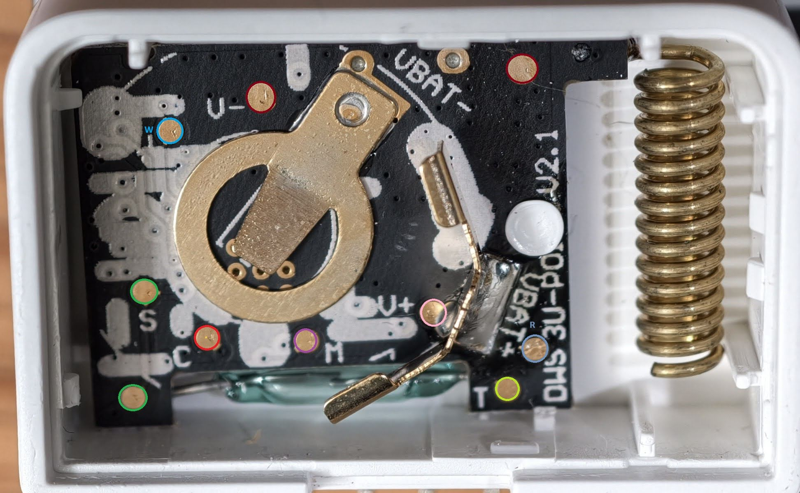

# Wyze Sense v1 contact sensor: bring-up guide

The user has many v1 contact sensors that the stock firmware's zero-MAC bug killed (docs/known-issues.md §1). With our
sensor firmware they work again under their real MAC: the first one, 777B42DF, did on 2026-10-24. They are to be the
main hardware of the DIY version, so this file collects everything needed to bring up the next ones, and every trap
we fell into with the first. Facts here come from FACTS.md (§5) with their evidence; this file is the how-to.

## The board

(The user's photo, 2026-11-03; the pad table with its colours: [guide/pads.md](../guide/pads.md).)

- MCU: **CC1310F128, 5x5 package (RHB, 32 pins)**. Its CCFG keeps the sensor's MAC as ASCII at 0x1FFCC; the ROM
  bootloader is **disabled** in it (BL_CONFIG 0x00FE0100), so JTAG is the only way in.
- Test pads (the user's map, after github.com/sycophantic/wyzeback):

| Pad | Chip pin | Signal | Use |
|---|---|---|---|
| M | 13 | JTAG TMSC | JTAG (2-pin cJTAG) |
| C | 14 | JTAG TCKC | JTAG |
| S | 19 | RESET_N | the debugger's reset: **needed** (see trap 4) |
| RX | 7 | DIO1 | UART RX (our console) |
| TX | 6 | DIO0 | UART TX (our console) |
| W | 23 | DIO10 | stock **Factory UART Test & Provisioning Mode strap pin** (`0xC000200A` in `BoardGpioInitTable` at `0x15338`; grounded at boot in `main()` at `0x099CE` to spawn `FactoryUart_taskFxn` at `0x0B044`, light the LED solid, and keep the CC1310 awake on UART0); also used as our ROM bootloader backdoor pin (§"The ROM bootloader") |
| + / - | | VDD / GND | 3.3 V from the LaunchPad (battery out) |

- Inside: the **reed switch on DIO7** (chip pin 20, closes to GND), the **button on DIO11** (pressed: low), the
  **LED on DIO9**. They have no pads; the user found them by continuity, and our firmware's `watch` confirmed them.
- Chip pins (TI datasheet, RHB): 1 RF_P, 2 RF_N, 3 RX_TX, 4-5 X32K, 6-10 DIO0-4, 11 VDDS2, 12 DCOUPL, 13 TMSC,
  14 TCKC, 15-16 DIO5-6, 17 DCDC_SW, 18 VDDS_DCDC, 19 RESET_N, 20-27 DIO7-14, 28 VDDS, 29 VDDR, 30-31 X24M,
  32 VDDR_RF. Pin 1 at the dot, counted **counter-clockwise seen from the top**, 8 per side.

## Wiring to the LaunchPad (LAUNCHXL-CC1310)

The jumper block in the middle of the LaunchPad joins its XDS110 (debugger, USB side) to its own CC1310. Wire the
sensor to the **XDS110 side** of these pins and **pull the jumpers** of every line used, so the LaunchPad's own chip is
off them:

| Sensor | LaunchPad (XDS110 side) | Jumper |
|---|---|---|
| M | TMS | pull |
| C | TCK | pull |
| S | RST (silkscreen "R", between TXD and TMS) | pull |
| TX | TXD (named from the chip's side: the chip's TX goes to TXD) | pull |
| RX | RXD | pull |
| + | 3V3 | can stay |
| - | GND | |

Pull TDO and TDI too (2-pin JTAG does not use them; the LaunchPad's chip would sit on them). The console then is
`/dev/ttyACM0` (`reference/tests/hw.uart()`), 115200 8N1.

## Tools

- **TI UniFlash** 9.7.0: `tools/toolchain.sh uniflash` (optional, ~380 MB, ~90 s; pinned in `tools/toolchain.lock`)
  installs it into `.toolchain/uniflash`, unattended, with the link its scripting needs. OpenOCD cannot do it: its
  XDS110 driver speaks 4-pin JTAG only, and the board has no TDO/TDI pads.
  - Use **DSLite itself** (`.toolchain/uniflash/deskdb/content/TICloudAgent/linux/ccs_base/DebugServer/bin/DSLite`),
    not the `dslite.sh` wrapper, which `eval`s its arguments and splits settings with spaces.
  - Target config: `firmware/boards/wyze_contact_v1/xds110_2pin.ccxml` (TI's 2-pin cJTAG XDS110 file for CC1310F128).
  - `--range` lengths are in **32-bit words**, not bytes (`--range 0x0,32768` = the whole 128 KB).
  - Scripting (`.../scripting/run.sh script.js`) needs the cloud agent where a CCS install has it: the toolchain
    step links `ccs_base/cloudagent` to `TICloudAgentHostApp`. `DSLite help` (not `--help`) lists its modes.
- **`tools/uniflash.py`** wraps it all: `backup DIR` (flash read twice and compared, CCFG, FCFG1), `flash --backup DIR
  APP.bin` (pages 0-29 only, refused unless `DIR/flash.bin` matches the connected chip's CCFG MAC; verified by read-back),
  `slots --backup DIR BOOT.bin SLOT_A.img` (the two-slot layout for OTA: the boot selector in page 0, slot A at 0x1000,
  slot B's first page blank), `enable-bootloader w|button --backup DIR --yes`, one-step `provision --sensor|--gateway
  --backup DIR` (`backup` → `slots`/`flash` → `enable-bootloader w` → `reset`), `reset`, and `read ADDR WORDS OUT`.
  Every command ends with the **clean reset**: a board reset through RESET_N with the debug power domain released
  (DSLite `-r 2`, `KeepDebugPoweredAtDisconnect=false`). That is what makes it all work without touching the board (trap 6).
- `OWS_BACKUP_DIR=DIR cmake --build --preset fw --target flash-sensor-contact-v1` runs `tools/uniflash.py flash --backup DIR`.
- Battery boards stay out of standby for `10 s` after power-up; any valid console input during that window extends
  console awake mode via a sliding `5-minute` inactivity timer (`sleep` re-enables standby immediately), so the
  single `fw` preset serves both bench debugging and coin-cell deployment.
- **`reference/tests/test_hw_contact_ota.py`** (same opt-in, and the spare dongle with our gateway): installs the
  selector + version N, then updates it over the air to N+1 (the console's `ota` opens the window, as a short press
  would): slot B, reports, "image confirmed"; ~5 minutes, no hands. From then on a unit is updated without JTAG.
- **`reference/tests/test_hw_contact_battery.py`** (same opt-in): the battery image (preset `fw`, standby)
  installed as selector + slot A: it starts with its CCFG MAC, answers during its first 10 s, then sleeps (its
  console stops answering: the UART is off in standby), and a board reset wakes it; ~40 s. Silence alone does not
  tell standby from a hang; the magnet does: on 2026-10-24 (the user, by hand) 14 moves of the magnet in 25 s after
  the window all reached the spare dongle (A2, counters 11-24 in a row, -32 to -40 dBm), and a short press woke it to
  check in (A1).
- **`reference/tests/test_hw_contact_v1.py`** (`OWS_HW=1 OWS_HW_TX=1 OWS_HW_CONTACT=1`): flashes the bench build,
  checks the banner's MAC against the CCFG, the console, and the recovery by reset; ~45 s, no hands. While the
  sensor is wired to the LaunchPad's XDS110, the LaunchPad's own tests (`test_hw_*.py`) cannot run.

## Bringing up a unit, step by step

1. **Solder** M, C, S, RX, TX, W (recommended for UART/ESP SBL), + and -; battery out. Check every joint (trap 2).
2. **Orientation check** with a meter (sensor unpowered): M beeps to chip pin 13, C to pin 14. Then S to 19.
3. **One-step provision (recommended)**: `tools/uniflash.py provision --sensor --backup backups/contact_<MAC>` (reads
   and verifies a dual-read 128 KB backup + CCFG + FCFG1, flashes selector + Slot A, enables the `W` pad ROM bootloader
   in CCFG while keeping the factory MAC untouched, and performs a clean reset). Or run steps 3a–5 individually:
   - **3a. Back up, read-only**, before anything else (CLAUDE.md): `tools/uniflash.py backup backups/contact_<MAC>` (or
     raw `DSLite memory --config .../xds110_2pin.ccxml --range 0x0,32768 --output flash.bin`, plus `0x1FFA8,22` and
     `0x50001000,256`). Archive reference dumps in `ground_truth/firmware/contact_v1_<MAC>_<date>/` with `info.json`,
     `SHA256SUMS`, and `README.md`.
4. **Optional, its stock behaviour**: pair it as it is with our gateway (`host_link.py --pair`, test PAN): a dead
   unit pairs with MAC 0 (`test_contact_v1_zero_mac_join`).
5. **Flash our firmware** (if not using `provision`): `tools/uniflash.py slots --backup backups/contact_<MAC>
   build/fw/firmware/boot-wyze_contact_v1.bin build/fw/firmware/sensor-contact-v1-slot-a.img` (or `flash --backup
   backups/contact_<MAC> build/fw/firmware/sensor-contact-v1-app.bin`; app pages only, CCFG and MAC untouched:
   `test_sensor_images_never_write_the_ccfg`). It restarts by itself.
6. **Test it**: `test_hw_contact_v1.py`, or by hand on the console: a newline (the first line is garbled), then
   `info`: `info <its MAC> type 01 …`.
7. **Pair**: hold the button `>= 3.04 s` (LED blinks 3× while still held, matching stock) with our gateway pairing; the
   reed switch then reports A2 open / closed, as `<its MAC>`.
8. Record the unit in the table below. Anything stuck: `tools/uniflash.py reset`.

## Traps (2026-10-24, the first unit)

1. **OpenOCD sees "all zeroes"**: not a dead chip. OpenOCD's XDS110 driver does 4-pin JTAG, the board has 2 pins. Use
   UniFlash.
2. **A cold joint on C (TCK) looks exactly like a dead or sleeping chip**: "IcePick_C: Unable to access device
   register", no LED, nothing on the air. We spent an hour on theories (standby, a half-written flash) before the user
   found the joint. Check every joint before suspecting anything else.
3. **Counting chip pins wrong**: two wrong readings (the button "on pin 14" = TCK, the reed switch "on pin 19" =
   RESET_N) before the orientation check. Always check M = 13 and C = 14 first; a signal on a JTAG or reset pin is a
   counting error.
4. **No reset line, no recovery**: UniFlash's connect retries and TI's mass erase both need a board reset ("Issuing
   Board Reset… Connect failed"). Wire the S pad (RESET_N) to the XDS110's RST from the start. On 4 wires (`+`, `-`,
   `M`, `C`; 7788CCF6, 7779519F, 778B8C64, 2026-10-31) a DSLite write, and on 7779519F's stock firmware even a read,
   left the chip unreachable (`IcePick_C ... -2131`) until a reset; DSLite's system reset over JTAG (`-r 1`) did not
   help after a write (`-242 Failed System Reset`). A pin reset does: touch S to GND for a moment (or take every wire off
   for a few seconds). Units revived that way, one DSLite session per reset, ended byte-exact (#85).
5. **"Power-cycling" through the 3V3 wire only is not one**: the XDS110 keeps driving the UART and JTAG lines, which
   feed the chip through its pins, so it does not reset cleanly. Don't; use `tools/uniflash.py reset` (trap 6).
6. **After a UniFlash flash with its "run", our firmware prints its banner and then stops answering.** The debugger
   leaves the chip's debug power domain on and runs it under the debugger; it then stays stuck until a real
   power-off. We unplugged the USB four times before finding the cure: a **board reset through RESET_N with the
   debug domain released** (`-r 2`, `KeepDebugPoweredAtDisconnect=false`), which starts it as a power-up does and
   also brings a stuck chip back (reproduced and recovered in `test_hw_contact_v1.py`). `tools/uniflash.py` always
   ends with it; never use DSLite's `-u` (run).
7. **PC 0x10003A12 with the stack at 0x11002000 does not mean stuck**: it is the ROM's wait-for-interrupt, where a
   chip also sits while idle and fine (seen answering its console right after). Judge by the console, not the PC.
   (A scripted `target.reset()` under the XDS110 can leave it stuck: don't; use the clean reset.)
8. **The stock PIN table in flash (`0x1532C`) is only the boot table**: `BoardGpioInitTable` at `0x1532C` configures
   `DIO9` (LED), `DIO1` (RX), `DIO0` (TX), and `DIO10` (`W` factory-mode strap pad) so `main()` (`0x0994C`) can read
   `DIO0`/`DIO10` immediately at boot. The reed switch (`DIO7`) and button (`DIO11`) `PIN_Config` table
   (`{0x80000007, 0x8005000B, 0x000000FE}`) lives in the LZSS-compressed `.data` initializer at flash `0x153F8`, which
   decompresses to SRAM `0x20002258` and is opened by `Sensor_init` at `0x02950–0x0298C`. On a new board, you can also
   find inputs live with our firmware's `watch <seconds> [hex mask]` (pull-ups on the free DIOs, prints `dio <hex>` on
   every change; bit n = DIO n) while moving the magnet and pressing the button.
9. **Our input driver pulled "active high" inputs down**: the reed switch closes to GND, so it never moved. Fixed:
   `BOARD_INPUT_EVENT_PULL_UP` separate from the active level.
10. **UniFlash reads**: lengths in words (a CCFG read of "88" ran past 0x20000 and failed), and `0xBAD0BAD0` from a
    peripheral means its power domain is off (the stock firmware sleeps), not a wrong address.
11. **Standby was not the problem** (we thought so for a while): a CC1310 in standby still answers the debugger
    (tested on the LaunchPad, FACTS §5). Our battery builds still stay awake for 10 s after power-up (cheap insurance).
12. **The LED stayed on** with our firmware (the "OK" LED): fine on the bench, a drain on a coin cell. Since #4 and
    `TASK-12` (`docs/design/DESIGN.md` §9.1), a battery board (`board_battery()`, from `BOARD_LOW_POWER`) follows stock LED
    patterns (`1 × 250 ms` normal boot, `3 × 250 ms` probation boot, `3 × 400 ms` at `3.04 s` while held and on join,
    `3 × 100 ms` join fail, `1 × 100 ms` short press, and **LED OFF** on normal reed/heartbeat events).
13. **Its first console line is garbage** (the line idles while the chip starts): send a newline first.

## As a gateway (issue #15)

Product `gateway-contact-v1`: our gateway app on this board, its host link (the stock dongle's protocol, 115200) on the
RX/TX pads, the unit's CCFG MAC as its MAC, never in standby (`board_keep_awake()`), the receiver always on: mains
power, not a coin cell. Without a CH554 it answers the sync host commands itself, as on the LaunchPad. Provision it in
one step with `tools/uniflash.py provision --gateway --backup backups/contact_<MAC>` (or `tools/uniflash.py flash
--backup backups/contact_<MAC> build/fw/firmware/gateway-contact-v1-app.bin`; pages 0-29, CCFG stays, and
`wyze_contact_v1`'s built-in CCFG also configures `BL_CONFIG = 0xC5FE0AC5` on `W`). To keep its paired sensors over an
update from a build before #61 (the old NV format), add `--nv migrate`: `uniflash.py` defaults to `keep`, and the new
firmware formats an old-format page, so the table is lost while the sensors still think they are joined and keep
reporting (#73).
- **`reference/tests/test_hw_contact_gateway.py`** (`OWS_HW=1 OWS_HW_CONTACT=1`, nothing transmits): builds `fw` with
  `-DOWS_PASSIVE=ON -DOWS_PAN=0x845B -DOWS_SHORT=0x3366` (`radio_tx` and `phy_cmd_tx` stripped via `--gc-sections`,
  replacing the removed `fw-mirror` preset) and drives it as wyzesense2mqtt does through the LaunchPad's UART; its
  alarms agree with the house bridge.
- **Pairing a stock sensor through it works** (2026-10-24, by hand, PAN 0x65FD — previously preset `fw-test2`, now
  configured at runtime via `0x53F0` sub-ID `0x04` `OWS_SUB_NETWORK` / `host_link.py --network`): the climate
  sensor 77C68193 held its button, scan result, R1, verify within 1 s; it reported at once (E8, A1) and on later
  presses. **Range** (the same session, its counters tell lost frames): next to it -37 dBm; across the floor -76; the
  far end of the same floor -82 to -85 (one of five frames lost: counter 6428); downstairs nothing arrived. Its CCFG does
  not force VDDR HH (below the dongle's +14 dBm); not yet compared with the spare dongle on the same spots.
- Left: a range comparison with the dongle, and running the ESP32 HIL regression (`test_hw_esp32.py`, now in HclX/wyzesense_relay).

## The ROM bootloader (issue #14)

Stock disables it; on our units we enable it once, over JTAG, with one of two backdoors (the user's two configs):
**`w`**, the W pad (DIO10, BL_CONFIG 0xC5FE0AC5): a pad an ESP32 can be wired to; **`button`** (DIO11, 0xC5FE0BC5): the
button, no wire, by hand. `tools/uniflash.py enable-bootloader w|button --backup <dir> --yes` (or `provision`) changes
only BL_CONFIG, checks that nothing else changes (MAC, TAP/DAP, IMAGE_VALID), writes page 31, reads it back. Both DIO10
and DIO11 have an external pull-up (verified: high even with the chip's pull-down), so the ROM sees them high unless
pulled to GND. Then: either enter SBL in software without pins (`0x53F0` sub-ID `0x05` `OWS_SUB_ENTER_SBL` on a gateway
or `sbl` on a sensor console, via `chip_enter_sbl()`), or hold W to GND (or the button), reset (power, S, or
`tools/uniflash.py reset`), release, and the ROM bootloader talks on the RX/TX pads (DIO1/DIO0, 115200):
`tools/uart_sbl.py check` (sync, ping, chip ID, the CCFG) and `flash BOOT.bin SLOT_A.img --yes` (pages 0-29 only, ~20 s);
then reset it with S or the power (or the `~15 s` hardware `WDT` after software SBL entry), not the bootloader's own
`CMD_RESET` (which hangs after JTAG sessions). Verified with `w` on 777B42DF (W held to GND by hand, 2026-10-24). With
`w`, an ESP32 on W, S, RX and TX (or 4-wire RX/TX via `OWS_SUB_ENTER_SBL`) can reflash a unit by itself (#15).

## What the units tell us

- A dead unit's **CCFG MAC is intact**; it sends MAC 0 because its NV page (30, `0x1E000`) lost its records—including
  `NVOCTP` item `(6, 8, 0)`—when unconditional boot-counter flash writes during ~250 dying-CR2032 brownout loops
  triggered a Page 30 compaction erase mid-brownout (root cause solved in [`docs/design/DESIGN.md` §3.4](DESIGN.md#34-definitive-root-cause-of-the-stock-v1-zero-mac-bug) and [`docs/known-issues.md` §1](../known-issues.md); our firmware reads CCFG `0x1FFCC` directly and never writes flash during normal operation).
- Stock radio settings as the dongle's (txPower 0xA73F), but the CCFG does not force VDDR HH; the DC/DC is on.

## Units

| MAC | Dumped | Our firmware | Notes |
|---|---|---|---|
| 777B42DF | `firmware/contact_v1_777B42DF_2026-10-24` | selector + slot A (bench or battery build, swapped by the tests), paired as 777B42DF on the test PAN, short 0x0006 | the first; pads soldered: M, C, S, RX, TX, +, -; **CCFG: bootloader enabled, backdoor `w`**, 2026-10-24 |
