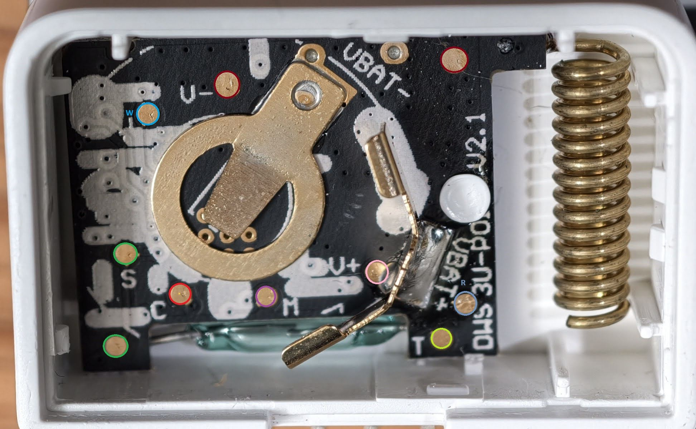
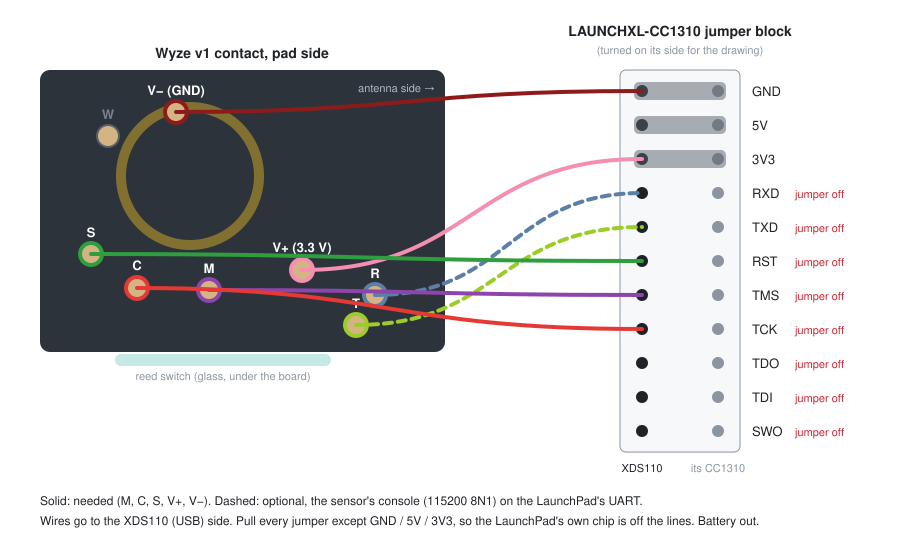

# Level 2: revive a dead v1 contact sensor

Many v1 contact sensors died from a stock firmware bug: once the battery runs low, the sensor wipes its own pairing
data and from then on sends `00000000` instead of its MAC. A new battery does not fix it, and wyzesense2mqtt-rs
cannot tell such sensors apart. The real MAC is still in the chip, in a part the bug never touches. Our firmware reads
it from there, so the sensor comes back under its original MAC, and the bug cannot happen again.

Signs of a dead unit: it shows up (or tries to pair) as `00000000`, or it stopped reporting after a battery change
and does not pair again.

This takes about 10 minutes per sensor once you've done the first one.

**You need:**

- the sensor and a fresh CR2032;
- a **TI LAUNCHXL-CC1310** LaunchPad and its USB cable; its on-board debugger (XDS110) does the flashing;
- 5 wires to the sensor's test pads: thin wires soldered on, or pogo pins held steady for about 30 seconds;
- from the release: `ows-flash-linux-x86_64-<version>`, `ows-sensor-contact-v1-boot-<version>.bin`,
  `ows-sensor-contact-v1-slot-a-<version>.img`, `71-ti-xds110.rules` (set up as in
  [Getting a release](README.md#getting-a-release));
- once, TI UniFlash (TI's own tool, which we may not redistribute):

  ```
  ./ows-flash fetch-uniflash
  ```

  This downloads it from TI (about 380 MB; the version and its SHA-256 are pinned) into
  `~/.local/share/openwyzesense/uniflash`.

## 1. Open the sensor

Open the case and **take the battery out**: the LaunchPad powers the sensor while you work. The test pads are on the
battery side of the board:



The pads are labelled on the board in small print. See [pads.md](pads.md#v1-contact-sensor) for what each one is.

## 2. Wire it to the LaunchPad

In the middle of the LaunchPad, a row of jumpers joins its debugger (XDS110, the USB side) to its own CC1310 chip.
**Pull the jumpers** of RXD, TXD, RST, TMS, TCK, TDO, TDI (and SWO) so the LaunchPad's chip is off those lines. GND,
5V and 3V3 can stay. Then wire the sensor's pads to the **XDS110 side** of the pins:



| Sensor pad | LaunchPad (XDS110 side) | |
|---|---|---|
| `M` | TMS | needed |
| `C` | TCK | needed |
| `S` | RST | **needed**: every step ends with a reset through it; without it the chip stops answering after the first write |
| `V+` | 3V3 | needed |
| `V−` | GND | needed |
| `T` | TXD | optional: the sensor's console (level 3) |
| `R` | RXD | optional: the sensor's console (level 3) |

Check the order of the jumper block against the silkscreen on your LaunchPad: it is printed next to the pins.

## 3. Flash it

Plug the LaunchPad into the PC, then:

```
./ows-flash v1 provision --sensor --boot ows-sensor-contact-v1-boot-<version>.bin \
                                  --slot-a ows-sensor-contact-v1-slot-a-<version>.img
```

In one run (about 25 seconds), it:

1. reads the chip's factory MAC and refuses to go on if it is missing;
2. backs up the whole chip, read twice and compared, into `backups/contact_v1/<MAC>/` (keep it; if a backup of this
   MAC is already there, it is checked instead of overwritten);
3. writes our firmware and reads it back. It never writes the part of the chip that holds the MAC;
4. enables the chip's serial bootloader on the `R` pad, so a Wi-Fi gateway can reflash this board later
   ([level 4](4-wifi-gateway.md)) without the LaunchPad;
5. resets the sensor.

If it stops half-way (pogo pins slipped, `S` not connected), fix the contact and run the same command again. It goes
on from the backup it already has. A unit that stopped answering comes back with `./ows-flash v1 reset`, or by taking
all wires off for a few seconds.

## 4. Battery in, pair

Take the wires off, put a **fresh CR2032** in, and close the case. The LED blinks once (a quarter of a second). Five
quick blinks mean the battery is low.

Turn on pairing at your gateway (in wyzesense2mqtt-rs: its web page, `POST /api/scan`, or MQTT), then **hold the
sensor's button for 3 seconds**: while you still hold it, the LED blinks 3 times slowly and pairing starts. After
that, 3 slow blinks mean it paired, and 3 quick ones mean no gateway answered (try again, closer).

It pairs under its original MAC, as a contact sensor, with a stock dongle or with ours. If wyzesense2mqtt-rs still
lists a `00000000` entry from its dead days, delete it.

What the sensor does from now on, and how to update it later without opening it: [level 3](3-contact-sensor.md#using-the-sensor).
