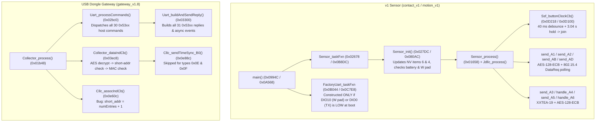

# Reverse-Engineered Stock Wyze Sense Firmware (`ti154stack`)

This directory contains the reconstructed C source code and data structures for the stock Wyze Sense sensor and USB
dongle (gateway) firmwares in [`ground_truth/firmware/`](../../ground_truth/firmware/README.md):

| Binary Dump | Device | MCU / Package | Firmware Version |
|---|---|---|---|
| `contact_v1_777B42DF_2026-10-24/flash.bin` | Wyze Sense v1 Contact Sensor (`sensor_type = 0x01`) | CC1310F128 5x5 (`RHB`) | `0x16` (22) |
| `motion_v1_777A9A46/dump.bin` | Wyze Sense v1 Motion Sensor (`sensor_type = 0x02`) | CC1310F128 5x5 (`RHB`) | `0x18` (24) / `0x19` (25) |
| `gateway_2025-02-08_v1.8/FLASH.bin` + `RAM.bin` | Wyze Sense USB Dongle (`0.0.0.47 V1.8 Gateway GW3U`) | CC1310F128 5x5 (`RHB`) | `1.8.0.0` |
| `gateway_2025-02-02_v1.4/FLASH.bin` | Wyze Sense USB Dongle (`V1.4`) | CC1310F128 5x5 (`RHB`) | `1.4.0.0` |

## Files in This Directory

- [`stock_common.h`](stock_common.h): Shared TI SimpleLink 15.4-Stack (`ti154stack`) data structures (`ApiMac_*`,
  `Llc_netInfo_t`, `Llc_deviceListItem_t`, `NVINTF_*`), NVOCTP item layouts (`sys = 6`), RF packet layouts
  (`0xA1`–`0xB0`, `0xE8`), and shared crypto routines (`Stock_xxtea19_encrypt`, `Stock_xxtea19_decrypt`,
  `Stock_aes128_ecb`) with stock flash and SRAM addresses.
- [`stock_sensor.c`](stock_sensor.c): Reconstructed C business logic for the v1 Contact (`contact_v1`) and v1 Motion
  (`motion_v1`) sensors, with every function and global variable annotated with its exact flash/SRAM address in both
  binaries.
- [`stock_gateway.c`](stock_gateway.c): Reconstructed C business logic for the v1.8 USB Dongle (`gateway_v1.8`), with
  every function and global variable annotated with its exact flash/SRAM address.

## TI SimpleLink CC13x0 SDK Architecture

Both the sensor and gateway firmwares are built on **TI's SimpleLink CC13x0 SDK `ti154stack`** (`sensor` and `collector`
example projects) running on **TI-RTOS (SYS/BIOS)** in ROM (`0x10000000`):

## Address Cross-Reference Table

### Sensor Functions (`contact_v1` vs `motion_v1`)

| Symbol / Role | `contact_v1` Flash | `motion_v1` Flash | Description |
|---|---|---|---|
| `main` | `0x0994C` | `0x0A568` | Calls `PIN_init(0x1532C / 0x156B0)`, checks `DIO10` (`W` pad) / `DIO0` (`TX`), constructs `Sensor_task` & (if `W` is low) `FactoryUart_task`, `BIOS_start()` |
| `GPIO_readDio` | `0x140AC` | `0x1440C` | Reads `(GPIO_DIN31_0 >> dio) & 1` from `0x400220C0` (`DIO7` reed, `DIO10` `W` pad, `DIO11` button) |
| `FactoryUart_taskFxn` | `0x0B044` | `0x0C7E8` | Constructed only when `W` (`DIO10` / `DIO2`) is low at boot (pri 2, stack `0x3C0`); calls `UartFactory_open` (`0x0F120`) and reads `0xAA 0x55` frames |
| `UartFactory_open` | `0x0F120` | `0x0FD74` | Opens `UART0` (`DIO0` TX, `DIO1` RX) at 115200 8N1 (`"Error opening the UART"` at `0x0F178`) |
| `FactoryTest_process43` | `0x0CA44` | `0x0CC14` | Handles class-`0x43` factory commands (`0x04` read MAC, `0x06` read key, `0x08` write MAC to CCFG `0x1FFCC` + NV 8, `0x0A` write key to NV 8, `0xD0` read NV status flags) |
| `FactoryTest_sendReply43` | `0x09124` | `0x09448` | Builds & sends `AA 55 43` UART responses (`0x05`, `0x07`, `0x09`, `0x0B`, `0xD1`) for `FactoryTest_process43` |
| `FactoryTest_sendVersion_5317` | `0x0EB00` | `0x0EC6C` | Sends `55 AA 53 <len> 17 <version_str> <csum>` in response to `0x53 0x16` |
| `FactoryTest_process53` | `0x01AC0` | `0x01CD6` | Handles class-`0x53` factory commands (`0x16` version, `0x2A -> 0x2B` RF PER test on 16-entry `TBB` channel map, `0x2D` write NV 10 + 3x blink, `0xD2 -> 0xD3` 20s PIR self-test, `0xD4` write NV 12) |
| `Sensor_taskFxn` | `0x02678` | `0x0B8DC` | Calls `Sensor_init()` (`0x027DC`), then loops on `Sensor_process()` (`0x01658`) |
| `Sensor_init` | `0x027DC` / `0x07C18` | `0x080AC` | Checks `DIO10` (`W` pad) for 400 vs 700 ms poll interval, writes NV items 6 & 4, checks battery (`0x53`), loads MAC/key, sets LED solid if `W` was low |
| `Sensor_process` | `0x01658` | `0x01658` | Main sensor event loop: dispatches `0x0001` start, `0x0002` `0xA2` retry (`80 ms` / `130 ms`), `0x0004` (`0xAD` history drain on `contact_v1` / 10s PIR bucket on `motion_v1`), `0x0008` (120s `0xAB` PIR summary), `0x0010`/`0x0080` button, `0x0020`/`0x0040` reed/PIR edge, `0x0100` 5-min heartbeat tick, `0x0200` factory UART, `0x0400` LED tick, `0x0800`/`0x1000` PIR 50ms settle & 120s clear, `0x2000` `0xA3`/`0xA5` TX, `0x4000` 5-sample reed debounce, `0x8000` 20s PIR self-test (`0x53 0xD3`) |
| `Ssf_checkBootBattery` | `0x11bc0` | `0x11e3c` | Samples `AONBatMonBatteryVoltageGet() >> 3` 6x over 1.2 s (`<= 0x53` low) |
| `Ssf_sampleBatteryPostTx` | `0x11c14` | `0x11e8c` | Post-TX battery check (`< 0x54` 3x in a row latches low-battery NV item 11) |
| `Ssf_readMacAndKey` | `0x115b8` / `0x11c50` | `0x11870` / `0x11ec8` | Reads 25-byte NV item `(6, 8, 0)` into RAM (never reads CCFG `0x1FFCC`!) |
| `Ssf_writeMacAndKey` | `0x12734` | `0x12a88` | Writes 25-byte `{key[16], mac[8], valid}` to NV item `(6, 8, 0)` |
| `Ssf_readNvStatusFlags` | `0x1104c` / `0x11094` | `0x10f8c` / `0x11308` / `0x112c0` | Reads 1-byte NVOCTP status flags (items 9, 10, 11, and item 12 on `motion_v1`) |
| `Ssf_incrementBootCounter` | `0x1216c` | `0x123ec` | Reads, increments, and writes 2-byte NV item `(6, 6, 0)` on every boot |
| `Ssf_initSeqCounter` | `0x10278` | `0x10558` | Reads 4-byte NV item `(6, 4, 0)` and writes back `seq + 25` |
| `Ssf_buttonClockCb` | `0x017e0` | `0x019a0` | 10 ms button poll: 40 ms debounce, 3.04 s hold blink/join, 8.04 s cancel |
| `Sensor_handleKeys` | `0x018a0` | `0x01a4e` | Dispatches short press (`action 3`: PIR LED arm) and 3s long press (`action 4`: factory reset + join) |
| `Ssf_factoryResetNv` | `0x12c88` / `0x140e8` | `0x13004` | Deletes NV items 2, 3[0..499], 4, 5, 6, 9 and zeroes 600-byte `g_historyLog` |
| `Ssf_ledBlink` | `0x140fc` | `0x140f8` | Starts LED blink clock with `(half_period_ms, blink_count)` |
| `Ssf_ledClockCb` | `0x12054` | `0x122bc` | Toggles LED pin (`DIO9` contact / `DIO12` motion) for `2 * count` edges |
| `Ssf_heartbeatClockCb` | `0x12440` | `0x12708` | 5-minute (`300,000 ms`) clock; triggers `0xA1` every 48 ticks (4 hours) |
| `Sensor_sendHeartbeat_A1` | `0x0c2f8` | `0x0be78` | Builds & encrypts 32-byte `0xA1` report (does not increment `seq_num`) |
| `Sensor_sendEvent_A2` | `0x0c238` | `0x0bdac` | Builds & encrypts 32-byte `0xA2` report, saves plaintext/ciphertext for retry & `0xAD` history |
| `Sensor_sendPirSummary_AB` | — | `0x0cedc` | (`motion_v1` only) Sends `0xAB` with twelve 10-second PIR pulse buckets every 120s |
| `Sensor_sendHistoryLog_AD` | `0x08280` | `0x07fa8` | Drains 50-entry `g_historyLog` via `0xAD` every 200 ms (with `+1 ms` tiebreaker for identical timestamps) |
| `Sensor_sendFactoryTestEcho_A9` | `0x0ec74` | `0x0ee60` | Echoes packets `1..49` of the 50-packet `0xAA` RF PER test as 32-byte `0xA9` with `rxRssi` at byte 30 |
| `Sensor_sendDecommAck_B1` | — | `0x122a4` | (`motion_v1` only) Sends 16-byte encrypted `0xB1` ACK before wiping NV on `0xA6` (`pt[2]==0x05`) decommission |
| `Sensor_sendJoinReq_A3` | `0x01714` / `0x0da30` | `0x01738` / `0x0d968` | Builds & encrypts 16-byte `0xA3` join request (every 3,000 ms) |
| `Sensor_sendJoinResp_A5` | `0x0ea84` | `0x0f764` | Computes `XXTEA-19(token, key)` and encrypts 32-byte `0xA5` response (`motion_v1` omits `memset` on `sp[27..31]`) |
| `Sensor_sendMsg` | `0x0acc4` | `0x0ae90` | Sends 802.15.4 `ApiMac_mcpsDataReq` with `sec.securityLevel = ApiMac_secLevel_none (0)` |
| `Sensor_dataCnfCb` | `0x057e0` | `0x05820` | 802.15.4 `McpsDataCnf`: schedules `80 ms` & `130 ms` `0xA2` retries on no-ACK, pushes un-ACKed `0xA2` to 50-entry `g_historyLog`, and triggers 200 ms `0xAD` drain on next ACKed `0xA2` |
| `Sensor_dataIndCb` | `0x03d28` | `0x06414` / `0x04368` | Decrypts incoming frames via `AES_decryptBuffer` and handles `0xB0` (time sync), `0xA4` (challenge), `0xA6` (`0x04` join + initial `0xA2` / `0x05` decommission + `0xB1`), and `0xAA` (50-pkt RF PER test -> `0xA9` echo + `0x53 0x2C` UART result) |
| `AES_encryptBuffer` | `0x0c5f0` | `0x0c7c0` | Multi-block AES-128-ECB encrypt into `0x2000187C` / `0x200018C0` (missing `else` after `len <= 16` falls through!) |
| `AES_decryptBuffer` | `0x086bc` | `0x089e0` | Multi-block AES-128-ECB decrypt into `0x200018BC` / `0x20001900` (missing `else` + broken `> 32`-byte branch) |
| `AES_encryptBlock16` | `0x10994` | `0x10bbc` | Single-block hardware AES-128-ECB encrypt using static NIST key at `0x20001944` / `0x20001988` |
| `AES_decryptBlock16` | `0x10940` | `0x10b68` | Single-block hardware AES-128-ECB decrypt using static NIST key at `0x20001944` / `0x20001988` |
| `Stock_xxtea19_encrypt` | `0x07f98` | `0x0842c` | 19-round big-endian XXTEA encrypt over 4 × 32-bit words using key at `0x20000ABC` / `0x20000F18` |
| `AONBatMonTemperatureGetDegC` | `0x12c88` | `0x12f40` | TI DriverLib signed integer temperature in °C |

### Gateway Functions (`gateway_v1.8`)

| Symbol / Role | `gateway_v1.8` Flash | Description |
|---|---|---|
| `Collector_process` | `0x01b48` | Main collector event loop: dispatches 12-state `g_joinPollState` (`0x01b92` `TBB` at `0x01bae`), 300 ms LED blink (`0x01d2e`), 10 ms clock tick (`0x01e42`), un-ACKed `0xA2` offline buffer push (`0x01eca`), `0x5337` offline `0xA2` drain (`0x01f42`), `0x5335` diag log dump (`0x01fc2`), 11-min `0x5332` time-sync req (`0x02060`), and 150 ms × 4 UART TX retries (`0x0209e`) |
| `Uart_processCommands` | `0x02bc0` | Parses and dispatches all 30 host → dongle UART commands (`0x02`, `0x04`, `0x06`, `0x08`, `0x0A`, `0x14`, `0x16`, `0x1C`, `0x21`, `0x23`, `0x25`, `0x27`, `0x2A`, `0x2D`, `0x2E`, `0x30`, `0x33`, `0x34`, `0x36`, `0x3A`, `0x3C`, `0x3D`, `0x3F`, `0x41`, `0x53`, `0x57`, `0x5A`, `0x5C`, `0x70`, `0x72`, `0x80`, `0x90`, `0x92`, `0xD0`, `0xE9`) |
| `Uart_buildAndSendReply` | `0x03300` | Central dongle → host frame builder for all 31 reply/event opcodes (`0x03`, `0x05`, `0x07`, `0x09`, `0x0B`, `0x15`, `0x17`, `0x18`, `0x19`, `0x1D`, `0x20`, `0x22`, `0x24`, `0x26`, `0x28`, `0x29`, `0x2B`, `0x2C`, `0x2F`, `0x31`, `0x32`, `0x35`, `0x3B`, `0x3E`, `0x40`, `0x42`, `0x54`, `0x71`, `0x73`, `0x81`, `0x91`, `0x93`, `0xD1`, `0xF2`) |
| `Uart_rxRingRead` | `0x071e8` | Reads `AA 55 53` framing & verifies 16-bit checksum from UART0 RX ring (`0x20003e18`); sends `0x535E` on checksum error (`0x0730a`), handles `HOST_ACK` (`0xFF` at `0x0732a`), and auto-ACKs valid commands (`0x072c4`) |
| `Uart_handleHistoryLog_AD` | `0x08e10` | Converts sensor `0xAD` offline history log timestamp into gateway ms epoch and forwards as `0x5319` (`0xA2`) |
| `Uart_sendImmediate53` / `Uart_send53` | `0x0e9cc` | Wraps payload in `55 AA 53 <b2> <cmd> ... <csum>` and calls `Uart_finalizeAndSend` (`0x12ad4`) |
| `Uart_finalizeAndSend` | `0x12ad4` | Computes checksum (`0x12d94`), writes frame to `UART0`, saves in `lastTxFrame` (`0x200018d5`), starts 150 ms retry timer (`0x14238`) |
| `Uart_sendTimeSyncReq_5332` | `0x13e90` | Sends `0x5332` (`HOST_TIME_SYNC_REQ`) after `0x5315` ACK, after `0x5331` sensor list, and every 11 minutes |
| `Collector_dataIndCb` | `0x03ec8` | 802.15.4 `mcpsDataIndCb`: decrypts in-place via `AES_decryptBuffer` (`0x0924c`), checks `pairedShortAddrs` (`0x20001994`), dispatches RF opcodes |
| `Cllc_sendTimeSync_B0` | `0x0e88c` | Queues 16-byte AES-128-ECB encrypted `0xB0` with 8-byte ms timestamp and `pt[9] = 0x28` (skipped for sensor types `0x0E`/`0x0F` at `0x0e848`) |
| `Cllc_sendChallenge_A4` | `0x0f878` | Queues 32-byte AES-128-ECB encrypted `0xA4` challenge (`0x20001828`) when `g_joinPollState == 1` |
| `Cllc_sendVerifyRsp_A6` | `0x0c608` | Queues 16-byte AES-128-ECB encrypted `0xA6` verify response (`0x200017D8`, `FF 04` + 8B time, no XXTEA!) when `g_joinPollState == 2` |
| `Cllc_sendRfCmd_C0` / `D0` / `E0` / `D2` / `E2` | `0x11f7c` / `0x11650` / `0x11fdc` / `0x11f1c` / `0x1203c` | Queues 16-byte AES-128-ECB encrypted downlink config commands (`g_joinPollState` 5..9, triggered by UART `0x5380`, `0x5370`, `0x5390`, `0x5372`, `0x5392`) |
| `Cllc_sendRfCmd_E9` / `B3` / `B5` | `0x10d9c` / `0x128f0` / `0x12324` | Queues 32B AES-encrypted `0xE9` (`state=10`, `0x5353`), 37B `0xB3` (`state=11`, `0x535A`), or 131B `0xB5` (`state=12`, `0x535C`) |
| `Cllc_assocIndCb` | `0x0e60c` | 802.15.4 `mlmeAssociateIndCb`: assigns `shortAddr = Csf_getNumDeviceListEntries() + 1` |
| `Cllc_sendDataReq` | `0x0d2b0` / `0x0d2dc` | Indirect MAC data transmission (`sec.securityLevel = 0`); sends `0x535E <status>` if `ApiMac_mcpsDataReq` fails |
| `Csf_getDevice` | `0x0e56c` | Searches NV item `(6, 5, 0..219)` (`Llc_deviceListItem_t`) by short or extended address |
| `Csf_getDeviceItem` | `0x102ec` | Reads the `n`-th live sensor record from NV item `(6, 5, sub)` |
| `Csf_findDeviceByMac` | `0x10460` | Returns NV sub-ID (`0..219`) for an 8-byte ASCII MAC, or `-1` if unpaired |
| `Csf_removeDevice` | `0x1064c` | Deletes a sensor from NV item `(6, 5, sub)` and decrements NV item `(6, 4, 0)` |
| `Csf_getNumDeviceListEntries` | `0x13088` | Reads 2-byte sensor count from NV item `(6, 4, 0)` |
| `Csf_sendSensorList_5331` | `0x0dc24` | Iterates NV item 5 and sends `0x5331` frames (10 ms apart) for each paired sensor |
| `Csf_deleteAllAndReboot_5340` | `0x11310` | Sends `0x5340`, wipes SRAM device tables, and calls `SysCtrlSystemReset()` (`0x16184`) |
| `Csf_writeCustomNvItem` / `Csf_readCustomNvItem` | `0x12cb0` / `0x12944` | Reads/writes custom NV items `0x10..0x13` (flags), `0x20` (gateway MAC), and `0x30` (16B ENR key via `0x12fa8`) |
| `AES_encryptBuffer` | `0x0d5a4` | Multi-block AES-128-ECB encrypt into `0x200013D0` (missing `else` after `len <= 16` falls through!) |
| `AES_decryptBuffer` | `0x0924c` | Multi-block AES-128-ECB decrypt into `0x20001410` (missing `else` + broken `> 32`-byte branch) |
| `AES_encryptBlock16` | `0x127a0` | Single-block hardware AES-128-ECB encrypt using static NIST key at `0x200014E0` |
| `AES_decryptBlock16` | `0x112a8` | Single-block hardware AES-128-ECB decrypt using static NIST key at `0x200014E0` |
| `Stock_xxtea19_encrypt` | `0x08b2c` | 19-round big-endian XXTEA encrypt using key at `0x20001374` (`"WYZE098765432101"`); called **only** at `0x039BC` (`0x4302 -> 0x4303` `GET_ENR`) |
