# OpenWyzeSense — Engineering Backlog & Task Tracker

**Design Reference:** [`docs/DESIGN.md`](docs/DESIGN.md) · **Protocol Evidence:** [`docs/FACTS.md`](docs/FACTS.md)  
**Purpose:** Local issue tracker for verified implementation defects, design-to-implementation alignment work, feature requests, tooling polish, and hardware prototyping/research tasks, with explicit inter-task dependencies.

---

## Dependency Graph

```mermaid
flowchart TD
    T01["TASK-01 (P0 Defect)\nESP SoftAP Teardown & HTTP Auth"]
    T02["TASK-02 (P0 Defect)\nOutage Buffer FIFO & Time Rebase"]
    T03["TASK-03 (P0 Defect)\nRF Payload Bounds & Buffer Safety"]
    T04["TASK-04 (P1 Defect)\nSensor Handshake, Queue & Sleep Fixes"]
    T05["TASK-05 (P1 Defect)\nGateway Joining Leak, ShortAddr & 0x5330 Pacing"]
    T06["TASK-06 (P1 Defect)\ngateway-contact-v1 Built-In CCFG SBL Enable"]
    T07["TASK-07 (P1 Defect)\nOWNV Compaction Guard & 6.5 KB SRAM Recovery"]
    T08["TASK-08 (P1 Defect)\nOTA Slot/Battery Guards & ESP Wi-Fi Latency"]

    T09["TASK-09 (P1 Alignment)\nCMake Preset Cleanup (fw + host) & UART Awake"]
    T10["TASK-10 (P1 Alignment)\n0x53F0/0x53F1 Sub-ID Envelope (<56 B CH554 Safe)"]
    T11["TASK-11 (P1 Alignment/Feature)\nHardened Pinless SBL Entry (chip_enter_sbl)"]
    T12["TASK-12 (P1 Alignment/UX)\nStock-Faithful Button (3.04s) & LED Patterns"]
    T13["TASK-13 (P2 Alignment/HW)\nsensor-motion-v1 Pins, 0xAB & Dual-Slot OTA"]

    T14["TASK-14 (P1 Feature)\nRuntime Network Config & Zero-Ladder NV Import"]
    T15["TASK-15 (P2 Feature)\nStock v1 0xAD Offline History Log Forwarding"]
    T16["TASK-16 (P2 Feature/UX)\nMulti-Sensor OTA Queue & Non-Disruptive CLI/MQTT"]
    T17["TASK-17 (P2 Feature/UX)\nESP Web UI Controls, mDNS & gwsync Safe-Mode"]
    T18["TASK-18 (P2 Tooling)\nFlashing Safety, VID:PID Auto-Detect & Ref Fixes"]
    T19["TASK-19 (P3 Feature)\nRuntime Sensor-Type & DIY Pin Profile in OWNV"]

    T20["TASK-20 (P2 Research)\nCH554 >63 B Framing & Software Exit from 0x4312"]
    T21["TASK-21 (P2 Research)\nStandalone HW Verification of chip_enter_sbl & WDT"]
    T22["TASK-22 (P3 Research)\nStock v2 Sensor Compatibility (A6_OURS & >32 B)"]
    T23["TASK-23 (P3 Research)\nMulti-Gateway Shared-PAN Single-ACK-Owner Roaming"]
    T24["TASK-24 (P2 Tooling/HIL)\nAlign test_hw_*.py Scripts with P0/P1 Changes"]
    T25["TASK-25 (P2 Feature/HIL)\nUnder-Load Low-Battery Detection & Zero-HW ESP32 Test Rig"]

    T05 --> T10
    T05 --> T15
    T06 --> T11
    T06 --> T18
    T10 --> T11
    T10 --> T14
    T10 --> T16
    T01 --> T14
    T01 --> T17
    T01 --> T24
    T07 --> T14
    T07 --> T19
    T07 --> T25
    T08 --> T13
    T08 --> T17
    T08 --> T25
    T04 --> T12
    T09 --> T12
    T09 --> T24
    T12 --> T13
    T12 --> T24
    T14 --> T17
    T14 --> T23
    T14 --> T24
    T11 --> T21
    T20 --> T18
```

---

## Task Index

| ID | Status | Type | Priority | Summary | Depends On | Blocks |
|---|---|---|---|---|---|---|
| [`TASK-01`](#task-01) | `[x]` | Defect (Security) | **P0** | ESP32/ESP8266 fallback softAP teardown on STA `GOT_IP` & HTTP authentication | — | `TASK-14`, `TASK-17`, `TASK-24` |
| [`TASK-02`](#task-02) | `[x]` | Defect (Data) | **P0** | Outage buffer (`buffer.c`) strict FIFO ordering, `acks_to_keep` timeout & `1970` timestamp rebasing | — | — |
| [`TASK-03`](#task-03) | `[x]` | Defect (Safety) | **P0** | Encrypted RF payload bounds checks (`sensor.c`, `gateway.c`), 802.15.4 mode `1` reject, `sniffer` overflow & GCC 15 fix | — | — |
| [`TASK-04`](#task-04) | `[x]` | Defect | **P1** | Sensor `0xB0` handshake lockup, `queue_report` eviction/state, `sensor_join` OTA reset, `watch` sleep & `restore()` fixes | — | `TASK-12` |
| [`TASK-05`](#task-05) | `[x]` | Defect | **P1** | Gateway `joining[]` slot leak/timeout, `associate()` short-addr wrap guard, ACK-paced `0x5330` & `host_proto` validation | — | `TASK-10`, `TASK-15` |
| [`TASK-06`](#task-06) | `[x]` | Defect | **P1** | Enable ROM SBL on `W` (`0xC5FE0AC5`) in `wyze_contact_v1/ccfg.c` so `gateway-contact-v1` never locks out SBL | — | `TASK-11`, `TASK-18` |
| [`TASK-07`](#task-07) | `[x]` | Defect | **P1** | `OWNV` compaction overflow guard, reclaim `6.5 KB` static `.bss` SRAM, partial-write `nv->end` & `OWNV` test vectors | — | `TASK-14`, `TASK-19` |
| [`TASK-08`](#task-08) | `[x]` | Defect | **P1** | OTA slot address-range check, mid-OTA per-page battery guard, ESP Wi-Fi `PS_NONE`/`TCP_NODELAY`/WS-Ping & streaming flash | — | `TASK-13`, `TASK-17` |
| [`TASK-09`](#task-09) | `[x]` | Alignment | **P1** | CMake preset simplification (`fw` + `host` only), remove `OWS_ENABLE_TX`, dynamic battery UART awake & CI `.img` upload | — | `TASK-12`, `TASK-24` |
| [`TASK-10`](#task-10) | `[x]` | Alignment | **P1** | Consolidate OWS host commands under `0x53F0`/`0x53F1` + `sub_id` (`<= 56 B` CH554-safe) & `gw->unacked[].pkt[64]` | `TASK-05` | `TASK-11`, `TASK-14`, `TASK-16` |
| [`TASK-11`](#task-11) | `[x]` | Alignment / Feature | **P1** | Hardened pinless software SBL entry (`chip_enter_sbl()`, `OWS_SUB_ENTER_SBL`, `0x4312`, 4-wire `gwsync`/`sbl`) | `TASK-06`, `TASK-10` | `TASK-21` |
| [`TASK-12`](#task-12) | `[x]` | Alignment / UX | **P1** | Stock-faithful sensor button (`3.04 s` while-held trigger) & LED blink patterns + gateway scan/RX LED | `TASK-04`, `TASK-09` | `TASK-13`, `TASK-24` |
| [`TASK-13`](#task-13) | `[x]` | Alignment / HW | **P2** | Complete `sensor-motion-v1` bring-up (`DIO9/10`, `DIO13`, `DIO2`, `120 s` clear / `0xAB`, `SLOTS` dual-slot OTA) | `TASK-08`, `TASK-12` | — |
| [`TASK-14`](#task-14) | `[x]` | Feature | **P1** | Runtime network config (`OWS_SUB_NETWORK`) & zero-ladder dongle-to-ESP32 NV sensor-table import (`OWS_SUB_NV_IMPORT`) | `TASK-01`, `TASK-07`, `TASK-10` | `TASK-17`, `TASK-23`, `TASK-24` |
| [`TASK-15`](#task-15) | `[x]` | Feature | **P2** | Stock v1 sensor `0xAD` offline missed-event log forwarding & `0xB1` acknowledgement in `gateway.c` | `TASK-05` | — |
| [`TASK-16`](#task-16) | `[x]` | Feature / UX | **P2** | Multi-sensor OTA staging queue & non-disruptive `wyzesense2mqtt-rs` / `host_link.py` (`--seconds 360`, flag-preserving) UX | `TASK-10` | — |
| [`TASK-17`](#task-17) | `[x]` | Feature / UX | **P2** | ESP32/ESP8266 Web UI controls (`/contact/*`), mDNS (`ows-relay-xxxx.local`), `gwsync` safe-mode & sensor diagnostics | `TASK-01`, `TASK-08`, `TASK-14` | — |
| [`TASK-18`](#task-18) | `[x]` | Tooling / UX | **P2** | Flashing safety (`uniflash.py` `--backup` guard + `provision`), `user-guide.md` fix, VID:PID auto-detect, `nvows` & `iq` fixes | `TASK-06` (`TASK-20` opt.) | — |
| [`TASK-19`](#task-19) | `[x]` | Feature | **P3** | Runtime sensor-type & DIY pin-profile override in `OWNV` for repurposed `wyze_contact_v1` sensors | `TASK-07` | — |
| [`TASK-20`](#task-20) | `[ ]` | Research / Proto | **P2** | Probe CH554 USB-HID behavior for `> 63 B` frames & software exit from `0x4312` update mode without USB unplug | — | `TASK-18` (dongle auto-exit) |
| [`TASK-21`](#task-21) | `[ ]` | Research / Proto | **P2** | Standalone battery/mains hardware verification of `chip_enter_sbl()` & `WDT` reset without XDS110 debug domain | `TASK-11` | — |
| [`TASK-22`](#task-22) | `[ ]` | Research / Proto | **P3** | Verify `A6_OURS` padding & `> 32 B` RF frame behavior across remaining stock devices (v2 leak, v2 motion, chime, keypad) | — | — |
| [`TASK-23`](#task-23) | `[ ]` | Research / Proto | **P3** | Prototype multi-gateway shared-PAN single-ACK-owner roaming (`CMD_PROP_RX_ADV` selective ACK + RSSI lease) | `TASK-14` | — |
| [`TASK-24`](#task-24) | `[x]` | Tooling / HIL | **P2** | Align hardware HIL scripts (`test_hw_gateway.py`, `test_hw_contact_gateway.py`, `test_hw_inputs.py`, `test_hw_esp32.py`) with P0/P1 changes | `TASK-01`, `TASK-09`, `TASK-12`, `TASK-14` | HIL bench runs (`DESIGN.md` §10.4) |
| [`TASK-25`](#task-25) | `[ ]` | Feature / HIL | **P2** | Under-load coin-cell low-battery detection (`post-TX` `AON_BATMON`, `pt[12]` sag hysteresis, `< 2.50 V` NV guard) & zero-extra-hardware ESP32 coin-cell HIL rig ([`docs/low-battery.md`](docs/low-battery.md)) | `TASK-07`, `TASK-08` | — |

---

## Group A — Critical Security, Data & State-Machine Defects

### TASK-01: ESP32/ESP8266 Fallback SoftAP Lifecycle Fix & HTTP Endpoint Authentication
- **Type:** Defect (Security)
- **Priority:** **P0**
- **Depends on:** None
- **Blocks:** `TASK-14` (`POST /contact/nv` relies on HTTP auth), `TASK-17` (Web UI controls rely on auth & AP lifecycle)
- **Affected Files:** `esp32/idf/main/net.c`, `esp32/idf/main/web.c`, `esp32/idf/main/settings.c`, `esp32/idf/main/settings.h`, `esp32/esp8266/src/main.cpp`, `esp32/web/index.html`
- **Context & Evidence:**
  1. **Permanent Open SoftAP After Router Reboot:** In `esp32/idf/main/net.c:21-29` and `esp32/esp8266/src/main.cpp:251-265`, after 10 rapid STA connection failures (`kFailsBeforeAp = 10`, ~20–30 s—shorter than a typical home Wi-Fi router reboot after a power outage), the relay enters `WIFI_MODE_APSTA` / `WIFI_AP_STA` and starts an **open, unencrypted** `OWS-relay-XXXX` access point. When the router finishes booting and `IP_EVENT_STA_GOT_IP` fires (`net.c:41-47`), `s_setup_ap` is **never torn down** (`esp_wifi_set_mode(WIFI_MODE_STA)` / `WiFi.softAPdisconnect(true)` is never called). The open AP remains permanently on the air.
  2. **Unauthenticated RCE / Firmware Overwrite Endpoints:** `POST /setup`, `POST /ota`, `POST /contact/reset`, `POST /contact/flash`, and `POST /debug/uart` (`esp32/idf/main/web.c`, `esp32/esp8266/src/main.cpp`) require zero authentication—anyone within range of the open AP or on the LAN can push arbitrary ESP32 or CC1310 firmware or redirect `/ws/bridge` to an attacker server. Furthermore, on ESP8266 (`main.cpp:365-391`), `/debug/uart` is compiled unconditionally in production builds.
- **Acceptance Criteria:**
  - [x] When `ssid` is already configured, use exponential backoff / a minimum `90–120 s` outage window before bringing up the fallback softAP (`ssid` empty still starts the setup AP immediately).
  - [x] Immediately shut down the softAP (`WIFI_MODE_STA` on ESP-IDF; `WiFi.softAPdisconnect(true)` + `WIFI_STA` on ESP8266) as soon as STA obtains an IP (`IP_EVENT_STA_GOT_IP`), and stop the fallback AP after a bounded timeout (e.g., `15 min`) while continuing STA reconnect retries.
  - [x] Require HTTP Basic / Bearer authentication (using a dedicated `admin_pass` or the configured WebSocket `token` when non-empty) on `POST /setup`, `POST /ota`, `POST /contact/*`, and `/debug/uart`.
  - [x] Gate `/debug/uart` behind a debug flag or auth on ESP8266 (matching ESP-IDF), and ensure no endpoint ever echoes stored `pass` or `token` in cleartext.

---

### TASK-02: Outage Buffer Strict FIFO Ordering, `acks_to_keep` Expiry & Post-Outage `1970` Timestamp Rebasing
- **Type:** Defect (Data Integrity)
- **Priority:** **P0**
- **Depends on:** None
- **Blocks:** None
- **Affected Files:** `esp32/relay/buffer.h`, `esp32/relay/buffer.c`, `esp32/host/test_buffer.c`
- **Context & Evidence:**
  1. **Chronological State Inversion During Drain (`buffer.c:94`):** `buffer_from_gateway()` checks `if (b->ready)` (`open && now >= ready_at`) without checking `b->count == 0`. Draining 32 buffered alarms at `BUFFER_REPLAY_EVERY = 200 ms` takes `6.4 s`. If a door opened during the outage (queued at slot 15) and closes at `t = +3.5 s` (after `ready_at`, while slots 3..15 are still draining), the live "door closed" packet bypasses the queue and reaches `wyzesense2mqtt-rs` *before* the older "door opened" packet is replayed—leaving Home Assistant stuck showing the door **OPEN** permanently when it is physically closed.
  2. **Unbounded `acks_to_keep` Desync (`buffer.c:130-156`):** Each replayed `0x5319` increments `b->acks_to_keep`, swallowing future `AA 55 53 19 FF` server ACKs. If a server ACK is lost across a reconnect race, `acks_to_keep` stays `> 0` indefinitely and swallows the legitimate server ACK for a future live `0x5319` alarm, forcing the CC1310 to retry 4 times and drop.
  3. **Cold-Boot Outage `1970-01-01` Timestamps (`DESIGN.md` §8.2):** After a whole-home power outage, the ESP + CC1310 boot in `< 2 s` (`gw->clock_ms ≈ 0`) while the Wi-Fi router + server take `60–120 s`. Any door/motion `0x5319` buffered during that window carries a `1970-01-01T00:00:xx` timestamp (`bytes[5..12]` of the `55 AA 53 <b2> 19 ...` packet).
- **Acceptance Criteria:**
  - [x] In `buffer_from_gateway()`, continue locally ACKing and appending incoming `0x5319` packets to the FIFO tail whenever `!b->ready || b->count > 0`, switching to direct pass-through only once `b->ready && b->count == 0`.
  - [x] Expire `b->acks_to_keep` on WebSocket disconnect and after `2000 ms` past the last replayed frame (`last_replay_ms`).
  - [x] When `buffer_from_server()` observes `0x5333` (`HOST_TIME_SYNC`, carrying `server_epoch_ms`), rebase any queued `0x5319` packet whose embedded 64-bit timestamp is `< 1577836800000ULL` (`2020-01-01`) using `(server_epoch_ms - sync_rx_ms) + pkt_rx_ms` and recompute its 16-bit big-endian UART checksum before replay.
  - [x] Add unit tests in `esp32/host/test_buffer.c` covering live-arrival-during-drain FIFO order, `acks_to_keep` timeout/disconnect reset, and `1970` timestamp rebasing.

---

### TASK-03: Encrypted RF Payload Bounds Checks, 802.15.4 Mode `1` Rejection, `sniffer` Stack Overflow & GCC 15 Fix
- **Type:** Defect (Memory Safety & Build)
- **Priority:** **P0**
- **Depends on:** None
- **Blocks:** None
- **Affected Files:** `firmware/common/sensor.c`, `firmware/common/gateway.c`, `firmware/common/mac154.c`, `firmware/apps/sniffer/sniffer_app.c`, `firmware/tests/test_sensor.c`, `firmware/tests/test_gateway.c`, `firmware/tests/test_main.c`
- **Context & Evidence:**
  1. **Out-of-Bounds Stack Reads & Corrupt Flash Writes in `sensor.c` (`sensor.c:457-496, 550-554`):** `sensor_rx()` decrypts `m.payload_len` bytes into uninitialized stack `uint8_t pt[APP_MAX_PAYLOAD]` and calls `on_message(s, pt, now)` **without passing `m.payload_len`**. Consequently, a 16-byte `0xA4` (`APP_JOIN_TOKEN`, needs `17 B`), `0xC0` (`APP_OTA_OFFER`, needs `25 B`), or `0xC2` (`APP_OTA_BLOCK`, needs `6 + block_len <= m.payload_len`) reads uninitialized stack bytes from `pt[16..]` and writes garbage into the inactive flash slot via `s->io.ota_write`.
  2. **Out-of-Bounds Read on `0xA5` in `gateway.c` (`gateway.c:601-614`):** `APP_JOIN_RESPONSE` (`0xA5`) copies 26 bytes from `pt + 1` into `HOST_GET_R1` (`0x5322`) without checking `if (n < 27) break;`.
  3. **Reserved 802.15.4 Addressing Mode `1` (`mac154.c:30-56`):** `get_addr()` treats `mode == 1` (`0b01`, reserved in IEEE 802.15.4-2006) identically to `MAC_ADDR_NONE` (`0`) instead of returning `false`.
  4. **Stack Buffer Overflow in `sniffer_app.c` (`sniffer_app.c:21`):** `char line[32 + 2 * 64]` (`160 B`) overflows when formatting frames up to `RADIO_MAX_FRAME` (`127 B` -> `254` hex chars + header + `\r\n` <= `288 B`).
  5. **GCC 15 `-Werror=unterminated-string-initialization` (`test_sensor.c:13, 307`):** `uint8_t mac[8] = "77001122"` fails host build on GCC 15 (`-Wall -Wextra -Werror`).
- **Acceptance Criteria:**
  - [x] Enforce exact minimum decrypted length checks for `0xA4` (`n >= 17`), `0xA6` (`n >= 11`), `0xB0` (`n >= 9`), `0xC0` (`n >= 25`), and `0xC2` (`6 + len <= n && len >= 1 && len <= OTA_BLOCK`) in `sensor.c`, and `0xA5` (`n >= 27`) in `gateway.c`.
  - [x] Reject `dst_mode == 1` or `src_mode == 1` in `mac154_parse()`.
  - [x] Enlarge `line[]` in `sniffer_app.c` to `32 + 2 * RADIO_MAX_FRAME + 4` and check bounds before appending.
  - [x] Replace `uint8_t[8] = "77001122"` string-literal initializers in tests with a byte-array macro or `__attribute__((nonstring))` so GCC 15 builds cleanly under `-Werror`.
  - [x] Add unit tests in `test_sensor.c`, `test_gateway.c`, and `test_main.c` for truncated encrypted frames and mode `1` MAC headers.

---

### TASK-04: Sensor Handshake `0xB0` Lockup, Report Queue Eviction, `watch` Sleep & `restore()` Fixes
- **Type:** Defect
- **Priority:** **P1**
- **Depends on:** None
- **Blocks:** `TASK-12` (button/LED UX builds on clean `sensor.c` / `sensor_app.c` state transitions)
- **Affected Files:** `firmware/common/sensor.c`, `firmware/common/sensor.h`, `firmware/apps/sensor/sensor_app.c`, `firmware/tests/test_sensor.c`, `firmware/tests/test_apps.c`
- **Context & Evidence:**
  1. **Permanent `SENSOR_HANDSHAKE` Lockup on Stale `0xB0` (`sensor.c:482-499`):** During re-pairing, if the gateway still holds a queued `0xB0` (`APP_TIME_SYNC`) for the sensor's short address, `on_message()` processes `0xB0` while `s->state == SENSOR_HANDSHAKE` and sets `s->polls_left = 0`, halting polling before `0xA4`/`0xA6` ever arrives. Because `SENSOR_HANDSHAKE` has no overall timeout and `sensor_app.c` ignores `join()` unless `state == SENSOR_UNJOINED || state == SENSOR_JOINED`, the sensor is stuck until battery pull.
  2. **In-Flight Report Eviction & Lost Event Polarity (`sensor.c:236-247`):** When `s->n_queued == SENSOR_QUEUE_LEN`, `queue_report()` shifts `s->queued[0]` out even when `s->tx_phase != TX_IDLE` (`queued[0]` is currently on the air awaiting ACK), attributing the incoming ACK to the wrong frame. Also, `queued[]` stores only the message opcode (`APP_EVENT`), reading live `s->event_state` at TX time instead of the debounced state captured when the edge occurred (collapsing rapid open→close transitions into two identical `close` packets).
  3. **Stale OTA / Check-In State Across Re-Join (`sensor.c:302-316`) & Undisarmed `awaiting_ack` (`sensor.c:462-477`):** `sensor_join()` does not clear `s->ota` or `s->check_in`; `sensor_rx()` does not clear `s->awaiting_ack = false` if a coordinator downlink frame arrives when the short 3-byte MAC ACK was missed.
  4. **Console `watch` Command Sleeps Through Events (`sensor_app.c:218-246`):** `sensor_app_step()` returns `wait_ms` up to 4 hours (`HEARTBEAT_MS`) without bounding by `50 ms` while `a->watch` is active, and `CONFIRM_MS` (`60 s`) is checked before `sensor_step()` increments `s->acks`.
  5. **`restore()` in `sensor_app.c` (`sensor_app.c:36-47`):** Does not call `set_type(a, a->cfg.sensor_type)` after loading `NV_CFG` and overwrites CLI `--pan` (`only_pan`) unconditionally from NV.
- **Acceptance Criteria:**
  - [x] Ignore `APP_TIME_SYNC` (`0xB0`) unless `s->state == SENSOR_JOINED`, add a `30 s` handshake timeout returning to `SENSOR_UNJOINED` (or previous joined state), and allow long-press `sensor_join()` from any state.
  - [x] Store `{ uint8_t msg; uint8_t state; }` per `queued[]` entry and never evict `queued[0]` while `tx_phase != TX_IDLE` (drop or coalesce `queued[1..]` instead).
  - [x] Reset `s->ota` and `s->check_in` inside `sensor_join()`, and clear `s->awaiting_ack` on valid coordinator response in `sensor_rx()`.
  - [x] Bound `sensor_app_step()` wait time when `a->watch` is enabled, evaluate slot confirmation *after* `sensor_step()`, and call `set_type()` / preserve explicit `only_pan` in `restore()`.
  - [x] Add regression tests in `test_sensor.c` and `test_apps.c` for all 5 scenarios.

---

### TASK-05: Gateway `joining[]` Slot Leak, `associate()` Collision Guard, ACK-Paced `0x5330` & `host_proto` Validation
- **Type:** Defect
- **Priority:** **P1**
- **Depends on:** None
- **Blocks:** `TASK-10` (clean `gateway.c` / `host_proto.c` unacked queue semantics), `TASK-15` (`0xAD` host forwarding)
- **Affected Files:** `firmware/common/gateway.c`, `firmware/common/gateway.h`, `firmware/common/host_proto.c`, `firmware/tests/test_gateway.c`, `firmware/tests/test_main.c`
- **Context & Evidence:**
  1. **`gw->joining[4]` Permanent Slot Exhaustion (`gateway.c:309-330, 811-840`):** `joining[]` slots are allocated on `0xA3` (`APP_JOIN_ANNOUNCE`) and freed only on `0x5323` (`HOST_VERIFY_SENSOR`). Four aborted pairings (or `DeleteSensor` / `DeleteAll`) permanently fill all 4 slots (`find_joining` returns `NULL`), silently breaking all future pairings until gateway power-cycle.
  2. **16-Bit Short Address Wrap / Collision (`gateway.c:309-340`):** `associate()` increments `max_short + 1` without checking for `0xFFFF`/`0xFFFE`, `gw->coord_short` (`0xAA55`), or collisions with existing `gw->sensors[]` entries after wrap-around.
  3. **`HOST_GET_SENSOR_LIST` (`0x5330`) Drops Sensors > 4 (`gateway.c:845-851`):** Loops synchronously over all `gw->sensors[i]` calling `host_send(0x5331, ...)`, overflowing `gw->unacked[GW_MAX_UNACKED]` (`4` slots) whenever more than 4 sensors are paired!
  4. **`host_parse()` / `host_build()` Validation (`host_proto.c:21-59`):** `host_parse()` accepts `b2 < 3` on non-ACK frames (underflowing `b2 - 3`), and `host_build()` accepts `n > HOST_MAX_PACKET - 7` without returning `0`.
- **Acceptance Criteria:**
  - [x] Clear matching `gw->joining[]` entries in `associate()`, `HOST_DELETE_SENSOR`, and `HOST_DELETE_ALL`, and expire stale `joining[]` entries after `GW_PENDING_MS` (`30 s`) in `gateway_step()`.
  - [x] Allocate the lowest unused short address in `0x0001..0xFFFD` (skipping `gw->coord_short` and active `gw->sensors[]`).
  - [x] Stream `0x5331` (`HOST_SENSOR_LIST_ITEM`) responses one at a time (or within free `unacked[]` capacity), advancing `list_cursor` as `HOST_ACK` arrives (matching stock `Csf_sendSensorList_5331` pacing) so all 64 sensors are reliably delivered.
  - [x] Guard `b2 >= 3` in `host_parse()` and `n <= HOST_MAX_PACKET - 7` in `host_build()`, with unit tests for 64-sensor list streaming and malformed host packets.

---

### TASK-06: Enable ROM Serial Bootloader on `W` (`0xC5FE0AC5`) in `wyze_contact_v1` Built-In CCFG
- **Type:** Defect
- **Priority:** **P1**
- **Depends on:** None
- **Blocks:** `TASK-11` (`chip_enter_sbl()` requires `BOOTLOADER_ENABLE == 0xC5` on `gateway-contact-v1`), `TASK-18` (provisioning safety checks)
- **Affected Files:** `firmware/boards/wyze_contact_v1/ccfg.c`, `reference/tests/test_firmware.py`
- **Context & Evidence:**
  - `firmware/boards/wyze_contact_v1/ccfg.c` includes Ti's default `startup_files/ccfg.c` without defining `SET_CCFG_BL_CONFIG_BOOTLOADER_ENABLE = 0xC5`, `SET_CCFG_BL_CONFIG_BL_ENABLE = 0xC5`, `SET_CCFG_BL_CONFIG_BL_LEVEL = 0x0`, and `SET_CCFG_BL_CONFIG_BL_PIN_NUMBER = 10` (`W` pad `DIO10`).
  - Consequently: (a) `ows_ccfg_builtin` in `gateway-contact-v1` fails `ccfg_is_safe()`, causing `OWS_SUB_CCFG` (`0x53F0` sub-ID `0x03`) to always refuse with `GW_CCFG_BAD_BUILTIN`; and (b) flashing `gateway-contact-v1.hex`/`.bin` (full 128 KB image) disables the ROM Serial Bootloader and locks out future UART/ESP32 SBL updates without 2-pin cJTAG recovery. *(Note: `board_keep_awake()` in `gateway_app.c:99` is already implemented.)*
- **Acceptance Criteria:**
  - [x] Configure `firmware/boards/wyze_contact_v1/ccfg.c` with `BL_CONFIG = 0xC5FE0AC5` (ROM SBL enabled, active-low backdoor on `DIO10` `W` pad) while keeping `sensor-contact-v1` slot images free of Page 31 writes (`test_sensor_images_never_write_the_ccfg`).
  - [x] Add an assertion in `reference/tests/test_firmware.py` verifying that `gateway-contact-v1.elf`'s `.ccfg` section has `BL_CONFIG == 0xC5FE0AC5` and passes `ccfg_is_safe()`.

---

### TASK-07: `OWNV` Compaction Overflow Guard, Reclaim `6.5 KB` Static `.bss` SRAM & Update Corruption Tests
- **Type:** Defect
- **Priority:** **P1**
- **Depends on:** None
- **Blocks:** `TASK-14` (`OWS_SUB_NV_IMPORT` bulk writes up to 64 sensors into `OWNV`), `TASK-19` (extra DIY config items in `OWNV`)
- **Affected Files:** `firmware/common/nvstore.c`, `firmware/soc/cc13x0/ccfg_flash.c`, `firmware/tests/test_nvstore.c`, `firmware/tests/test_apps.c`
- **Context & Evidence:**
  1. **Silent Data Loss in `compact()` (`nvstore.c:139-143`):** `static uint8_t keep[2560]` breaks out of the scan loop when `kept + total > sizeof(keep)`, then **still erases Page 30** and writes back only the truncated subset—silently deleting paired sensors if live records ever exceed `2560 B`.
  2. **`6.5 KB` (`32%` of 20 KB SRAM) Permanently Consumed in `.bss`:** `nvstore.c:127` (`static uint8_t keep[2560]`) and `ccfg_flash.c:30` (`static uint8_t page[4096]`) sit permanently in `.bss` even though neither runs concurrently and each executes at shallow stack depth.
  3. **Partial-Write `nv->end` Tracking (`nvstore.c:171-178`):** If `nv_page_write()` fails partway through `append()`, returning early before advancing `nv->end` causes the next `nv_set()` to attempt programming `0->1` bits over dirty flash bytes instead of compacting first.
  4. **Outdated Test Magic (`test_nvstore.c`, `test_apps.c`):** Corruption tests still seed `"OWSN\x01\xff\xff\xff"` instead of `"OWNV\x01\xff\xff\xff"`, inadvertently testing fresh-format fallback instead of mid-page record corruption recovery.
- **Acceptance Criteria:**
  - [x] Abort `compact()` *before* `nv_page_erase()` and return `false` if all live records on Page 30 exceed staging capacity (or size staging / two-pass copy so any valid 4 KB page of live records fits).
  - [x] Move the `nvstore.c` compaction buffer and `ccfg_flash.c` page buffer off permanent `.bss` (using bounded stack buffers with linker stack headroom verified via ELF `.bss`/stack inspection), reclaiming ~`6.5 KB` of static SRAM.
  - [x] Advance `nv->end` (or mark dirty so the next write triggers `compact()`) whenever `nv_page_write()` fails in `append()`.
  - [x] Update `test_nvstore.c` and `test_apps.c` corruption vectors to use `"OWNV"` and verify mid-page corruption recovery.

---

### TASK-08: OTA Slot Address-Range Guard, Mid-OTA Battery Check & ESP Relay Low-Latency / Streaming Polish
- **Type:** Defect
- **Priority:** **P1**
- **Depends on:** None
- **Blocks:** `TASK-13` (dual-slot OTA on `sensor-motion-v1`), `TASK-17` (ESP Web UI `/contact/flash`)
- **Affected Files:** `firmware/common/boot_slot.c`, `firmware/apps/sensor/sensor_app.c`, `tools/slot_image.py`, `esp32/idf/main/net.c`, `esp32/idf/main/relay_task.c`, `esp32/idf/main/web.c`, `esp32/esp8266/src/main.cpp`, `esp32/relay/relay.c`, `esp32/host/ows_relay.c`, `firmware/tests/test_boot.c`, `esp32/host/test_relay.c`
- **Context & Evidence:**
  1. **Cross-Slot Image Verification Gap (`boot_slot.c:21-38`):** `boot_slot_valid()` checks `reset >= 0x01101 && reset < 0x1D000` (covering *both* slots) rather than checking `[slot_base + 0x100, slot_base + SLOT_SIZE)`. Passing `slot-a.img` twice on `host_link.py --ota <MAC> slot-a.img slot-a.img` flashes a `0x01100`-linked image into Slot B (`0x0F000`), which passes CRC-32 and crashes 3× on boot before rolling back.
  2. **Mid-OTA Battery Sag Check (`sensor_app.c:127-160`):** `V_bat >= 2500 mV` is checked only once at `0xC0` offer start (`ota_accept()`), never before erasing subsequent 4 KB flash pages across the 3-minute, ~380-block transfer on a cold/aging CR2032.
  3. **ESP Wi-Fi Power-Save Latency & Dead-Socket Detection (`esp32/`):** Default ESP32/ESP8266 Wi-Fi DTIM modem sleep (`100–300 ms`) + Nagle's algorithm (`TCP_NODELAY` unset) causes server `HOST_ACK`s to miss the CC1310's `160 ms` `HOST_RETRY_MS` window and slows OTA block fetches. Also, `relay.c` never sends client-initiated `OP_PING` frames (so half-open NAT/server drops keep `RELAY_OPEN` true and bypass `buffer.c`), requires `"101 "` with trailing space (`HTTP/1.1 101\r\n` fails), and drops connections on server `PING` > 125 B (`ws_buf` cap); `esp32/idf/main/web.c` `malloc`s 120 KB contiguously for `/contact/flash` instead of using `sbl_stream_*()`; and `ows_relay.c` uses blocking DNS/TCP `connect()`.
- **Acceptance Criteria:**
  - [x] Verify in `boot_slot_valid()` / `boot_written_ok()` that the vector table `reset` handler falls strictly inside `[slot_base + 0x100, slot_base + SLOT_SIZE)`, and stamp/verify the slot index (`0=A, 1=B`) in `slot_image.py` / `host_link.py`.
  - [x] Re-check `board_battery_mv() >= 2500` before every 4 KB page erase in `sensor_app.c` `ota_write()`, cleanly aborting (`OTA_DONE_FLASH`) without touching the active slot if voltage sags.
  - [x] Set `esp_wifi_set_ps(WIFI_PS_NONE)` / `WiFi.setSleepMode(WIFI_NONE_SLEEP)` and `TCP_NODELAY = 1` on ESP32 and ESP8266; add periodic client `OP_PING` + `PONG` timeout in `relay.c`; accept `HTTP/1.1 101\r\n` without trailing space; switch ESP-IDF `/contact/flash` in `web.c` to `sbl_stream_*()` (zero 120 KB heap `malloc`); and make `ows_relay.c` `connect()` non-blocking.

---

## Group B — Design-to-Implementation Alignment & Core Refactors

### TASK-09: CMake Preset Simplification (`fw` + `host` Only), Remove `OWS_ENABLE_TX` & Dynamic Battery UART Awake
- **Type:** Alignment (`DESIGN.md` §2.3, §7.1)
- **Priority:** **P1**
- **Depends on:** None
- **Blocks:** `TASK-12` (sensor console/awake loop in `sensor_app.c`)
- **Affected Files:** `CMakePresets.json`, `firmware/CMakeLists.txt`, `firmware/products.cmake`, `firmware/soc/cc13x0/radio.c`, `firmware/soc/cc13x0/board.c`, `firmware/apps/sensor/sensor_app.c`, `.github/workflows/ci.yml`, `reference/tests/test_firmware.py`, `CLAUDE.md`, `AGENTS.md`
- **Context & Evidence:**
  - `CMakePresets.json` and `.github/workflows/ci.yml` still build 7 presets (`fw`, `fw-no-tx`, `fw-mirror`, `fw-test`, `fw-test2`, `fw-bench`, `host`) and gate `radio_tx()` behind `#if OWS_ENABLE_TX`. Per `DESIGN.md` §2.3, only **`fw`** and **`host`** should exist, with PAN IDs configured at runtime (`TASK-14`) and battery boards extending their `10 s` boot UART console window dynamically when serial RX activity is seen.
  - `.github/workflows/ci.yml:108` uploads `*.bin, *.hex, *.elf` artifacts but omits `*-slot-a.img` and `*-slot-b.img`, forcing users who download CI artifacts to run Python scripts to build OTA images.
- **Acceptance Criteria:**
  - [x] Remove `fw-no-tx`, `fw-mirror`, `fw-test`, `fw-test2`, and `fw-bench` from `CMakePresets.json`, `ci.yml`, and docs, leaving `fw` and `host`, and remove the `OWS_ENABLE_TX` compile-time macro (`sniffer` remains RX-only by application design).
  - [x] On `BOARD_LOW_POWER=1` boards, if any valid UART RX character arrives during the initial `10 s` `DEBUG_WINDOW_MS`, extend console awake mode via a sliding `5-minute` inactivity timer (and immediately re-enable standby on a `sleep` console command) so bench debugging works on the standard `fw` image without permanently draining a deployed battery on a stray glitch.
  - [x] Include `build/fw/firmware/*.img` alongside `.bin/.hex/.elf` in `.github/workflows/ci.yml` release/build artifacts.

---

### TASK-10: Consolidate OWS Host Extensions Under `0x53F0` / `0x53F1` + `sub_id` (`<= 56 B` CH554-Safe)
- **Type:** Alignment (`DESIGN.md` §5.1, §5.2.2)
- **Priority:** **P1**
- **Depends on:** `TASK-05` (`gateway.c` / `host_proto.c` framing & unacked handling)
- **Blocks:** `TASK-11` (`OWS_SUB_ENTER_SBL`), `TASK-14` (`OWS_SUB_NETWORK`, `OWS_SUB_NV_IMPORT`), `TASK-16` (OTA host tooling)
- **Affected Files:** `firmware/common/host_proto.h`, `firmware/common/gateway.h`, `firmware/common/gateway.c`, `esp32/contact/gwsync.c`, `tools/host_link.py`, `reference/wyzesense_ref/host.py`, `firmware/tests/test_gateway.c`, `reference/tests/test_gwsync.py`
- **Context & Evidence:**
  1. **Opcode Proliferation:** Current code uses separate top-level commands `0x53F0/F1` (flags), `0x53F2/F3` (CCFG), `0x53F4..F8` (OTA), and `0x53FA/FB` (build info), diverging from `DESIGN.md` §5.2.2 (`0x53F0` `HOST_OWS_CMD` / `0x53F1` `HOST_OWS_RSP` + `sub_id`).
  2. **CH554 63-Byte USB-HID Ceiling Violation & `unacked[].pkt[48]` Truncation (`gateway.h:119`, `gateway.c:949`):** `0x53FB` currently sends all `116 bytes` of `build_info_t` (`123 B` total frame)—which (a) **overflows `gw->unacked[].pkt[48]`** (currently mitigated only by sending it un-retried or overflowing if queued) and (b) **exceeds the 63-byte single-report USB-HID limit (`56 B` max payload)** of the CH554 bridge chip on `gateway-dongle` (`tools/host_link.py:66-79`).
- **Acceptance Criteria:**
  - [x] Implement the multiplexed `0x53F0` / `0x53F1` + `sub_id` dispatch in `gateway.c`, `host_proto.h`, `gwsync.c`, `host_link.py`, and `wyzesense_ref/host.py` (`0x01` Flags, `0x02` Build Info, `0x03` CCFG, `0x10..0x13` OTA; keeping a backward-compatible read-only alias on `0x53FA` for rolling ESP updates per Open Question #1).
  - [x] Split `OWS_SUB_BUILD_INFO` (`sub_id = 0x02`, `req: part = 0 | 1 | 2`) into CH554-safe `<= 55 B` pages (`part 0`: header + `id[8]` + `product[24]` + `app[12]` = `53 B`; `part 1`: `id[8]` + `board[24]` + `version[0..21]` = `55 B`; `part 2`: `id[8]` + `version[22..39]` = `27 B`) so every OWS command works identically over `/dev/hidrawN` (USB Dongle) and direct UART, and `gwsync.c` needs only `part 0` (`1` round-trip).
  - [x] Increase `gw->unacked[].pkt` in `gateway.h` from `48` to `64` bytes so every `<= 63 B` async `0x53` packet can be reliably ACK-tracked and retried.

---

### TASK-11: Hardened Pinless Software SBL Entry (`chip_enter_sbl()`, `OWS_SUB_ENTER_SBL`, `0x4312`, 4-Wire `gwsync`/`sbl`)
- **Type:** Alignment / Feature (`DESIGN.md` §6.6)
- **Priority:** **P1**
- **Depends on:** `TASK-06` (`gateway-contact-v1` CCFG `BOOTLOADER_ENABLE == 0xC5`), `TASK-10` (`0x53F0` `sub_id = 0x05`)
- **Blocks:** `TASK-21` (hardware verification on standalone battery/mains boards)
- **Affected Files:** `firmware/hal/chip.h`, `firmware/soc/cc13x0/chip.c`, `firmware/common/gateway.c`, `firmware/apps/gateway/gateway_app.c`, `firmware/apps/sensor/sensor_app.c`, `esp32/relay/buffer.c`, `esp32/contact/gwsync.c`, `esp32/contact/sbl.c`, `tools/uart_sbl.py`, `tools/host_link.py`
- **Context & Evidence:**
  - Pinless software SBL entry (`chip_enter_sbl()`, `DESIGN.md` §6.6) did not yet exist in `firmware/soc/cc13x0/chip.c` prior to this task (only `chip_reset()` existed at `chip.c:42-58`).
  - Jumping to ROM `0x10003c67` without shutting down the RF Core Cortex-M0 (`CMD_PROP_RX` DMA into `0x20000000..0x20001000`), arming the hardware Watchdog (`WDT`), refusing on `gateway-dongle` (CH554), or filtering on remote `/ws/bridge` risks SRAM corruption or wedging a remote/USB gateway.
- **Acceptance Criteria:**
  - [x] Implement `chip_can_enter_sbl()` and `chip_enter_sbl()` in `firmware/soc/cc13x0/chip.c`: verify `(CCFG_O_BL_CONFIG >> 24) == 0xC5`, drain `UART0` TX, call `radio_off()` and power down `PRCM_DOMAIN_RFCORE`, arm the CC1310 hardware `WDT` (`~15 s` timeout for self-recovery if no SBL master syncs), mask IRQs, stop `SysTick`, clear `icer[0..1]`/`icpr[0..1]`, disable `UART0` & reset TX/RX IOC pins to `IOC_STD_INPUT`, set `CONTROL = 0`, `SCB->VTOR = 0x10000000`, `cpsie i`, and branch to `0x10003c67`.
  - [x] Wire `OWS_SUB_ENTER_SBL` (`0x53F0 0x05` with 4-byte confirmation magic `"OSBL"`) and `0x4312` on direct-UART gateways (`gateway-contact-v1`, `gateway-launchpad`), **refusing `OWS_SUB_ENTER_SBL` with `0xE0` on `gateway-dongle`**, and wire `sbl` on the sensor UART console.
  - [x] Filter out `0x4312` and `OWS_SUB_ENTER_SBL` in `esp32/relay/buffer.c` `buffer_from_server()` so remote `/ws/bridge` clients cannot drop an ESP-attached CC1310 into raw SBL mode.
  - [x] Update `gwsync.c`, `ows-sbl`, and `tools/uart_sbl.py` to try software SBL entry first (enabling 4-wire `+/-/T/R` ESP builds without `W` soldered) and fall back to hardware `W` + `S` pin toggling if unresponsive.

---

### TASK-12: Stock-Faithful Sensor Button (`3.04 s` While-Held Trigger) & LED Blink Patterns + Gateway LED
- **Type:** Alignment / UX (`DESIGN.md` §9.1)
- **Priority:** **P1**
- **Depends on:** `TASK-04` (sensor state machine cleanup), `TASK-09` (low-power awake/sleep loop)
- **Blocks:** `TASK-13` (`sensor-motion-v1` shares `sensor_app.c` button/LED engine)
- **Affected Files:** `firmware/apps/sensor/sensor_app.c`, `firmware/apps/gateway/gateway_app.c`, `firmware/boards/wyze_dongle/board_config.h`, `firmware/tests/test_apps.c`
- **Context & Evidence:**
  - `sensor_app.c:180-198` currently triggers pairing only **after button release** at `>= 2000 ms` (`LONG_PRESS_MS = 2000`) and has only a single-pulse `led_until` timer instead of multi-blink `Ssf_ledBlink(period_ms, count)` patterns. A user holding the button waiting for the stock `3.04 s` 3× blink sees nothing while holding!
  - During a 3-minute OTA transfer, the sensor gives zero visual feedback at OTA start, completion, or failure.
  - `gateway_app.c:109` sets `board_led(0, true)` at boot and never blinks on pairing scan mode (`gw->permit`) or RF packet reception (and `wyze_dongle` has two LEDs `DIO10` and `DIO13`).
- **Acceptance Criteria:**
  - [x] Implement non-blocking `led_blink(a, half_period_ms, count)` in `sensor_app.c` matching `DESIGN.md` §9.1: `1 × 250 ms` normal boot, `5 × 200 ms` low-battery/missing-MAC/OTA-refused error, `3 × 400 ms` immediately at **`3040 ms` while button is still held** (starting `sensor_join()` without waiting for release), `3 × 400 ms` on join `0xA6` success, `3 × 100 ms` on join failure, `1 × 100 ms` on short press (`40..1000 ms`, check-in + 5-min OTA window), and brief blinks on OTA accept (`2 × 100 ms`) / OTA success (`3 × 250 ms`), while keeping the LED strictly **OFF** on normal reed/PIR/heartbeat events.
  - [x] Add non-blocking LED indication in `gateway_app.c`: slow `300 ms` toggle while `gw->permit` scan mode is active (matching stock `ledBlinkToggle` in `stock_gateway.c:37`) and brief pulse on valid RF frame RX.
  - [x] Update `firmware/tests/test_apps.c` to verify while-held `3.04 s` pairing trigger and LED blink sequences.

---

### TASK-13: Complete `sensor-motion-v1` Hardware Bring-Up (`DIO9/10`, `DIO13`, `DIO2`, `0xAB`) & Dual-Slot OTA (`SLOTS`)
- **Type:** Alignment / Hardware (`DESIGN.md` §2.2, §3.1, §4.4.1)
- **Priority:** **P2**
- **Depends on:** `TASK-08` (OTA slot guards), `TASK-12` (`sensor_app.c` button/LED state machine)
- **Blocks:** None
- **Affected Files:** `firmware/boards/wyze_motion_v1/board_config.h`, `firmware/boards/wyze_motion_v1/ccfg.c`, `firmware/products.cmake`, `firmware/common/sensor.c`, `firmware/apps/sensor/sensor_app.c`, `firmware/tests/test_apps.c`
- **Context & Evidence:**
  - `firmware/boards/wyze_motion_v1/board_config.h` currently defines only `BOARD_LED_OK_DIO = 12`, leaving PIR (`DIO9` / `DIO10`), Button (`DIO13`), `W` pad (`DIO2`), and UART (`DIO0`/`DIO1`) unwired (`FACTS.md` §5, `stock_sensor.c:30-49`).
  - `firmware/products.cmake:13` builds `sensor-motion-v1` without `SLOTS`, so it lacks the Page 0 Boot Selector and cannot receive dual-slot OTA updates (`0xC0–0xC3`).
  - Stock `motion_v1` sends `0xA2 (state=1)` on initial PIR trigger, runs twelve `10 s` windows (`120 s` clear timer) before sending `0xA2 (state=0)` and `0xAB` (`pir_buckets[12]`).
- **Acceptance Criteria:**
  - [x] Wire `BOARD_INPUT_EVENT_DIO = 9` + `BOARD_INPUT_EVENT_ALT_DIO = 10` (`BOARD_PULL_NONE` push-pull PIR front-end), `BOARD_INPUT_BUTTON_DIO = 13`, `BOARD_UART_TX = 0`, `BOARD_UART_RX = 1` in `firmware/boards/wyze_motion_v1/` (preserving stock `motion_v1` CCFG `BL_CONFIG = 0xC5FE01C5` on `DIO1` per `dump.bin` ground truth and `test_wyze_board_ccfg_is_the_stock_one`).
  - [x] Enable `SLOTS` on `sensor-motion-v1` in `firmware/products.cmake`.
  - [x] Implement the `SENSOR_MOTION_V1` (`0x02`) `120 s` retriggerable clear timer and `0xAB` 12-bucket PIR activity summary in `sensor.c` / `sensor_app.c`, with unit & virtual-air coverage in `test_sensor.c` and `test_apps.c`.

---

## Group C — New Features & End-User Workflow Improvements

### TASK-14: Runtime Network Identity (`OWS_SUB_NETWORK`) & Zero-Ladder Dongle-to-ESP32 NV Import (`OWS_SUB_NV_IMPORT`)
- **Type:** Feature (`DESIGN.md` §5.2.2, §8.3, §11.1, `#77`)
- **Priority:** **P1**
- **Depends on:** `TASK-01` (HTTP auth for `/contact/nv`), `TASK-07` (`OWNV` bulk-write & compaction safety), `TASK-10` (`0x53F0`/`0x53F1` sub-ID envelope)
- **Blocks:** `TASK-17` (Web UI NV migration button), `TASK-23` (multi-gateway identity coordination)
- **Affected Files:** `firmware/common/gateway.c`, `firmware/common/host_proto.h`, `esp32/idf/main/web.c`, `esp32/esp8266/src/main.cpp`, `tools/host_link.py`, `tools/nv_json.py`, `firmware/tests/test_gateway.c`
- **Context & Evidence:**
  - Removing compile-time PAN presets (`fw-test`, `fw-mirror` in `TASK-09`) requires runtime configuration of `pan_id`, `coord_short`, and `ext_addr` in `OWNV` item `1` (`OWS_SUB_NETWORK`, `sub_id = 0x04`).
  - **Zero-Ladder Migration Gap:** Today, migrating an existing house from a USB Dongle (`dongle_sbl.py` exports `nv.json`) to an ESP32/ESP8266 IP Gateway has no host/HTTP command to import `nv.json` into the ESP-attached `gateway-contact-v1`'s Page 30 `OWNV`—forcing users to either compile a binary blob or climb a ladder to hold buttons on 20+ mounted sensors!
- **Acceptance Criteria:**
  - [x] Implement `OWS_SUB_NETWORK` (`sub_id = 0x04`): query or set `{ pan_id, coord_short, ext_addr[8] }` in `OWNV` item `1` and re-init coordinator state cleanly.
  - [x] Implement `OWS_SUB_NV_IMPORT` (`sub_id = 0x06`): `CLEAR`, `SET_NET`, and `ADD_SENSOR (mac[8], short_addr_le16, type)` commands that persist directly to `gw->sensors[]` and Page 30 `OWNV`.
  - [x] Expose `host_link.py --network` and `host_link.py --nv-import nv.json` / `--nv-export nv.json`, plus `POST /contact/nv` and `GET /contact/nv` on ESP32 and ESP8266 so users can migrate from a USB dongle to an IP gateway in 5 seconds without re-pairing a single sensor.

---

### TASK-15: Stock v1 Sensor `0xAD` Offline Missed-Event Log Forwarding in `gateway.c`
- **Type:** Feature (`DESIGN.md` §4.4.1)
- **Priority:** **P2**
- **Depends on:** `TASK-05` (`gateway.c` unacked queue & host streaming)
- **Blocks:** None
- **Affected Files:** `firmware/common/wyze_app.h`, `firmware/common/gateway.c`, `firmware/tests/test_gateway.c`
- **Context & Evidence:**
  - Un-reflashed stock v1 contact and motion sensors (`R1`) record up to 50 missed `0xA2` state transitions in NV item `(6, 3, sub)` when the gateway is powered off or out of range, and transmit them as `22 B -> 32 B` encrypted `0xAD` (`StockHistoryLogAD_t`: `AD + mac[8] + type(1) + ts_be64(8) + 0xA2 + state(1) + seq_be16(2)`) upon reconnection.
  - Currently `gateway.c` MAC-ACKs the frame (causing the stock sensor to advance its read pointer) and silently drops `0xAD` in `on_data()` `default:`!
- **Acceptance Criteria:**
  - [x] Handle `APP_HISTORY_LOG` (`0xAD`, `n >= 22`) in `gateway.c`: apply `GW_FLAG_FIX_ZERO_MAC` if enabled, convert/forward as a `0x5319` (`HOST_ALARM`) using the embedded timestamp (or rebased gateway clock if un-synced) and sequence number so `wyzesense2mqtt-rs` receives missed offline events without requiring host protocol changes.
  - [x] Add unit tests in `test_gateway.c` with synthetic and ground-truth `0xAD` payloads.

---

### TASK-16: Multi-Sensor OTA Staging Queue & Non-Disruptive `wyzesense2mqtt-rs` / `host_link.py` OTA UX
- **Type:** Feature / UX (`DESIGN.md` §6.5, §9.2)
- **Priority:** **P2**
- **Depends on:** `TASK-10` (`0x53F0`/`0x53F1` OTA sub-IDs)
- **Blocks:** None
- **Affected Files:** `tools/host_link.py`, `firmware/common/gateway.c` (or host-side queue), `docs/ota.md`, `docs/user-guide.md`
- **Context & Evidence:**
  1. **`host_link.py --ota` Defaults & Flag Wipe (`tools/host_link.py:216-265`):** `--seconds` defaults to `120 s` even though a ~36 KB sensor image takes ~`180 s` at 5 kbps (aborting at ~66% unless `--seconds 300` is passed!), and `finally: link.flags(0)` at line 263 wipes `GW_FLAG_DEDUP` and `GW_FLAG_FIX_ZERO_MAC` on exit!
  2. **Single-Sensor Exclusive Link Friction:** Today, running `host_link.py --ota` requires stopping `wyzesense2mqtt-rs` (taking the whole home offline for 5 minutes per sensor) and `gw->ota` stages only one sensor MAC at a time.
- **Acceptance Criteria:**
  - [x] Change `tools/host_link.py --ota` default `--seconds` to `360` (and extend dynamically while `0xC1` blocks are actively advancing), and snapshot + restore prior `gw->flags` on exit instead of calling `link.flags(0)`.
  - [x] Support batching multiple sensor MACs (or wildcard `--ota-all-matching-board` in `host_link.py` / `wyzesense2mqtt-rs` MQTT command integration) so a user can arm fleet OTA in software and walk around short-pressing each sensor's button without stopping `wyzesense2mqtt-rs`.

---

### TASK-17: ESP32/ESP8266 Web UI Controls, mDNS (`ows-relay-xxxx.local`), `gwsync` Safe-Mode & Per-Sensor Diagnostics
- **Type:** Feature / UX (`DESIGN.md` §8.3)
- **Priority:** **P2**
- **Depends on:** `TASK-01` (HTTP auth), `TASK-08` (streaming `/contact/flash`), `TASK-14` (`/contact/nv` import/export)
- **Blocks:** None
- **Affected Files:** `esp32/web/index.html`, `esp32/idf/main/web.c`, `esp32/idf/main/net.c`, `esp32/idf/main/main.c`, `esp32/esp8266/src/main.cpp`, `esp32/relay/buffer.c`
- **Context & Evidence:**
  - `esp32/web/index.html` currently exposes forms only for Wi-Fi/WS `/setup` and ESP `/ota`—even though the backend already implements `/contact/reset` and `/contact/flash` (forcing users to craft `curl` commands for CC1310 maintenance).
  - If an embedded `gateway-contact-v1-app.bin` has a regression or a developer flashes a custom bench build onto the CC1310, `gwsync_run()` overwrites it on every ESP reboot unless a `skip_gwsync` NVS toggle exists.
  - Finding the ESP's DHCP IP requires checking router tables because mDNS (`ows-relay-xxxx.local`) is not advertised.
- **Acceptance Criteria:**
  - [x] Expand `esp32/web/index.html` (staying compact and dependency-free) with authenticated UI actions for: **Reset Radio (`POST /contact/reset`)**, **Flash Custom Radio Image (`POST /contact/flash`)**, **Pause Startup Auto-Sync (`skip_gwsync` toggle)**, and **Import / Export `nv.json` (`POST/GET /contact/nv`)**.
  - [x] Enable mDNS (`mdns_init()` on ESP-IDF; `MDNS.begin()` on ESP8266) advertising `ows-relay-<mac4>.local` (`_http._tcp`).
  - [x] Track lightweight last-heard sensor telemetry (`mac`, `type`, `seen_s`, `rssi`, `bat_mv`) passively in the relay status table and display it in `GET /api/status` and `index.html` for instant range/placement troubleshooting.

---

### TASK-18: Flashing & CLI Tooling Safety/Polish (`uniflash.py`, `dongle_sbl.py`, `user-guide.md`, `nvows.py`, `wyzesense_ref`)
- **Type:** Tooling / UX (`DESIGN.md` §9.2, `CLAUDE.md`)
- **Priority:** **P2**
- **Depends on:** `TASK-06` (`wyze_contact_v1` CCFG constants); optionally enhanced by `TASK-20` (CH554 software exit)
- **Blocks:** None
- **Affected Files:** `tools/uniflash.py`, `tools/dongle_sbl.py`, `tools/host_link.py`, `tools/udev/99-wyze-dongle.rules`, `docs/user-guide.md`, `reference/wyzesense_ref/nvows.py`, `reference/wyzesense_ref/iq.py`, `tools/decode_stream.py`, `reference/tests/test_ground_truth.py`
- **Context & Evidence:**
  1. **Unchecked Backup Rule in `uniflash.py` (`tools/uniflash.py:249-325`):** `flash` and `slots` erase and program a sensor without checking that a verified `backup` exists for that chip's MAC (`CLAUDE.md` hard rule!), and initial provisioning requires 4 separate manual invocations (`backup` → `slots` → `enable-bootloader w` → `reset`).
  2. **Broken Reference in `docs/user-guide.md` (`user-guide.md:208`):** Directs users to run `tools/contact_station.py`, which does not exist in `tools/`!
  3. **USB VID:PID Auto-Detect & `dongle_sbl.py` Finish UX:** `host_link.py` picks the lowest `/dev/hidrawN` (which can be a USB keyboard/mouse!) instead of filtering by VID:PID `1a86:e024`; no udev rule is provided so Linux users hit `PermissionError` without `sudo`; and `dongle_sbl.py` waits silently at the end instead of immediately printing a clear replug (or auto-exit) status.
  4. **Python Reference Bugs (`project-review-issues.md` §2.7–2.8):** `nvows.py` `pack()` never compacts deleted records and `unpack()` keeps reading past corrupt tail bytes; `iq.py` `find_bursts()` drops bursts crossing sample-chunk boundaries and `decode_stream.py` overlaps chunks by `8000` samples (`3.2 ms`) instead of a full frame (`~260 ms`); `test_ground_truth.py` checks `SHA256SUMS` only one way (misses untracked files in `ground_truth/`).
- **Acceptance Criteria:**
  - [x] Require `--backup <dir>` (verifying `flash.bin` matches the connected chip's CCFG MAC) or explicit `--no-backup-i-know` in `uniflash.py` `flash`/`slots`, and add a single-command `uniflash.py provision --sensor|--gateway` workflow (`backup` → `slots`/`flash` → `enable-bootloader w` → `reset`).
  - [x] Replace the nonexistent `tools/contact_station.py` reference in `docs/user-guide.md` with the real `uniflash.py` / `ows-sbl` / ESP32 workflow, add `tools/udev/99-wyze-dongle.rules` (`1a86:e024`), and filter `/dev/hidraw*` / `/dev/ttyACM*` by VID:PID (`1a86:e024`, `0451:bef3`) across `host_link.py` and `dongle_sbl.py`.
  - [x] Align `nvows.py` `unpack()`/`pack()` with `nvstore.c`, fix chunk-boundary burst handling in `iq.py` / `decode_stream.py`, and make `test_ground_truth.py` verify 1-to-1 bidirectional membership between `ground_truth/` files and `SHA256SUMS`.

---

### TASK-19: Runtime Sensor-Type & Pin-Profile Configuration in `OWNV` for Repurposed `wyze_contact_v1` DIY Sensors
- **Type:** Feature (`DESIGN.md` §1.2, §12 Q3)
- **Priority:** **P3**
- **Depends on:** `TASK-07` (`OWNV` storage fixes)
- **Blocks:** None
- **Affected Files:** `firmware/common/sensor.h`, `firmware/apps/sensor/sensor_app.c`, `docs/user-guide.md`, `firmware/tests/test_apps.c`
- **Context & Evidence:**
  - `DESIGN.md` §1.2 Pillar 5 targets repurposing inexpensive `wyze_contact_v1` boards (via `DIO7`, `DIO10` `W`, `DIO11`, `DIO0`/`DIO1`) into leak detectors (`0x03`), external dry-contact switches (`0x01`), or motion/pulse sensors (`0x02`) without maintaining custom CMake targets per DIY sensor.
  - Note: `sensor_app.c` already supports `NV_CFG` (`0x21`) on its debug console (`type contact|motion`), so extending `NV_CFG` cleanly unlocks full DIY profiles on standard `sensor-contact-v1` images + OTA!
- **Acceptance Criteria:**
  - [x] Extend `NV_CFG` (`0x21`) in `sensor_app.c` (and UART console + `nv_json.py`) to configure `sensor_type` (`0x01` contact, `0x02` motion, `0x03` leak), active polarity (`invert`), and debounce/pull-up mode on `DIO7`, preserving the custom profile across dual-slot OTA updates.
  - [x] Document hardware wiring examples (e.g., resistive water-leak probe across `DIO7` and `GND`) in `docs/user-guide.md`.

---

## Group D — Unknown Prototyping & Hardware Research

### TASK-20: Probe CH554 USB-HID `> 63 B` Behavior & Software Exit from `0x4312` Update Mode on `wyze_dongle`
- **Type:** Research / Prototype (`DESIGN.md` §5.1, §9.2)
- **Priority:** **P2** *(Requires user bench permission — `manual` / `OWS_HW=1`)*
- **Depends on:** None
- **Blocks:** Optional `dongle_sbl.py` unplug-free auto-exit in `TASK-18`
- **Affected Files:** `docs/FACTS.md`, `tools/dongle_sbl.py`
- **Context & Evidence:**
  1. When `dongle_sbl.py` sends `0x4312`, the USB Dongle's CH554 bridge chip pulls `DIO1` low, pulses `RESET_N`, and enters raw SBL HID pass-through. Normally the user must physically unplug/replug the dongle afterward—yet on 2026-10-24 (`known-issues.md` / `FACTS.md`), the CH554 returned to normal `AA 55` mode ~1 minute after SBL `CMD_RESET (0x25)`.
  2. Confirming exact CH554 behavior on multi-report frames (`> 63 B`), USB HID feature/reset requests, or idle timeout will verify whether `dongle_sbl.py` can exit update mode 100% in software without unplugging.
- **Acceptance Criteria:**
  - [ ] With user bench approval, test USB control transfers (`USBDEVFS_RESET`, HID `SET_REPORT` / `GET_REPORT`), SBL `CMD_RESET (0x25)` + silence timing, and `> 63 B` CC1310→CH554 UART frames on a non-production dongle.
  - [ ] Record verified findings in `docs/FACTS.md` §9 (with capture/log evidence) and, if a reliable software exit exists, integrate it into `tools/dongle_sbl.py`.

---

### TASK-21: Hardware Verification of `chip_enter_sbl()` & `WDT` Reset on Standalone Battery/Mains `wyze_contact_v1`
- **Type:** Research / Prototype (`DESIGN.md` §6.6)
- **Priority:** **P2** *(Requires user bench permission — `OWS_HW=1`)*
- **Depends on:** `TASK-11` (`chip_enter_sbl()` implementation)
- **Blocks:** None
- **Affected Files:** `firmware/soc/cc13x0/chip.c`, `reference/tests/test_hw_esp32.py`, `docs/FACTS.md`
- **Context & Evidence:**
  - On CC1310, `SysCtrlSystemReset()` (`RESETCTL.SYSRESET`) halts in boot ROM if `AON_WUC:JTAGUSERCODE` / debug power domain was latched by an XDS110 probe (`HaltInBoot`), whereas standalone power-cycled boards behave differently. We need hardware proof on a standalone ESP32-powered `wyze_contact_v1` (4-wire `+/-/T/R` only, no XDS110 attached) that:
    1. `chip_enter_sbl()` reliably enters SBL auto-baud, flashes via `sbl_stream_*()`, and
    2. When `S` (`RESET_N`) is **not** wired (4-wire build), the `~15 s` hardware `WDT` (or `SYSRESET` when `JTAG_PD` is off) cleanly reboots the CC1310 back into the newly flashed application without hanging!
- **Acceptance Criteria:**
  - [ ] Test 10 consecutive 4-wire (`+`, `-`, `T`, `R` only, `W` and `S` disconnected) `gwsync` flash + reboot cycles on real `wyze_contact_v1` + ESP32 hardware.
  - [ ] Test interrupted SBL entry (send `OWS_SUB_ENTER_SBL`, send zero SBL bytes, wait `20 s`) and verify the CC1310 `WDT` automatically recovers back into normal `gateway-contact-v1` operation.
  - [ ] Document the verified 4-wire vs 6-wire wiring behavior in `esp32/README.md` and `docs/FACTS.md`.

---

### TASK-22: Stock v2 Sensor Compatibility Audit (`A6_OURS` Padding & `> 32 B` Downlink Frames)
- **Type:** Research / Prototype (`DESIGN.md` §1.3 R1, §4.4.2, `docs/stock-unknowns.md` J6)
- **Priority:** **P3** *(Requires user bench permission)*
- **Depends on:** None
- **Blocks:** Enabling `GW_FLAG_ANNOUNCE` by default
- **Affected Files:** `docs/FACTS.md`, `docs/stock-unknowns.md`, `firmware/common/gateway.c`
- **Context & Evidence:**
  - Disassembly of stock v1 `contact_v1` and `motion_v1` (`stock_sensor.c`) proved they ignore bytes `11..15` of `0xA6` (`A6_OURS` `"OW"` marker). However, we do not yet have firmware dumps or live pairing captures confirming that stock **v2 contact (`0x0E`)**, **v2 motion (`0x0F`)**, **v2 leak (`0x03`)**, **v2 climate (`0x07`)**, keypad, and chime also ignore non-zero bytes `11..15` in `0xA6`.
- **Acceptance Criteria:**
  - [ ] Pair stock v2 sensors (or inspect dumps if backed up) against an OWS gateway with `GW_FLAG_ANNOUNCE` enabled and verify they complete `0xA6` join and report `0xA1`/`0xA2`/`0xE8` normally.
  - [ ] Update `docs/FACTS.md` and `docs/stock-unknowns.md` (`J6`) with the verified evidence.

---

### TASK-23: Multi-Gateway Shared-PAN Single-ACK-Owner Roaming Prototype
- **Type:** Research / Prototype (`DESIGN.md` §11.1, §12 Q4)
- **Priority:** **P3**
- **Depends on:** `TASK-14` (`OWS_SUB_NETWORK` & NV import)
- **Blocks:** Shared-PAN roaming mode in `wyzesense2mqtt-rs`
- **Affected Files:** `firmware/common/gateway.h`, `firmware/common/gateway.c`, `firmware/soc/cc13x0/radio.c`, `firmware/tests/test_apps.c`, `docs/DESIGN.md`
- **Context & Evidence:**
  - As documented in `DESIGN.md` §11.1, two gateways sharing one `PAN` + `coord_short` cannot both auto-ACK every frame because simultaneous 906.8 MHz 2-GFSK ACKs with `±10–40 ppm` crystal offset create carrier-beat nulls at the sensor.
  - Because OWS already generates the 3-byte MAC `ACK` in software inside `gateway.c` (`send_ack()`, rather than ROM hardware auto-ACK), `gateway.c` can inspect an explicit per-sensor `ack_owner` bitmap maintained by `wyzesense2mqtt-rs` (based on rolling RSSI) before transmitting an ACK or indirect downlink!
- **Acceptance Criteria:**
  - [ ] Prototype an `ack_owner` per-sensor flag in `gateway.c` + `OWS_SUB_ACK_LEASE` subcommand: non-owner gateways decrypt and forward `0x5319` alarms (with RSSI) to `wyzesense2mqtt-rs` silently *without* transmitting RF MAC ACKs, while the single leased owner gateway ACKs and serves `DATA_REQ` polls (with automatic fallback if an unleased sensor retries `FCF` / sequence `#` without hearing its owner).
  - [ ] Validate in `test_apps.c` multi-gateway virtual-air simulation (including simulated co-channel collision penalties when two gateways TX simultaneously) and measure real-air packet delivery across two bench gateways before productizing.

---

### TASK-24: Align Hardware HIL Scripts (`test_hw_*.py`) with P0/P1 Changes (`TASK-01`, `TASK-09`, `TASK-12`, `TASK-14`)
- **Type:** Tooling / HIL (`DESIGN.md` §10.1, §10.4)
- **Priority:** **P2** *(Prerequisite before running `Env 4` HIL suites on hardware)*
- **Depends on:** `TASK-01`, `TASK-09`, `TASK-12`, `TASK-14`
- **Blocks:** `Env 4` hardware regression runs (`DESIGN.md` §10.4)
- **Affected Files:** `reference/tests/test_hw_gateway.py`, `reference/tests/test_hw_contact_gateway.py`, `reference/tests/test_hw_inputs.py`, `reference/tests/test_hw_esp32.py`, `firmware/common/gateway.h`, `firmware/common/gateway.c`
- **Context & Evidence:**
  1. `test_hw_gateway.py` and `test_hw_contact_gateway.py` still load `build/fw-mirror/firmware/gateway-*.elf` (removed in `TASK-09`) and assert `'phy_cmd_tx' not in Elf(elf).symbols` before listening passively to the house network (`PAN 0x845B`). Because standard `fw` gateway images now always compile in `phy_cmd_tx`, pointing them at `PAN 0x845B` without a passive/no-TX mode would violate the hard rule against transmitting on the house PAN.
  2. `test_hw_inputs.py` only checks `OWS_HW=1` (missing `OWS_HW_TX=1`) and has stale `5 s` comments (`3.04 s` since `TASK-12`), yet `build/fw/firmware/sensor-launchpad.elf` now compiles in `phy_cmd_tx` and transmits a 906.8 MHz Beacon Request when `hw.press(14)` triggers long-press join.
  3. `test_hw_esp32.py` issues unauthenticated `POST /setup`, `/contact/reset`, `/contact/flash`, and `/ota` requests (which return `401` on ESP relays provisioned with a `token` or `admin_pass` after `TASK-01`) and does not yet exercise `GET/POST /contact/nv` (`TASK-14`).
- **Acceptance Criteria:**
  - [x] Add a strict non-transmitting passive/mirror mode (`-DOWS_PASSIVE=ON`, verified by ELF symbol check) for `test_hw_gateway.py` and `test_hw_contact_gateway.py` so they work without `fw-mirror` while guaranteeing zero RF TX on `PAN 0x845B`.
  - [x] Require `OWS_HW_TX=1` in `test_hw_inputs.py` and update button hold comments from `5 s` to `3.04 s`.
  - [x] Add `OWS_HW_ESP32_AUTH` (`Authorization: Basic/Bearer ...`) support and `GET/POST /contact/nv` coverage to `test_hw_esp32.py`.

---

### TASK-25: Under-Load Coin-Cell Low-Battery Detection & Zero-Extra-Hardware ESP32 HIL Verification Rig
- **Type:** Feature / HIL Research ([`docs/low-battery.md`](docs/low-battery.md), `DESIGN.md` §10.3, `FACTS.md` §4.1 & §5)
- **Priority:** **P2** *(Host implementation & unit tests self-contained; physical HIL requires user bench approval — `OWS_HW=1 OWS_HW_LOWBAT=1`)*
- **Depends on:** `TASK-07` (`OWNV` compaction guard), `TASK-08` (OTA `< 2.50 V` guard)
- **Blocks:** None
- **Affected Files:** `docs/low-battery.md`, `firmware/soc/cc13x0/chip.c`, `firmware/common/sensor.h`, `firmware/common/sensor.c`, `firmware/apps/sensor/sensor_app.c`, `firmware/tests/test_sensor.c`, `firmware/tests/test_apps.c`, `esp32/idf/main/contact.c`, `reference/tests/test_hw_low_battery.py`
- **Context & Evidence:**
  1. Aging or cold `CR2450`/`CR2032` lithium cells recover to `2.85–2.95 V` at `~1 µA` `STANDBY` and only sag across their `30–80 Ω` ESR during `10–20 mA` RF bursts. Sampling `chip_battery_mv()` once per second at idle (`sensor_app.c:761`) misses load sag, whereas stock v1 firmware (`Ssf_sampleBatteryPostTx`, `0x11c14` / `0x11e90`) sampled `AON_BATMON` immediately after every TX and set `pt[12] = 0x01` after 3 consecutive post-TX readings `< 0x54` (`2.625 V`) — though stock fatally wrote NV before checking voltage (`Zero-MAC` bug `Z1`) and permanently latched NV item 11 without recovery on battery swap.
  2. Full bench verification of `1.70–3.10 V` voltage sweeps, ESR sag, `5 × 200 ms` LED blinks, OTA brownout abort, and 500-cycle BOD torture can be automated using **only an ESP32 (`LOLIN32` 8-bit DAC `GPIO25`/`GPIO26` or `ESP32-S3` Core-1 open-source pulse-skipping LDO) wired to `wyze_contact_v1` (`CR2450` removed)** once ESP32 `UART1 TX` is placed in open-drain mode (`GPIO_MODE_OUTPUT_OD`, pulled to CC1310's own `VDDS` by `DIO1` `IOC_IOPULL_UP`) to eliminate `3.3 V` ESD-diode back-powering ([`docs/low-battery.md`](docs/low-battery.md)).
- **Acceptance Criteria:**
  - [ ] Sample `AON_BATMON` (`PER_CONT` / fresh conversion) immediately post-TX (`radio_send()`), track a 3-sample `< 2625 mV` (`0x54`) under-load streak to set `pt[12] = 0x01` in `0xA1`/`0xA2`/`0xE8` reports (and `5 × 200 ms` blink at `3.04 s` button hold), and auto-clear `low_bat` when `>= 2800 mV` after battery replacement.
  - [ ] Gate non-essential `OWNV` writes/compactions in `sensor_app.c` below `NV_MIN_MV` (`2500 mV`), and add `bat` and RF-silent `load <ms>` (`RX + LED + CPU` `~13.5 mA` dummy load) console hooks, covered by `ctest --preset host` (`test_sensor`, `test_apps`).
  - [ ] Add optional bench voltage-control + open-drain UART TX mode on ESP32 and `reference/tests/test_hw_low_battery.py` (`OWS_HW=1 OWS_HW_LOWBAT=1`): verify closed-loop `AON_BATMON` targeting, power-line ADC LED-blink counting (`1 × 250 ms` vs. `5 × 200 ms`), RF-silent `load 30` ESR droop latching/recovery, mid-OTA `< 2.50 V` abort, and 500-cycle `1.70–2.55 V` BOD brownout `OWNV`/MAC survival.
